# Bimodal Brush Functionalized TiO₂/silicone Nanocomposites with Improved Dielectric Properties

Yanhui Huang, Timothy M. Krentz, J. Keith Nelson, and Linda S. Schadler

Dept. of Materials Science and Engineering
Rensselaer Polytechnic Institute
Troy, NY USA

Email: huangy12@rpi.edu

Abstract— Bimodal ligand engineering was applied in  $TiO_{2}$ /silicone nanocomposites to independently control the nanoparticle dispersion and interface properties. The introduction of well-dispersed anthracene grafted  $TiO_{2}$  nanoparticles improved the AC breakdown strength and retarded the space charge accumulation in silicone rubber. A candidate mechanism of charge trapping and impact ionization of  $TiO_{2}$  and anthracene is proposed to explain the improvements.

Keywords: nanocomposite; silicone; bimodal ligand engineering; charge trapping; impact Ionization;

## I. INTRODUCTION

Carefully tuning the interface properties of nanocomposites is critical to achieving good dielectric properties. This is usually done by grafting functional molecules to the nanoparticle. However, it is difficult to independently control the nanoparticle dispersion and the electronic features of the interface. Bimodal ligand engineering has proved an effective way to both introduce functionality and control dispersion [1]. In this method, two types of molecules are grafted to the nanoparticle: a low graft density of high molecular weight matrix compatible polymer and a high graft density of electronically active small molecules. The grafted polymers are used to create favorable interactions with the matrix and ensure a good dispersion of the nanoparticle, while the small molecules can act as potential charge trapping centers. This has been successful in $\mathrm{SiO_2}$/epoxy nanocomposites with a low graft density of polyglycidyl methacrylate long chains and a high graft density of small conjugated molecules [1, 2].

Michael Bell and Brian Benicewicz
Dept. of Chemistry and Biochemistry
University of South Carolina
Columbia, SC USA

In this work, we expand the bimodal ligand engineering method to  $TiO_{2}$ /silicone nanocomposites. By using a “grafting to” approach, two populations of polydimethylsiloxane (PDMS) chains were grafted to the  $TiO_{2}$  nanoparticles. The long chains entangled with the matrix and short chains provided sufficient shielding against the nanoparticle core-core attraction [3]. The nanoparticle dispersion improved after PDMS grafting and further attachment of anthracene molecules did not significantly impact the dispersion. The effects of  $TiO_{2}$  and anthracene were investigated by AC breakdown tests, dielectric spectroscopy, pulse electro-acoustic analysis (PEA) and a dc conductivity test.

## II. MATERIAL SYNTHESIS AND SAMPLE PARAPARATION

## A. Synthesis of Anthracene Grafted $\mathrm{TiO_2}$ nanoparticles

The synthesis of PDMS grafted $\mathrm{TiO_2}$ nanoparticles was documented elsewhere [3]. The $\mathrm{TiO_2}$ nanoparticle are anatase with a narrow size distribution of 5 nm in diameter. Two populations of PDMS chains were grafted to the nanoparticles with a molecular weight of 36k at a graft density of 0.01 ch/nm $^{2}$ and 10k at 0.1 ch/nm $^{2}$.

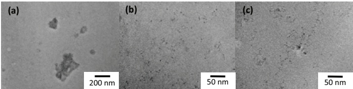

Fig. 1 The TEM images of (a) $4\mathrm{wt}\%$ as-synthesized $\mathrm{TiO_2}$, (b) $2\mathrm{wt}\%$ PDMS-$\mathrm{TiO_2}$, (c) $2\mathrm{wt}\%$ PDMS-Anth-$\mathrm{TiO_2}$.

## B. Grafting 9- anthracenemethylphosphonic acid to the PDMS grafted $\mathrm{TiO_2}$ nanoparticle

In a typical synthesis step, 0.056 g of 9-anthracenemethylphosphonic acid (the detailed synthesis of 9-anthracenemethylphosphonic acid will be discussed in another paper) was dissolved in 50 ml tetrahydrofuran (THF) and 1.0 g PDMS grafted  $TiO_{2}$  nanoparticles were added to the solution using an ice bath. The mixture was warmed up to room temperature and stirred overnight. The nanoparticles were recovered by precipitation in methanol, and then re-dispersed in THF. The graft density of anthracene is  $\sim0.3~ch/nm^{2}$  determined by UV-Vis spectroscopy [2].

## C. Sample Preparation

Silicone rubber (Sylgard $^{®}$  184 from Dow Corning) was used as the polymer matrix. Sylgard $^{®}$  184 contains 40 wt% fumed silica as a reinforcing filler. The resin was dissolved in THF to mix with the TiO $_{2}$  nanoparticles and then the solvent was removed under vacuum. The cross-linker was added at a 10:1 weight ratio before shear mixing at 3500 rpm for 1 min. The resin was cast in a flat aluminum dish and cured at 110  ${}^{\circ}$ C under vacuum for 1.5 h. The cured samples were stored in a desiccator and conditioned at 70  ${}^{\circ}$ C under vacuum overnight before dielectric testing.

## III. MATERIAL CHARACTERIZATION

Transmission electron microscopy (TEM) sections were microtomed from samples at  $-140\ ^{0}C$  with a thickness of 80 nm. The distribution of  $TiO_{2}$  nanoparticles in the silicone matrix was characterized from TEM images. The breakdown samples were  $400 \pm 30 \mu m$  thin films. The thickness at several points was measured with a micrometer before testing. The top electrode was made of stainless steel and is spherical with a diameter of 5 mm. The bottom electrode was the supporting aluminum dish on which the sample was cured. The tests were carried out in transformer-grade silicone oil to avoid flashover. The short term AC breakdown strength was measured by manually ramping the voltage at a rate of approximately 500 V/s, taking the maximum voltage as the breakdown voltage. Dielectric spectroscopy measurements were carried out with a Novocontrol Alpha analyzer. The pulse electro-acoustic (PEA) test used an aluminum bottom electrode as ground and a carbon black loaded semi-conductive polymer top electrode. The applied voltage was DC, and the probe pulse had a width of 10 ns, a repetition frequency of 140 Hz, and an amplitude of 300 V. The sample used for volume DC conductivity testing had a thickness of 50  $\mu$ m with a supporting aluminum disk as the anode, and a brass guarded electrode as the cathode. The voltage was increased in a stepwise manner using 500 V increments, but 10 min was allowed for stabilization at each voltage until breakdown. Three samples were tested for each group.

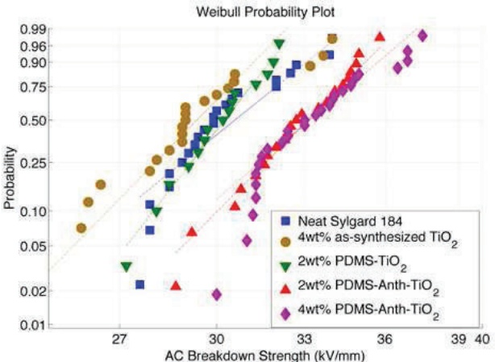

Fig. 2 Weibul plot of measured breakdown strength of neat Sylgard $184^{\text{®}}$ and its nanocomposites.

## IV. RESULTS AND DISCUSSION

As shown in Fig. 1, the as-synthesized  $TiO_{2}$  tended to agglomerate into clusters larger than 50 nm in the silicone matrix. After grafting with two populations of PDMS chains, the dispersion state was greatly improved and individual particles can be seen. Further grafting with anthracene did not change the dispersion significantly.

Fig. 2 shows a Weibull plot of the AC breakdown strength for different samples. The introduction of  $TiO_{2}$  nanoparticles regardless of the dispersion does not significantly change the AC breakdown strength of the silicone. But the breakdown strength was increased by 8 % in the 2wt% PDMS-Anth- $TiO_{2}$  filled sample. Increasing the loading of nanoparticles to 4wt% did not further improve the breakdown strength.

The real permittivity of neat silicone and  $TiO_{2}$  filled samples at high frequencies are almost the same with a value of 3.1, see Fig. 3. At low frequencies, an increase of real and imaginary permittivity was observed in all samples but with different slope and magnitude. For a better view of the low frequency processes, the dielectric susceptibility  $\chi^{*}$  was plotted as a function of frequency. As Jonscher [4] suggested,  $\chi^{*}$  can be defined as  $\chi^{*} = [\varepsilon^{*} - \varepsilon_{\infty}] / \varepsilon_{0} = \chi' - i\chi''$ , where  $\varepsilon_{0} = 8.854 \times 10^{-12} F m^{-1}$ , and  $\varepsilon_{\infty}$  is taken as the real permittivity at the frequency of 1 MHz. Several processes can operate in the low frequency region including hopping conduction (also known as low frequency dispersion–LFD) [5], pure dc conduction, and interfacial polarization.

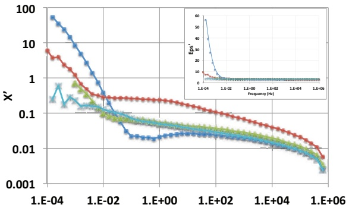

Frequency (Hz)

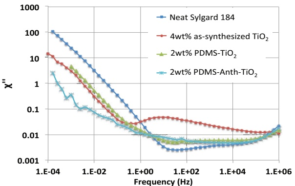

Fig. 3 The real relative permittivity (inset), real susceptibility $\chi'$ and imaginary susceptibility $\chi''$ of different samples.

In LFD, $\chi$ follows a power law behavior with frequency[5],

$$
\chi^ {\prime} (\omega) \propto \chi^ {\prime \prime} (\omega) \propto \omega^ {- n}, 0 <   \mathrm{n} <   1.\tag{1}
$$

The LFD phenomena can easily be confused with the onset of dc conduction, for which

$$
\begin{array}{l}\chi^ {\prime} (\omega) \rightarrow c o n s t\\\chi^ {\prime \prime} (\omega) \propto \sigma_ {d c} / \omega\end{array}\begin{array}{l}\square\\\boxed {\omega} \rightarrow 0\end{array}\tag{2}
$$

with $\sigma_{\mathrm{dc}}$ as the frequency-independent dc conductivity [6]. Similarly the Maxwell-Wagner-Sillars (MWS) interfacial polarization effect predicts a limiting behavior of the form of (2) but on the higher-frequency side of the peak

$$
\chi^ {\prime \prime} (\omega) \propto \omega^ {- 1} \text {and} \chi^ {\prime} (\omega) \propto \omega^ {- 2}\tag{3}
$$

the relaxation time of which scales inversely with the conductivity of each phase [6]. The low frequency power-law behavior of each sample is analyzed and summarized in Table I. As Fig. 3 shows, the magnitude of $\chi$ follows the descending order of neat Sylgard$^{\textregistered}$ $184 > 4\mathrm{wt}\%$ as-synthesized $\mathrm{TiO_2}$, $\approx 2\mathrm{wt}\%$ PDMS-$\mathrm{TiO_2} > 2\mathrm{wt}\%$ PDMS-Anth-$\mathrm{TiO_2}$, suggesting that some processes were suppressed with the addition of $\mathrm{TiO_2}$ and anthracene. From this perspective, the relaxations in neat Sylgard$^{\textregistered}$ 184 can be explained as a combination of LFD, dc conduction and the interfacial polarization between silica particles and polymer matrix. The introduction of $\mathrm{TiO_2}$ reduced the magnitude of the existing interfacial polarization. This may be the caused by the $\mathrm{TiO_2}$ limiting the movement of space charge, which would shift the polarization to lower frequencies. The addition of anthracene further reduced the conductivity and resulted in an even lower loss. The reduction in conductivity can potentially be explained by trapping of

(1B)

charge by the surface states in $\mathrm{TiO_2}$ and anthracene. The well dispersed $\mathrm{TiO_2}$ nanoparticles and anthracene molecules may provide a myriad of deep traps for both electrons and holes as they have larger electron affinity (EA) (5.1 eV for $\mathrm{TiO_2}$ and 0.6 eV for anthracene) and smaller ionization potential (IP) (8.3 eV for $\mathrm{TiO_2}$ and 7.4 eV for anthracene) compared to the matrix polymer (estimated as polyethylene EA = -0.65 eV, IP = 8.15 eV)[7-9]. These traps would reduce the charge mobility and result in a low loss at low frequencies. The additional loss peak in the $4\mathrm{wt}\%$ as-synthesized $\mathrm{TiO_2}$ sample at $10\mathrm{Hz}$ is ascribed to the interfacial polarization between the polymer and $\mathrm{TiO_2}$ clusters. However, this peak disappeared in samples for which $\mathrm{TiO_2}$ nanoparticles were individually dispersed, implying a reduction of local field distortion.

TABLE I. THE FITTED POWER-LAW BEHAVIOR OF DIFFERENT SAMPLES AT LOW FREQUENCIES AND THE INFERRED DOMINANT PROCESSES.

| Sample | Power-law Behavior at Low Frequencies | Dominant Processes |
| --- | --- | --- |
| neat Sylgard® 184 | $\chi'(\omega) \propto \omega^{-1.4}$;$\chi''(\omega) \propto \omega^{-0.9}$ | LFD, MWS, dc conduction |
| 4wt% as-synthesized $TiO_{2}$ | $\chi'(\omega) \propto \chi''(\omega) \propto \omega^{-0.8}$ | LFD, dc conduction |
| 2wt% PDMS- $TiO_{2}$ | $\chi'(\omega) \propto \chi''(\omega) \propto \omega^{-0.9}$ | LFD, dc conduction |
| 2wt% PDMS-Anth-$TiO_{2}$ | $\chi'(\omega) \propto \omega^{-0.2}$;$\chi''(\omega) \propto \omega^{-0.8}$ | dc conduction |

The trapping of charge by  $TiO_{2}$  and anthracene was further supported by the PEA test. Fig. plots the space charge profile of different samples as a function of time for voltage-on and voltage-off cases. The low Young's modulus of silicone rubber causes a large acoustic attenuation, which renders the magnitude of the image charge peak at the cathode 1/3 of that at the anode. For neat Sylgard $^{\circledR}$  184 and 2wt% PDMS- $TiO_{2}$  samples, heterocharge accumulation at the cathode was observed immediately after the voltage application (shown as a small spreaded peak near the cathode), which is not seen in the anthracene modified  $TiO_{2}$  filled sample. These fast moving heterocharges have a mobility greater than  $10^{-11} m^{2} V^{-1} s^{-1}$  and may have a solitonic nature as proposed by Montanari et al. [10]. For those charges travelling at a slow speed ( $\mu \sim 10^{-14} m^{2} V^{-1} s^{-1}$ ), both electron and hole injection were observed in all samples and showed different transport speed and injected quantity, in the order of neat Sylard 184 > 2wt% PDMS- $TiO_{2}$  > 2wt% PDMS-Anth- $TiO_{2}$ , suggesting a trapping mechanism operates in the  $TiO_{2}$  and anthracene modified TiO2 composites. This is further supported by comparing the charge decay rate in the voltage-off cases. The neat Sylgard $^{\circledR}$  184 sample has the fastest charge decay rate and almost all charges decayed within the first minute, indicating that the charge resides in shallow traps, In the  $TiO_{2}$  and anthracene modified TiO2 filled samples, the charge decayed at a much slower rate. Similar phenomena were observed at higher fields of 20 and 30 kV/mm.

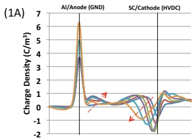

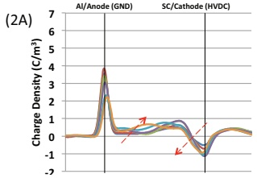

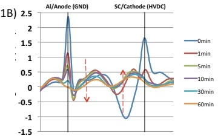

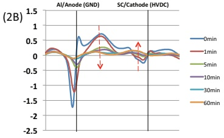

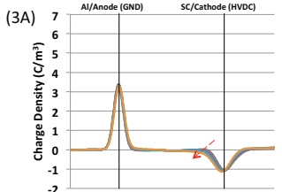

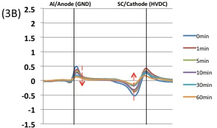

Fig. 4 The space charge profile at $10\mathrm{kV / mm}$ of (1) neat Sylgard® 184, (2) $2\mathrm{wt}\%$ PDMS-$\mathrm{TiO_2}$, (3) $2\mathrm{wt}\%$ PDMS-Anth-$\mathrm{TiO_2}$ ((A) for voltage-on and (B) for voltage-off cases). The red arrow shows the space charge evolution with time.

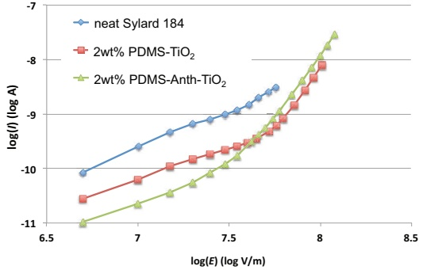

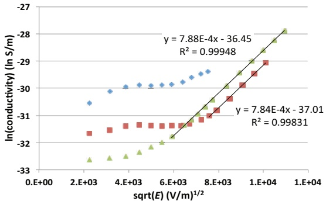

Fig. 5 The $I - E$ characteristics of neat Sylgard® 184, $2\mathrm{wt}\%$ PDMS-$\mathrm{TiO_2}$ and $2\mathrm{wt}\%$ PDMS-Anth-$\mathrm{TiO_2}$. The current was averaged from three tested samples. The fitting results of a Poole-Frenkel effect are shown.

The magnitude of the injected space charge and the transport speed can be reflected in the magnitude of the external current and this was evident in the dc conductivity test. The $\mathrm{TiO_2}$ and anthracene modified $\mathrm{TiO_2}$ filled samples showed a decrease in conductivity at fields below $40\mathrm{kV / mm}$ compared to neat Sylgard® 184. In this low field range, we hypothesize that the current in all samples was dominated by space charge injection and transport. The currents have a similar scale factor with the field and the values are of the same order of magnitude of that deduced from the space charge accumulation rate in PEA. However, at higher fields (for instance, above 50 kV/mm for the 2wt% PDMS- $TiO_{2}$ filled sample and above 30 kV/mm for the 2wt% PDMS-Anth- $TiO_{2}$ ), a remarkable increase in the current with field was observed. This may be caused by impact ionization of $TiO_{2}$ and anthracene molecules as they have a much smaller band gap ( $\sim3.0~eV$ ) than the matrix polymer (>8 eV) and thus are subject to easier impact ionization [11]. They would act like electron/hole donors. Thus the I-E characteristics can be decribed by the the Poole-Frenkel effect for which the conductivity is given as:

$$
\sigma = N _ {e f f} ^ {1 / 2} N _ {D} ^ {1 / 2} e \mu \exp \left(\frac {- \Delta}{2 k _ {B} T}\right) \exp \left\{\frac {e ^ {3 / 2} E ^ {1 / 2}}{\left(4 \pi \varepsilon_ {0} \varepsilon_ {r}\right) ^ {1 / 2} k _ {B} T} \right\}\tag{4}
$$

where $N_{eff}$ is the effective density of states in the conduction band; $N_D$ is the density of donors; $\Delta$ is the barrier height and $\mu$ is the charge mobility [12]. A plot of $\ln \sigma$ versus $E^{1/2}$ yields a straight line giving an intercept of $\ln (N_{eff}^{1/2} N_D^{1/2} e\mu) - \Delta / (2k_BT)$ and a slope of $e^{3/2} / [(4\pi\varepsilon_0\varepsilon_r)^{1/2} k_BT]$ (Fig. 5). The relative permittivity calculated from the slope is 3.5, about 13% higher than the measured value by dielectric spectroscopy. The discrepancy could be explained by ionization taking place at the interface between the nanoparticle and the polymer matrix. In this case, the dielectric constant used in the equation should involve a local contribution from the $\mathrm{TiO_2}$ nanoparticles, which can yield a larger value than the bulk. The fitted intercept gives information about the energy barrier for the charge to escape. For example, in the 2wt% PDMS-$\mathrm{TiO_2}$ sample, if we assume that: 1) the effective density of states is of the same order of magnitude as the number of atoms per unit volume in silicone, $N_{eff} = 10^{29} \mathrm{~m}^{-3}$, 2) the density of donor states equals the volume fraction of the nanoparticles, $N_D = 0.005 N_{eff}$, and 3) the mobility is $\mu = 10^{-14} \mathrm{~m}^2 \mathrm{~V}^{-1} \mathrm{~s}^{-1}$ (deduced from the space charge transport in PEA), the calculated energy barrier is 1.3 eV. Similarly, in the 2wt% PDMS-Anth-$\mathrm{TiO_2}$ sample, assuming a reduced mobility of $\mu = 10^{-15} \mathrm{~m}^2 \mathrm{~V}^{-1} \mathrm{~s}^{-1}$, the donor states density from anthracene of $N_D = 0.0005 N_{eff}$, and subtracting the contribution from $\mathrm{TiO_2}$ nanoparticles, the barrier for anthracene is 1.1 eV. In addition, for the Poole-Frenkel effect to be dominant, the electrode contact must be ohmic in order for current continuity to be maintained, which might be explained by the following mechanism. Because impact ionization will generate a large number of heterocharges close to the electrode, charges at the electrode can be injected into the sample via a downward recombination, which is more energetically favorable compared to an upward thermionic emission. So there would be no limit for charge flow at the electrode. The ionization of $\mathrm{TiO_2}$ nanoparticles or anthracene creates more free electrons/holes, which however may be beneficial to the polymer as it can dissipate the kinetic energy of the hot electrons and limit the electron energy below 4 eV, which is usually considered the threshold energy to break the bonds of polymer chains.

## V. CONCLUSIONS

The dispersion state of $\mathrm{TiO_2}$ nanoparticles can be greatly improved by grafting two populations of PDMS chains to the nanoparticle, with sparsely grafted long chains entangling with the matrix and densely grafted short chains providing sufficient screening of nanoparticle attractions[3]. Backfilling the nanoparticle with anthracene did not affect the dispersion. The well dispersed $\mathrm{TiO_2}$ and anthracene modified $\mathrm{TiO_2}$ in the silicone matrix led to improved dielectric properties of increased breakdown strength and suppressed space charge accumulation. These changes in properties might be the result of charge trapping and ionization. $\mathrm{TiO_2}$ and anthracene can provide deep traps both for electrons and holes due to their larger EA and smaller IP compared to the matrix. However, because of the small band gaps, $\mathrm{TiO_2}$ and anthracene are prone to the impact ionization by hot electrons, leading to an increase in the current at high field. The ionization creates more free electrons/holes, but could also be a way to dissipate the energy of hot electrons and avoid damaging the polymer.

## ACKNOWLEDGEMENT

This work is supported by the U.S. Office of Naval Research under Grant N000141310173.

## REFERENCES

[1] S. Virtanen, T. M. Krentz, J. K. Nelson, L. S. Schadler, M. Bell, B. Benicewicz, et al., "Dielectric breakdown strength of epoxy bimodal-polymer-brush-grafted core functionalized silica nanocomposites," Dielectrics and Electrical Insulation, IEEE Transactions on, vol. 21, pp. 563-570, 2014.

[2] T. M. Krentz, Y. Huang, J. K. Nelson, L. S. Schadler, M. Bell, B. Benicewicz, et al., "Enhanced charge trapping in bimodal brush functionalized silica-epoxy nanocomposite dielectrics," in Electrical Insulation and Dielectric Phenomena (CEIDP), 2014 IEEE Conference on, 2014, pp. 643-646.

[3] Y. Li, P. Tao, A. Viswanath, B. C. Benicewicz, and L. S. Schadler, "Bimodal surface ligand engineering: the key to tunable nanocomposites," Langmuir, vol. 29, pp. 1211-20, Jan 29 2013.

[4] A. K. Jonscher, "The universal dielectric response," Nature, vol. 267, pp. 673-679, 1977.

[5] L. A. Dissado and R. M. Hill, "Anomalous low-frequency dispersion. Near direct current conductivity in disordered low-dimensional materials," Journal of the Chemical Society, Faraday Transactions 2: Molecular and Chemical Physics, vol. 80, pp. 291-319, 1984.

[6] F. Kremer and A. Schönhals, Broadband dielectric spectroscopy: Springer, 2003.

[7] H. Zhang, Y. Shang, X. Wang, H. Zhao, B. Han, and Z. Li, "Mechanisms on electrical breakdown strength increment of polyethylene by aromatic carbonyl compounds addition: a theoretical study," J Mol Model, vol. 19, pp. 5429-38, Dec 2013.

[8] J. Robertson, "Band offsets of wide-band-gap oxides and implications for future electronic devices," Journal of Vacuum Science & Technology B, vol. 18, pp. 1785-1791, 2000.

[9] G. Teyssedre and C. Laurent, "Charge transport modeling in insulating polymers: from molecular to macroscopic scale," Dielectrics and Electrical Insulation, IEEE Transactions on, vol. 12, pp. 857-875, 2005.

[10]G. Montanari, L. Dissado, and S. Serra, "The hidden threat to HVDC polymeric insulation at design field: Solitonic conduction," Electrical Insulation Magazine, IEEE, vol. 30, pp. 39-50, 2014.

[11]O. Lesaint and M. Jung, "On the relationship between streamer branching and propagation in liquids: influence of pyrene in cyclohexane," Journal of Physics D: Applied Physics, vol. 33, p. 1360, 2000.

[12]L. A. Dissado and J. C. Fothergill, Electrical degradation and breakdown in polymers: IET, 1992.