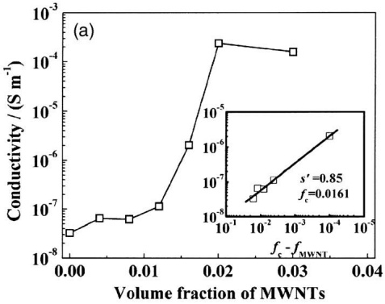
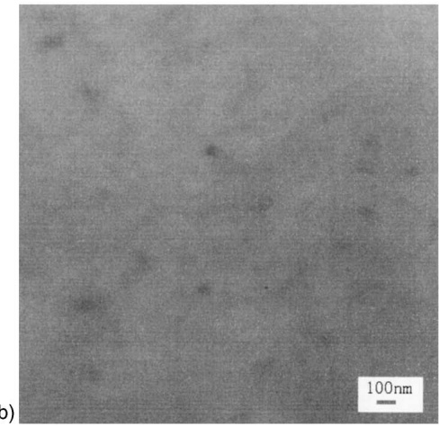
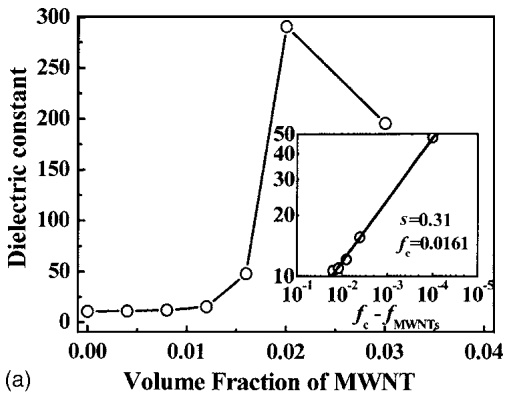
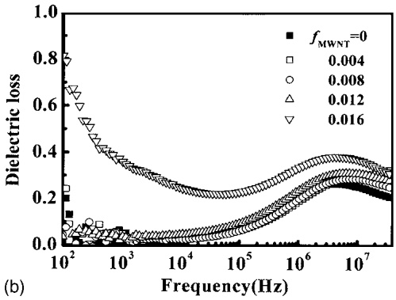
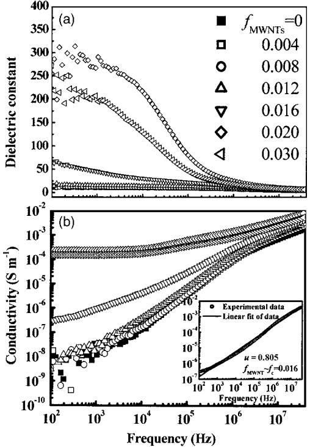

# Carbon nanotube composites with high dielectric constant at low percolation threshold 

Lan Wang; Zhi-Min Dang

Check for updates

**Appl. Phys. Lett.** 87, 042903 (2005)

[https://doi.org/10.1063/1.1996842](https://doi.org/10.1063/1.1996842)

## Articles You May Be Interested In

[Influence of aspect ratio of carbon nanotube on percolation threshold in ferroelectric polymer nanocomposite](https://pubs.aip.org/aip/apl/article/91/21/212901/117636/Influence-of-aspect-ratio-of-carbon-nanotube-on)

**Appl. Phys. Lett.** (November 2007)

[BaTiO 3 -carbon nanotube/polyvinylidene fluoride three-phase composites with high dielectric constant and low dielectric loss](https://pubs.aip.org/aip/apl/article/93/18/182905/335572/BaTiO3-carbon-nanotube-polyvinylidene-fluoride)

**Appl. Phys. Lett.** (November 2008)

**Appl. Phys. Lett.** (June 2017)

<a href="https://pubs.aip.org/aip/apl/article/110/24/242902/235803/Three-phase-Fe3O4-MWNT-PVDF-nanocomposites-with">Three-phase Fe3O4/MWNT/PVDF nanocomposites with high dielectric constant for embedded capacitor</a>

Applied Physics Letters

Special Topics Open for Submissions

# Carbon nanotube composites with high dielectric constant at low percolation threshold

Lan Wang and Zhi-Min Danga

Key Laboratory of Beijing City for Preparation and Processing of Novel Polymer Materials and Key Laboratory of the Ministry of Education on Nanomaterials, Beijing University of Chemical Technology, Beijing 100029, People’s Republic of China

Received 11 March 2005; accepted 3 June 2005; published online 21 July 2005-

In this letter, the dielectric properties of the untreated multiwall carbon-nanotubes/polyvinylidene fluoride- MWNT/PVDF- composites are studied. Towards low frequencies, the dielectric constant of a composite with about 2.0 vol % of MWNT increases rapidly and the value of the dielectric constant is as high as 300. However, by a calculation, the percolation threshold of the MWNT/ PVDF composites is only 1.61 vol % 0.0161 volume fraction- of MWNT. Both the large aspect ratio and the high conductivity of the MWNT may lead to the low percolation threshold of the MWNT/PVDF composites. For the percolation composite, the dielectric loss value is always less than 0.4, irrespective of the frequency. Therefore, the experimental results suggest that the dielectric properties of MWNT/PVDF composites may be improved significantly without the chemical functionalization to carbon nanotubes. © 2005 American Institute of Physics.

In recent years, flexible polymer materials with good piezoelectric and pyroelectric responses, such as polyvinylidene fluoride- PVDF-, polyvinylidene fluoride- -co-trifluoroethylene PVDF-TrFE-, and polyvinylidene fluoride -trifluoroethylene -chlorofluoroethylene- PVDF-TrFE-CFE- have been considered attractive for a broad range of important technological applications.1–5 However, for these polymers to be employed as functional materials in other fields, such as high charge-storage capacitors, electrostriction for artificial muscles, and “smart skins” for drag reduction, it is required to enhance the dielectric constant of these polymers substantially.1,2 The common method for increasing the dielectric constant is currently dispersing some high dielectric constant ceramic powders into the polymer to form 0–3 type composites. At high ceramic particulate loading, however, ceramic-particle-filled polymers lose their flexibility, and low quality composites are obtained. Therefore, organicparticle-loaded composites with high dielectric constants are very attractive, however a large amount of filler is still necessary .1,3,7 The results in many references show that the dielectric property of composites depends on physical property, preparation method, and interface interaction between the fillers and the polymer, especially the size and shape of fillers.6,8–12

In this letter, we investigate untreated multiwall carbonnanotubes/polyvinylidene fluoride- MWNT/PVDF- composites with low concentrations of MWNT, to significantly raise the dielectric constant of polymer matrix materials. Carbon nanotubes are selected as the conducting filler due to their large aspect ratio and unique physical properties, in particular electrical and mechanical. Recently, several groups have found an extraordinary increase in the dielectric constant in composites containing electrical conducting granules.4,5,8–12 It has also been observed that at critical concentration, the thermal conductivity of untreated carbon nanotubes composites increases significantly.13 In our study, the MWNT/PVDF composites are prepared by using very simple physical blending, and subsequently, hot-molding technologies. The MWNT/PVDF composites with different volume fractions of MWNT were prepared in order to approach the critical value as closely as possible in the composite systems.

Care was taken to disperse MWNT materials uniformly through the composite. Without further purification, MWNT was ultrasonically dispersed in an organic solvent N, N-dimethylformamide DMF- for as long as 2 h in order to form a stable suspension. At the same time, PVDF powder was dissolved in the DMF solvent at $5 0 ~ ^ { \circ } \mathbf { C }$ . Then, the suspension of MWNT in solvent was added into PVDF solution, and the solution was stirred by further ultrasonic treatment for 10 min. Afterwards, the solution was heated to 60 ° C for 8 h to completely evaporate the solvent, and consequently molded by hot-pressing at about 200 °C and 15 MPa. The final samples with a disk-shape are 12 mm in diameter and around 1 mm thick. For electrical measurement, electrodes were painted on using silver paste. Alternating current acelectrical properties of the samples were measured using HP 4194A impedance in the frequency ranges of 100 Hz– 40 MHz at room temperature. The fractured cross-sections of the samples were examined by transmission electron microscopy TEM, Hitachi H-800-.

Figure 1a- shows the ac conductivity of the MWNT/ PVDF composites as a function of the volume fraction of MWNT. The conductivity measured clearly demonstrates a conductor-insulator translation at $f _ { \mathrm { M W N T } }   \approx   0 . 0 1 6   -   0 . 0 2$ . Percolation theory allows one to describe using laws of power the conductivity of the composite near the conductor– insulator transition as follows:2,10,12,14

$$
\sigma_ {\mathrm{eff}} \propto \sigma_ {\mathrm{PVDF}} (f _ {c} - f _ {\mathrm{MWNT}}) ^ {- s ^ {\prime}}, \quad \text {for} f _ {\mathrm{MWNT}} \leqslant f _ {c},\tag{1}
$$

where $\sigma _ { \mathrm { P V D F } }$ is the conductivity of the insulating PVDF polymer, fMWNT is the filling factor, $f _ { c }$ is the percolation threshold, and $s ^ { \prime }$ is the critical exponent in the insulating region. The best fits of the conductivity data to the log–log plots of the power laws give $f _ { c } \approx 0 . 0 1 6 1$ , and $s ^ { \prime } { = } 0 . 8 \bar { 5 }$ according to Eq. 1- in the MWNT/PVDF composites, as shown the insets in Fig. 1a-. The percolation threshold, $f _ { c }$ 0.16, has a value commonly obtained in two-phase random composites when the conducting fillers with micron scale and sphere shape are used. However, the percolation threshold, $f _ { c }   \approx   0 . 0 1 6 1$ in the MWNT/PVDF composites is 10 times smaller than that of common two-phase random composites. The critical exponent, $s ^ { \prime }   =   0 . 8 5$ see the inset in Fig. 1a-, in our composites, exhibits the same value with the universal ones $\overline{s_{un}^{\prime}} \approx 0.8 - 1$ . The inverse Swiss-cheese model,10 which is based on a medium made of conducting fillers embedded in an insulating matrix, may apply to our composites with $f _ { \mathrm { M W N T } } { \leqslant } f _ { c } ,$ where the conduction process is controlled by interfiller tunneling. In fact, the morphology of fractured MWNT/PVDF composite with 2.0 vol % MWNT as shown in Fig. 1b- is very helpful in understanding the electrical properties in this study. Figure 1b- shows that the MWNT is fairly well dispersed randomly in the PVDF matrix composite. Moreover, it also indicates that the MWNT may connect with each other in part, and form a partly continuous random cluster. And when the volume fraction of MWNT is near the critical value, i.e., percolation threshold, the electrical conducting phase may form a continuous random cluster.2,10 Compared with the results reported in the polymer/conductive filler composites,2,8,12 the percolation threshold of the MWNT/PVDF composites is quite low due to a high aspect ratio and the unique physical properties of

(b)

FIG. 1. a- Dependence of the effective conductivity of the MWNT/PVDF composites on the MWNT volume fraction, fMWNT, measured at room temperature and 1000 Hz and the inset in a- shows the best fits of the effective conductivity to Eq. 1-; b- TEM micrograph of the fractured MWNT/PVDF composite with MWNT volume fraction of 0.02.

FIG. 2. a- Dependence of the effective dielectric constant of the MWNT/ PVDF composites on the MWNT volume fraction, $f _ { \mathrm { M W N T } } ,$ measured at room temperature and 1000 Hz. And the inset in a- shows the best fits of the effective dielectric constant to Eq. 2-; b- dependence of dielectric loss of the MWNT/PVDF composites on frequency at room temperature.

MWNT employed. The low percolation threshold renders the MWNT/PVDF composites highly flexible.

It is also worth noting the large enhancement observed in the effective dielectric constant of the MWNT/PVDF composites near percolation threshold. Figure 2 shows that the attained value of the effective dielectric constant of the percolation MWNT/PVDF composite at room temperature is around 200, which is about 20 times higher than that of PVDF. In fact, the dielectric constant is as high as 300 when the concentration of MWNT in the MWNT/PVDF composite is 2.0 vol %. The results suggest that the dielectric constant of MWNT/PVDF composites may be improved without the need to chemically functionalize the carbon nanotubes further. The measured dielectric constant presents a divergence at both sides near to the percolation threshold. This variation of the dielectric constant in the neighborhood of the percolation threshold is also given by a power law as follows:2,4,10

$$
\varepsilon_ {\text {eff}} \propto \varepsilon_ {\text {PVDF}} (f _ {c} - f _ {\text {MWNT}}) ^ {- s}, \quad \text {for} f _ {\text {MWNT}} \leqslant f _ {c},\tag{2}
$$

where s is the dielectric critical exponent. It exhibits the same laws of power dependence on the volume fraction as the conductivity below $f _ { c } ,   s   =   0 . 3 1$ . It is obvious that the dielectric critical exponent observed in the MWNT/PVDF practical continuum system is in accordance with the universality of percolation theory. As shown in Fig. 2a-, the experimental values of the dielectric constant are in agreement with Eq. 2-, with $f _ { c } { = } 0 . 0 1 6 1$ and $s { = } 0 . 3 1$ see inset in Fig. 2a-. However, the $s ^ { \prime } { = } 0 . 8 5$ see the inset in Fig 1a- and $s { = } 0 . 3 1$ are lower than the universal 3D lattice value $\left( s   =   s ^ { \prime } \right.$  2-. It is obvious that the large aspect ratio of MWNT fillers may play an important role on the percolation threshold of MWNT/PVDF composites, compared with metal powder/

FIG. 3. Dependence of the effective a- dielectric constant and b- conductivity of the MWNT/PVDF composites on frequency at room temperature. The inset in b- shows the best fits of the effective conductivity to Eq. 3aat $f _ { \mathrm { M W N T } } = 0 . 0 1 6$

PVDF composites reported previously.4,8 In fact, the increase of the dielectric constant may also be understood from gradually assessing the formation of minicapacitor networks in the MWNT/PVDF composites when the concentration of MWNT increases. It is noted that the dielectric loss of the percolation MWNT/PVDF composite is as high as 0.8 at room temperature and low frequency, 100 Hz, as shown in Fig. 2b-. The value is still maintained when the percolation composite with a high dielectric constant is employed as a dielectric in some application fields. For the percolation composites, the dielectric loss increases rapidly, with both features associated with the approach of percolation.2,4,10 In comparison to the polymer matrix, the composites also exhibit relatively high dielectric loss. The loss of the composites increases significantly with an increase in the MWNT concentration. The increased dielectric loss for the composites is due to the effect of the electrically conductive MWNT. Furthermore, towards higher frequency, the dielectric loss of the percolation composite is lower than 0.4 with an increase in frequency, which is very attractive for us. Therefore, these kinds of composites can be used to create some devices, such as high charge-storage capacitors with various shapes.

Figure 3 shows the dielectric constant and conductivity of the MWNT/PVDF composites as a function of the frequency at room temperature, respectively. Towards low frequency, the dielectric constant of a composite with only 2.0 vol % of MWNT is more than 30 times higher than that of the PVDF matrix $( \varepsilon   \approx   1 0 )$ , rising to about 300 at room temperature. The dielectric constants of the MWNT/PVDF composites with low concentration of MWNT, such as $f _ { \mathrm { M W N T } }   \leqslant   0 . 0 1 6 ,$ , show a slight correlation to the frequency, while the dielectric constant of the MWNT/PVDF composite near to percolation threshold decreases dramatically when the measured frequency is as high as $1 0 ^ { 4 }$ Hz. Accordingly, the effective conductivity increases with frequency as shown in Fig. 3b-. According to percolation theory, as $f _ { \mathrm { M W N T } } { \longrightarrow } f _ { c } ;$ 2,4,10

$$
\sigma_ {\mathrm{eff}} (\omega , f _ {c}) \propto \omega^ {u},\tag{3a}
$$

$$
\varepsilon_ {\mathrm{eff}} (\omega , f _ {c}) \propto \omega^ {u - 1},\tag{3b}
$$

where $\omega { = } 2$ v and u is a critical exponent. The data for the MWNT/PVDF composite with $f _ { \mathrm { M W N T } } { = } 0 . 0 1 6$ gives u ${ = } 0 . 8 0 5$ see the inset in Fig. 3b-, which is close to the normal value for the percolation theory. For the percolation MWNT/PVDF composite, $f _ { \mathrm { M W N T } }   \approx   0 . 0 1 6$ , the measured data of the conductivity is close to a straight line in conductivity versus frequency log–log plots as shown the inset in Fig. 3b-. When the concentration of MWNT in the composites is higher than percolation threshold, the composites are electrically conductive, but when the concentration is lower than percolation threshold, the composites act as insulators. And the data points of the conductivity may be connected into the curves in conductivity versus frequency log–log plots Fig. 3b-.

In summary, the dependence of the dielectric properties of the untreated MWNT/PVDF composites on frequency and different volume fraction of MWNT was studied. Towards low frequency, the dielectric constant of a composite with only 1.6 vol % of MWNT fillers increases significantly, and for the composites with more than 1.6 vol % of MWNT fillers, the dielectric loss increases rapidly, with both features associated with the approach of percolation. Such a low percolation threshold in the MWNT/PVDF composites may attribute to the large aspect ratio of the MWNT employed. For the percolation composite, the dielectric loss value is always less than 0.4, irrespective of the frequency. In general, the dielectric properties of MWNT/PVDF composites may be improved without the chemical functionalization to the carbon nanotubes further.

This work was supported by the NSF of China. We also thank Professor Jeffrey S. Gillette Department of Natural Sciences, Virginia Western Community College- and Marshall Scott Central University for Nationalities, PRC- for their help with the English corrections.

1Q. M. Zhang, H. F. Li, M. Poh, H. S. Xu, Z.-Y. Cheng, F. Xia, and C. Huang, Nature London- 419, 284 2002-.

2Z. M. Dang, C. W. Nan, D. Xie, Y. H. Zhang, and S. C. Tjong, Appl. Phys. Lett. 85, 97 2004-.

3J. Y. Li, Phys. Rev. Lett. 90, 217601-1 2003-.

4Z. M. Dang, Y. H. Lin, and C. W. Nan, Adv. Mater. Weinheim, Ger.- 15, 1625 2003-.

5N. Levi, R. Czerw, S. Xing, P. Iyer, and D. L. Carroll, Nano Lett. 4, 1267 2004-.

6Y. Bai, Z. Y. Cheng, V. Bharti, H. A. Xu, and Q. M. Zhang, Appl. Phys. Lett. 76, 3804 2000-.

7C. Huang, Q. M. Zhang, and J. Su, Appl. Phys. Lett. 82, 3502 2003-.

8Z. M. Dang, Y. H. Zhang, and S. C. Tjong, Synth. Met. 146, 79 2004-.

9Z. X. Jin, L. Huang, S. H. Goh, G. Q. Xu, and W. Ji, Chem. Phys. Lett. 352, 328 2002-.

10C. W. Nan, Prog. Mater. Sci. 37, 1 1993-.

11A. Nogales, G. Broza, Z. Roslaniec, K. Schulte, I. Sics, B. S. Hsiao, A. Sanz, M. C. Garcıa-Gutierrez, D. R. Rueda, C. Domingo, and T. A. Ezquerra, Macromolecules 37, 7669 2004-.

12B. E. Kilbride, J. N. Coleman, J. Fraysse, P. Fournet, M. Cadek, A. Drury, S. Hutzler, S. Roth, and W. J. Blau, Appl. Phys. Lett. 92, 4024 2002-.

13M. J. Biercuk, M. C. Llaguno, M. Radosavljevic, J. K. Hyun, A. T. Johnson, and J. E. Fischer, Appl. Phys. Lett. 80, 2767 2002-.

14S. Kirpatrick, Rev. Mod. Phys. 45, 574 1973-.