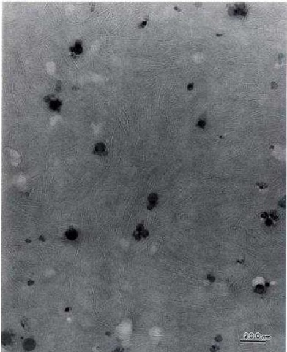
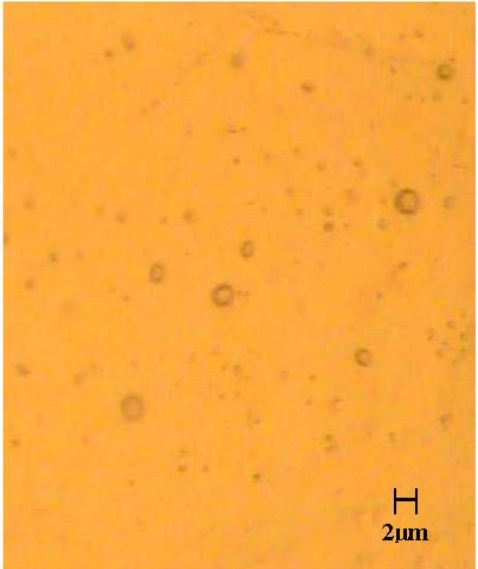
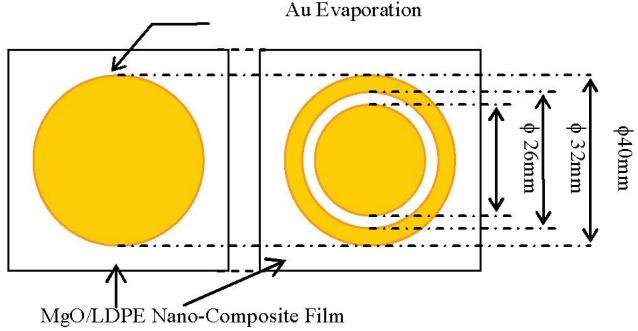
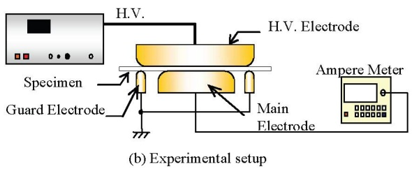
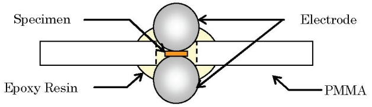
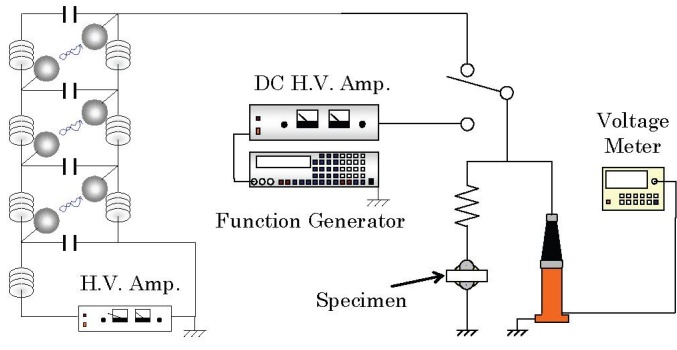
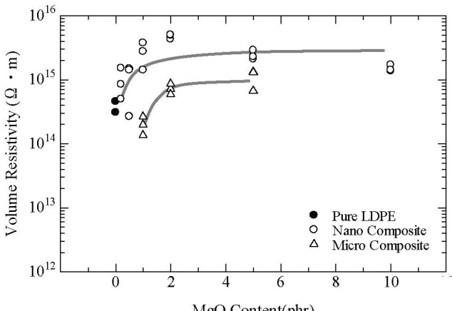
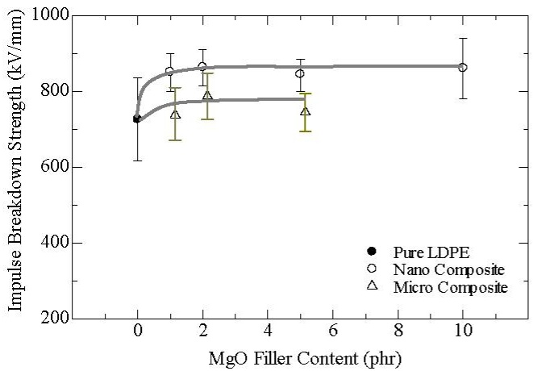
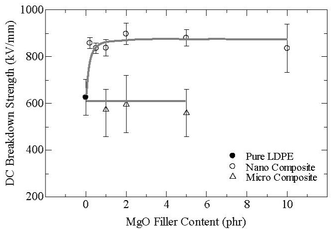
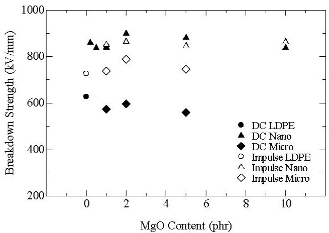

# DC Breakdown Strength and Conduction Current of MgO/LDPE Composite Influenced by Filler Size

Shunsuke Okuzumi $^{1}$ , Yoshinobu Murakami $^{1}$ , Masayuki Nagao $^{1}$ ,

Yoitsu Sekiguchi $^{2}$ , Ch. Chakradhar Reddy $^{2}$  and Yoshinao Murata $^{2}$ $^{1}$ Toyohashi University of Technology, 1-1 Hibarigaoka, Tenpaku, Toyohashi, 441-8580, Japan  
 $^{2}$ J-Power Systems Corporation, 5-1-1 Hitaka, Hitachi, 319-1414, Japan

Abstract- A nano-composite material is attracting many researchers' attention in the field of dielectric and electrical insulation. The purpose of this study is to investigate the influence of MgO filler size on electrical properties of MgO/LDPE nanocomposite. The volume resistivity, DC breakdown strength and the impulse breakdown strength of low-density polyethylene (LDPE) containing nano-filler or micro-filler of magnesium oxide (MgO) were measured. The volume resistivity of the sample without the MgO filler increases by addition of the MgO nano-filler or the MgO micro-filler. The impulse breakdown strength and the DC breakdown strength of the sample without the MgO filler measured with McKeown type electrode increases by the addition of the MgO nano-filler but that does not increase by the addition of the MgO micro-filler. From the result, it becomes clear that the addition of the MgO nano-filler is suitable for the DC insulating material rather than that of the MgO micro-filler.

## I. INTRODUCTION

Polymer insulating materials are widely applied to power apparatuses and cables. Traditionally, additive agents and fillers are often used for improving insulating and mechanical properties [1]. Recently, nano-composite material is attracting many researchers' attention in the field of dielectric and electrical insulation [2]. A nano-composite polymer is composed of nano-filler, of which diameter is as small as a few tens to a few hundreds of nanometers, and a polymer as a matrix. Since the sectional area of the interface between the filler and the matrix is enormously large compared to that of conventional micro-composite materials, some improvement of insulating performance is expected to be realized by using such technology. In previous paper, it is reported by the authors that the addition of nano-sized magnesium oxide (MgO) to a low-density polyethylene (LDPE) brought significantly improvement of electrical properties like DC breakdown strength, the volume resistivity, the space charge and the electrical treeing [3]-[5]. The purpose of this study is to investigate the electrical properties influenced by the MgO filler size. In this paper, the volume resistivity, DC breakdown strength and the impulse breakdown strength of LDPE containing nano-filler or micro-filler of MgO were measured.

## II. SAMPLE

MgO/LDPE nanocomposites were prepared from raw LDPE and magnesium oxide powder of several ten nm, of which concentration was 0.2, 0.5, 1, 2, 5 and 10 phr. The film was prepared with a blown method. Here the unit of “phr”

Fig. 1. TEM photograph of MgO/LDPE nano-composite material, MgO content is 5 phr.

Fig. 2. Laser microscope photograph of MgO/LDPE micro-composite material, MgO content is 5 phr.

represents “parts per hundred parts of resin”. For example, 1 phr nanocomposite consists of 1 part of filler and 100 parts of LDPE. LDPE without MgO nano-filler, corresponding to 0 phr, was also prepared as a reference. The film thickness is about 0.1 mm unless otherwise stated. Figure 1 shows the TEM photograph of the nanocomposite sample with 5 phr. A number of dark spots are seen in this figure. An energy dispersive X-ray fluorescence analyzer (EDX) spectrum, it is suggested that MgO particles are dispersed almost homogeneously in the LDPE matrix [6].

MgO/LDPE microcomposites were also prepared from raw LDPE and magnesium oxide powder of several  $\mu$ m in diameter, of which concentration was 1, 2, and 5 phr. Figure 2 shows the photograph of leaser microscope of the microcomposite sample with 5 phr.

## III. EXPERIMENTAL PROCEDURE

## A. Conduction Current

Figure 3 shows (a) the electrode configuration and (b) the experimental setup for the conduction current measurement. A gold electrode of $40\mathrm{mm}$ in diameter was formed by vacuum evaporation on one side of the film. On the other side, a gold electrode of $26\mathrm{mm}$ in diameter was formed as the main electrode and a gold electrode of $32\mathrm{mm}$ in inner diameter and $40\mathrm{mm}$ in outer diameter was formed as the guard electrode. The conduction current was measured under a constant DC field of $40\mathrm{kV / mm}$ at $303\mathrm{K}$. The conduction current at 10 minutes after the DC filed application was employed to determine the volume resistivity. The volume resistivity was calculated by multiplying the applied field and the main electrode area to the reciprocal of conduction current.

(a) Electrode configuration

Fig. 3. Conduction current measurement system

## B. DC Breakdown and Impulse Breakdown

Figure 4 shows (a) the electrode configuration and (b) the experimental setup for DC or impulse breakdown test. The breakdown tests were performed in silicone oil at $303\mathrm{K}$ using

McKeown type electrode [7]. In the DC breakdown test, the sample was subjected to a ramp voltage with increase rate of

(a) McKeown type electrode

(b) Experimental Setup

Fig. 4. Experimental setup for DC breakdown test

500 V/s. In impulse breakdown test, the sample was subjected to impulse voltage with wave front of 1.2  $\mu$ s. An impulse breakdown test was performed at the wave front of the one shot impulse.

## IV. EXPERIMENTAL RESULT AND DISCUITION

## A. Conduction Current

Figure 5 shows the influence of the MgO nano-filler content and MgO micro-filler content on the volume resistivity under the field application of $40\mathrm{kV / mm}$. The open signs and solid signs in Fig. 5 are each values of three measurements in the sample with the MgO filler and values without that, respectively. The volume resistivity of the sample with MgO nano-filler was higher than that without

Fig. 5. Dependence of the MgO nano-filler and micro-filler content on volume resistivity

MgO filler. The MgO nano-filler content above 1 or 2 phr, the volume resistivity of the sample with MgO nano-filler show saturated value. It was reported by the authors that the charge density and the charge mobility of the sample with the MgO nano-filler decreased compared with that without the MgO filler [4]. It is considered that the trapping effect by the addition of the MgO nano-filler may suppresses the conduction current. In the case of the MgO micro-filler, there was increasing trend in some degree with increasing the MgO micro-filler content. However, the volume resistivity of 1 phr sample with the MgO micro-filler decreased than that of 0 phr sample. The sample with MgO nano-filler also exhibited higher volume resistivity compared with the sample with MgO micro-filler in spite of MgO filler content. It was considered that the difference of sectional area around the filler between the MgO nano-filler and the MgO micro-filler influenced the conduction mechanism.

## B. DC Breakdown and Impulse Breakdown

Figure 6 shows the influence of the MgO nano-filler and micro-filler content on impulse breakdown strength using McKeown type electrode. The breakdown strength was calculated by dividing the breakdown voltage by the film thickness. The error bar and the signs are standard deviation and the average about 10 samples, respectively. The indication in figures is the same with this unless otherwise stated. In the case of the MgO nano-filler sample, the impulse breakdown strength of the sample with the MgO nano-filler increased than that without MgO filler. Above the MgO nano-filler content of 1 phr, the impulse breakdown strength of the sample with MgO nano-filler show also saturated value. In the case of the MgO micro-filler sample, the impulse breakdown strength of the sample with MgO micro-filler compared with that with MgO nano-filler is the same or increased slightly. The sample with MgO nano-filler also exhibited higher impulse breakdown strength compared with the sample with MgO micro-filler in spite of MgO filler content as well as the result of the volume resistivity.

Figure 7 shows the influence of the MgO nano-filler and micro-filler content on the DC breakdown strength measured with McKeown type electrode. The DC breakdown strength of the sample with the MgO nano-filler increased than that without MgO nano-filler. Above the MgO nano-filler content of 0.2 or 2 phr, the DC breakdown strength of the sample with MgO nano-filler also showed almost saturated value. These characteristics of the DC breakdown strength of the sample with the MgO nano-filler are strikingly similar to that of the volume resistivity as shown in Fig. 5. In the case of the MgO micro-filler sample, the DC breakdown strength of the sample with the MgO micro-filler is almost the same or deceased slightly compared with that without the MgO filler. The sample with MgO nano-filler also exhibited higher DC breakdown strength compared with the sample with MgO micro-filler in spite of MgO filler content.

Fig. 6. Influence of MgO nano-filler and micro-filler content on Impulse breakdown strength measured with McKeown type electrode

Fig. 7. Influence of the MgO nano-filler content on DC breakdown strength using McKeown type electrode

Figure 8 shows the summary of the breakdown strengths measured with the McKeown type electrode. The open signs and solid signs in Fig.8 are the results of the impulse breakdown test and that of the DC breakdown test, respectively. The DC breakdown strength of 0 phr sample is lower than the impulse breakdown strength of that. The effect of the addicting MgO nano-filler excelled under DC field rather than under impulse field. DC breakdown strength of 0 phr sample and the sample with MgO micro-filler was higher than impulse breakdown strength of those while DC breakdown strength of the sample with MgO nano-filler was almost same compared with impulse breakdown strength of that.

Fig. 8. Summary of the average on breakdown test measured McKeown type electrode

The addition of a few MgO nano-filler brought the improvement of the volume resistivity, impulse breakdown strength and DC breakdown strength as shown in Figs.5, 6 and 7. Those characteristics of the sample with the MgO nano-filler showed a similar trend which those characteristics were saturated. However it was recognized that the addition of MgO micro-filler did not exhibit improvement of electrical properties. It is suggested that the improvement properties depend on the filler size of MgO and smaller filler size of MgO brought clearly the improvement of electrical properties. It is considered that the higher DC breakdown strength of the sample with MgO nano-filler can be explained by the thermal breakdown process. In other words, it was considered that higher volume resistivity bringing the suppression of joule heating led to higher DC breakdown strength of the sample with the MgO nano-filler. Impulse breakdown strength of the sample with the MgO nano-filler also increased but it is not as effective as that under DC voltage. As mentioned above, DC breakdown strength of the sample with MgO nano-filler was almost same compared with impulse breakdown strength of that. It is considered that DC breakdown strength of the sample with the MgO nano-filler is corresponding to impulse breakdown strength of that since the electron avalanche is considered to be scattered by the MgO nano-filler. However, the saturation, especially on DC breakdown strength, is difficult to be interpreted only by the electron avalanche breakdown process. Breakdown strength of the sample with the MgO micro-filler under DC and impulse voltage are almost same or slightly decrease/increase due to the extinction of the addition effect of the MgO nano-filler, bringing the trap of charge. It was reported by the authors that the suppression effect of conduction current determined by the space charge leads to higher DC breakdown strength of the sample with the MgO nano-filler from the space charge measurement up to the breakdown under ramp voltage with an increment of 500 V/s .[8] The space charge formation strictly depends on an increment rate of applied voltage. Therefore, it is necessary that the relationship of the breakdown strength and the volume resistivity including the effect of the space charge formation and the filler size was investigated.

## V. CONCLUSION

To understand influence of MgO filler size on the electrical properties of MgO/LDPE nano-composite and micro-composite materials, their volume resistivity under the DC voltage, the DC breakdown strength and the impulse breakdown strength were measured. The main results are as follows.

(1) The volume resistivity of LDPE increases by addition of the MgO nano-filler or the MgO micro-filler. The volume resistivity of nanocomposite is larger than that of microcomposite.

(2) The impulse breakdown strength of LDPE measured with McKeown type electrode increases by the addition of the MgO nano-filler but that does not increase by the addition of the MgO micro-filler.

(3) The DC breakdown strength of LDPE measured with McKeown type electrode also increases by the addition of the MgO nano-filler but that does not increase by the addition of the MgO micro-filler.

(4) It becomes clear that the addition of the MgO nano-filler is suitable for the DC insulating material rather than that of the MgO micro-filler.

## ACKNOWLEDGMENT

This research work was partly supported by a Grant-in-Aid for Scientific Research (B) (No. 19360130) from the Ministry of Education, Science, Sports, and Culture Japan.

## REFERENCES

[1] E. Watanaber Y. Takeda, M. Yoshizawa, T. Moriya and M. Nakajima, "The Effect of Filler Particle Size on Ultrasonic Image of Electrical Breakdown Region in Fill-Added Insulating Materials", IEEE Conf. Electr. Insul. Dielectr. Phenomena, pp. 697-700, 1996

[2] T. J. Lewis, “Nanometric Dielectrics”, IEEE Trans. Dielectr. Electr. Insul., vol.1, pp. 812-823, 1994.

[3] S. Masuda, S. Okuzumi, R. Kurniant, Y. Murakami, M. Nagao, Y. Murata, Y. Sekiguchi, "DC Conduction and Electrical Breakdown of MgO/LDPE Nanocomposite", 2007 Annual Report Conference on Electrical Insulation and Dielectric Phenomena, pp.697-700, 2007

[4] Y. Murakami, M. Nemoto, S. Okuzumi, S. Masuda, M. Nagao, N. Hozumi, Y. Sekiguchi and Y. Murata, “DC Conduction and Electrical Breakdown of MgO/LDPE Nanocomposite”, IEEE Trans. Dielectr. Electr. Insul., vol.15, pp. 33-39, 2008.

[5] R. Kurnianto, Y. Murakami, M. Nagao, N. Hozumi and Y. Murata, Treeing Breakdown in Inorganic-filler/LDPE Nano-composite", IEEJ Trans.FM., vol.128, No.1, pp. 29-34, 2007.

[6] Y. Murata, Y. Sekiguchi, Y. Inoue and M. Kanaoka: "Investigation of Electrical phenomena of Inorganic-filler/LDPE Nanocomposite Material", IEEE Inter. Symp. Elect., Insul. Mater., pp.650-653, 2005

[7] J. J. McKeown, “Intrinsic electric strengths of organic polymeric materials” Proceedings of Institute of Electrical Engineers, vol.112, No.4, pp.824-828(1965)

[8] Y. Murakami, S. Okuzumi,, M. Nagao, N. Hozumi, Y. Sekiguchii, M. Goshowaki and Y. Murata: "The Space Charge Measurement in MgO/LDPE Nanocomposite up to the Breakdown under DC Ramp Voltage", IEEE Inter. Symp. Elect., Insul. Mater., 2008