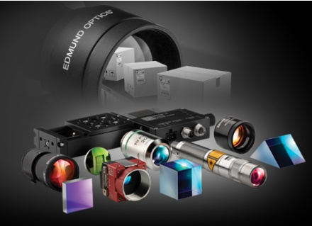
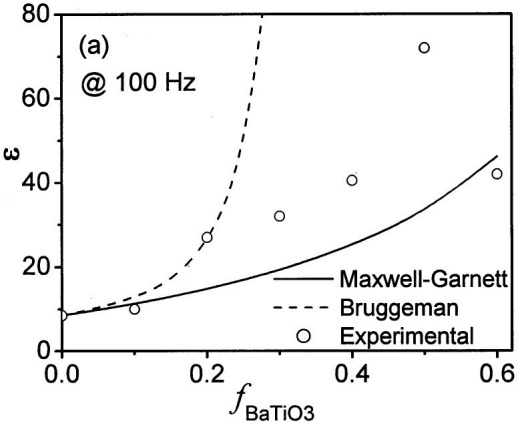
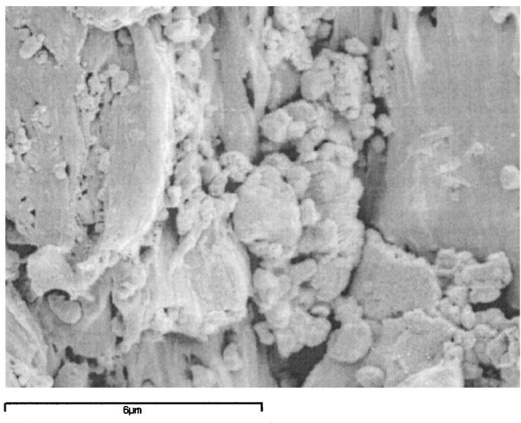
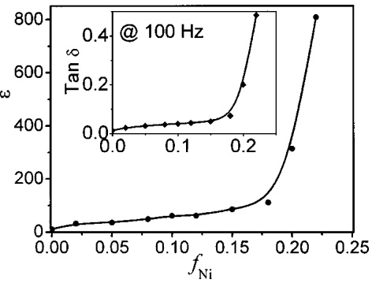
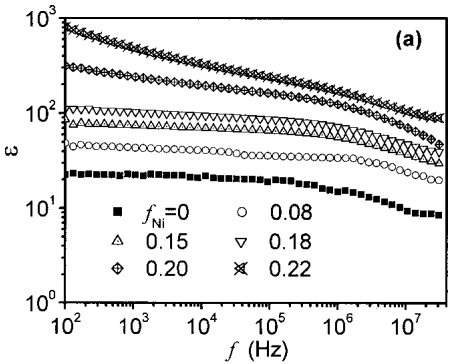
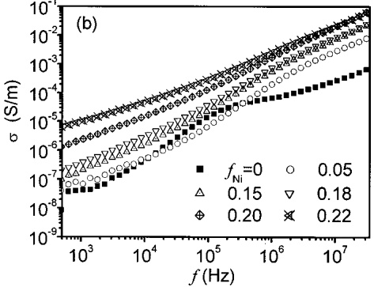

# Dielectric behavior of three-phase percolative Ni–BaTiO3 /polyvinylidene fluoride composites 

Z.-M. Dang; Y. Shen; C.-W. Nan

Check for updates

**Appl. Phys. Lett.** 81, 4814–4816 (2002)

[https://doi.org/10.1063/1.1529085](https://doi.org/10.1063/1.1529085)

## Articles You May Be Interested In

[Low loss high dielectric permittivity of polyvinylidene fluoride and K x Ti y Ni 1 − x − y O   ( x = 0.05 ,   y = 0.02 ) composites](https://pubs.aip.org/aip/jap/article/107/12/124115/146158/Low-loss-high-dielectric-permittivity-of)

**J. Appl. Phys.** (June 2010)

[On the question of percolation threshold in polyvinylidene fluoride/nanocrystalline nickel composites](https://pubs.aip.org/aip/apl/article/92/13/132905/238204/On-the-question-of-percolation-threshold-in)

**Appl. Phys. Lett.** (April 2008)

[Size-dependences of the dielectric and ferroelectric properties of BaTiO 3 /polyvinylidene fluoride](https://pubs.aip.org/aip/jap/article/108/1/014102/395117/Size-dependences-of-the-dielectric-and)

[nanocomposites](https://pubs.aip.org/aip/jap/article/108/1/014102/395117/Size-dependences-of-the-dielectric-and)

**J. Appl. Phys.** (July 2010)

Your One-Stop Shop for the Best Brands in Optics

• Extensive inventory with over 34.000 products available & 2.900 new products

• Fast shipping from our 9 distribution centres around the globe

• Bringing 80+ years of optical expertise to customers worldwide

# Dielectric behavior of three-phase percolative Ni–BaTiO3Õpolyvinylidene fluoride composites

Z.-M. Dang, Y. Shen, and C.-W. Nana)

Department of Materials Science and Engineering, Tsinghua University, Beijing 100084, People’s Republic of China

\~Received 4 September 2002; accepted 19 October 2002!

A three-phase percolative composite with a ferroelectric phase $\mathrm{(BaTiO_{3})}$ and metallic inclusions \~Ni! embedded into polyvinylidene fluoride matrix was prepared by using a simple blending and hot-molding technique. Effective medium approximations and percolation theory were employed in order to design and describe the dielectric behavior of such three-phase composites. Our experimental results showed that the static dielectric constant of such a three-phase composite can reach above 800 when the Ni concentration is close to its percolation threshold. Such composites have a potential to become capacitors and can be easily fabricated into various shapes due to its flexibility. © 2002 American Institute of Physics. @DOI: 10.1063/1.1529085#

Recently, particulate composites \~so-called 0–3 composites! of ferroelectric ceramics and polymers have attracted much attention due to their easy processing and flexibility \~see, for example, Refs. 1 and 2!. As dielectric materials, however, the dielectric constant of such 0–3 polymer–matrix composites still keeps a low level of about 50 at room temperature.1–5 For example, in a $\mathrm { B a T i O } _ { 3 }$ /epoxy composite, though $\mathrm { B a T i O } _ { 3 }$ has a relative high dielectric constant above 1000, the effective dielectric constant of the composite with high $\mathrm { B a T i O } _ { 3 }$ concentration still remains a relatively low value due to lower dielectric constant of the epoxy matrix. Bai $e t   a { l . } ^ { 1 }$ have reported a high dielectric constant of «$= 2 5 0$ in the polymer–matrix composite with high concentration \~50 vol %! of relaxor ferroelectric ceramic particles, which makes the composite lose its flexibility. On the other hand, Pecharroman et $a { l _ { \ast } ^ {   6 } }$ have reported $\mathrm{Ni/BaTiO}_{3}$ metal/ ceramic composites with high dielectric constant of «$= 8 0   0 0 0$ but the metal/ceramic composites still need to be sintered at high temperature about $1 3 0 0   ^ { \circ } \mathrm { C }$ under the special protection of preventing from oxidation of Ni. In this work, we report a three-phase polymer–matrix composite with high dielectric constant of above 500. The composite is based on the mixture rules and percolation theory, and consists of an insulating polymer matrix and small, homogeneously distributed ferroelectrics ceramic particles $\mathrm{(BaTiO_{3})}$ and metallic particles \~Ni!. Such a three-phase polymer–matrix composite is flexible, and can be easily fabricated into various shapes with low processing temperature. It might be attractive for applications in capacitors and electric energy storage devices.

The electrical properties of such composites can be analyzed by percolation theory when metallic filler concentration is close to the percolation threshold. Though their electrical properties have widely been investigated in recent years, they have not yet been well-understood under alternating current. It is well known that this type of composite demonstrates a metal–insulator transition with increasing metallic filler concentration. Several teams have found experimental evidence of a rise in the dielectric constant in the neighborhood of the percolation threshold.6–11 The dielectric constant of such composites can be much larger than that of the polymer matrix. This abnormal behavior can be comprehended if one takes into account the fact that near the percolation threshold there are many conducting particles secluded by thin insulating layers. Therefore, the composites in the neighborhood of the percolation threshold could become a capacitor.

Our composites were prepared by a simple blending and hot-molding procedure. $\mathrm { B a T i O } _ { 3 }$ and Ni powders with a nearly spherical shape were used and their grain sizes are about 1 and $0 . 2 \quad \mu \mathrm { m } ,$ respectively. Polyvinylidene fluoride \~PVDF! power was used as the polymer matrix. A suitable amount of $\mathrm { B a T i O } _ { 3 }$ and Ni powders were blended with PVDF powder. The mixtures were then molded by pressing at about $2 0 0   ^ { \circ } \mathrm { C }$ under a pressure of 10 MPa. Disk-shaped samples of 12 mm in diameter were cut from the molded sheet \~1 mm in thickness! and silver-paint electrodes were applied to the samples. The dielectric properties of the samples were measured using an HP 4192A impedance analyzer in the frequency range of 100 Hz–40 MHz at room temperature.

Figure 1\~a! shows the dielectric constant at 100 Hz for the two-phase Ba $\mathrm{TiO}_{3}/\mathrm{PVDF}$ composites. As expected, the dielectric constant increases with the volume fraction of $\mathrm { B a T i O } _ { 3 }$ . For illustration and comparison, Fig. 1\~a! also shows the calculations from well-known Maxwell–Garnett approximation:7,12

$$
\varepsilon = \varepsilon_ {1} \left(1 + \frac {3 f _ {\mathrm{BaTiO} _ {3}} \beta}{1 - f _ {\mathrm{BaTiO} _ {3}} \beta}\right),\tag{1}
$$

and Bruggeman self-consistent effective medium approximation:7,12,13

$$
(1 - f _ {\mathrm{BaTiO} _ {3}}) \frac {\varepsilon_ {1} - \varepsilon}{\varepsilon_ {1} + 2 \varepsilon} + f _ {\mathrm{BaTiO} _ {3}} \frac {\varepsilon_ {2} - \varepsilon}{\varepsilon_ {2} + 2 \varepsilon} = 0,\tag{2}
$$

where $\beta = ( \varepsilon _ { 2 } - \varepsilon _ { 1 } ) / ( \varepsilon _ { 2 } + 2 \varepsilon _ { 1 } ) ;$ « is the dielectric constant of the $\mathrm{BaTiO}_{3}/\mathrm{PVDF}$ composite; $\varepsilon _ { 1 }   =   8 . 5$ and $\varepsilon _ { 2 }   =   3 0 0 0$ are used as the dielectric constants of the PVDF matrix and

<small>a!Electronic mail: cwnan@tsinghua.edu.cn</small>

(b)

FIG. 1. \~a! Variation of the dielectric constant « of the BaTiO3 /PVDF composites with the volume fraction of $\mathrm { B a T i O } _ { 3 }$ particles, $f _ { \mathrm { B a T i O } _ { 2 } }$ . For comparison, the calculations by using Maxwell–Garrett and Bruggeman equations are also shown; \~b! SEM micrographs of the fractured surface of the BaTiO3 /PVDF composite with $f _ { \mathrm { B a T i O } _ { 3 } }   =   0 . 4$

Ba $\mathrm { T i O } _ { 3 }$ ceramic particles, respectively; and $f _ { \mathrm { B a T i O } _ { 3 } }$ is the volume fraction of the $\mathrm { B a T i O } _ { 3 }$ particles. The Maxwell– Garnett approximation is known to be reasonable for matrixbased composites consisting of a continuum matrix with embedded inclusions, while in Bruggeman self-consistent effective medium approximation each phase is equally treated. As seen from Fig. 1\~a!, at $f _ { \mathrm { B a T i O } _ { 3 } } \mathrm { < } 0 . 1 5$ , the experimental results are in good agreement with those calculated by using Eqs. \~1! and \~2!, both of which give similar results. $As $f _ { \mathrm { B a T i O } _ { 3 } }$$ increases, there are some $\mathrm { B a T i O } _ { 3 }$ ceramic particles aggregated in the composites. If there are particle clusters and continuous percolation cluster in the composites, the Maxwell–Garnett approximation underestimates the effective dielectric constant of the composites, as shown in Fig. $1(a). \mathrm{At} f_{\mathrm{BaTiO}_3}=0.2$ , the enhancement in the effective dielectric constant of the composite reaches as high as 3–4 times of that of the polymer matrix. As $f _ { \mathrm { B a T i O } _ { 3 } } \mathrm { > } 0 . 2$ , some $\mathrm { B a T i O } _ { 3 }$ particles begin to aggregate to form particle clusters. In the case of large $f _ { \mathrm { B a T i O } _ { 3 } } ,$ , Bruggeman effective medium approximation is more valid.7 However, Fig. 1\~a! illustrates that the experimental data are lower than those calculated from Eq. \~2! for $f _ { \mathrm { B a T i O } _ { 3 } } \mathrm { > } 0 . 2$ , especially in the high $f _ { \mathrm { B a T i O } _ { 3 } }$ range, and even the dielectric constant decreases as $f _ { \mathrm { B a T i O } _ { 3 } } \mathrm { > } 0 . 5$ . The lower dielectric constant than expected in the high $f _ { \mathrm { B a T i O } _ { 3 } }$ range is due to pores caused by the high concentration of ceramic fillers. SEM micrograph @Fig. 1\~b!# of the fractured surface for the $\mathrm{BaTiO}_{3}/\mathrm{PVDF}$ composite with $f _ { \mathrm { B a T i O } _ { 3 } }   =   0 . 4$ shows that there are pores in the sample. Therefore, in this work, the volume fraction of $\mathrm { B a T i O } _ { 3 }$ powder in the composites is chosen as 0.2 for further investigation.

FIG. 2. Variation of the effective dielectric constant e of the Ni–BaTiO3 /PVDF composites with the Ni volume fraction, $f _ { \mathrm { N i } }   .$ The solid line denotes the fit of the experimental data to Eq. \~3!. Dependence of the dielectric loss tan d on $f _ { \mathrm { N i } }$ is shown in the inset, and the solid line is a guide for the eyes.

The dielectric constant of the $\mathrm{BaTiO}_{3}/\mathrm{PVDF}$ composites can be enhanced further by addition of metallic particles in terms of the percolation phenomenon. Figure 2 shows the dielectric behavior measured for the three-phase $\mathrm{Ni}-\mathrm{BaTiO}_{3}/\mathrm{PVDF}$ composites. Usually only a small increase in the dielectric constant occurs unless the metallic particle concentration is very close to the percolation thresh old. This is because the variation of the effective dielectric constant in the neighborhood of the percolation threshold is given by the following power law:

$$
\varepsilon = \varepsilon_ {o} \left| \frac {f _ {c} - f _ {\mathrm{Ni}}}{f _ {c}} \right| ^ {- q},\tag{3}
$$

FIG. 3. \~a! Dielectric constant « and \~b! electrical conductivity s of the Ni–BaTiO3 /PVDF composites as a function of frequency f.

where $\varepsilon _ { o }$ is the dielectric constant of $\mathrm{BaTiO}_{3}/\mathrm{PVDF}$ composite with $f_{\mathrm{BaTiO}_{3}}=0.2\left[\mathrm{Fig.~1(a)}\right],f_{\mathrm{Ni}}$ is the volume fraction of the metallic Ni particles, $f _ { c }$ is the percolation threshold, and q is a critical exponent of about 1. As can be seen in Fig. 2, the experimental values of the dielectric constant are in good agreement with Eq. \~3!, with $f _ { \mathrm { N i } }   \approx   0 . 2 3$ and $q   \sim   1$ . Of interesting to note is that the values of the effective dielectric constant at room temperature can reach up to 800. Similarly to the change in the dielectric constant with $f _ { \mathrm { N i } }$ , the dielectric loss tan d of the composites increases with $f _ { \mathrm { N i } }$ \~see the inset in Fig. 2!. At the same percolation threshold tan d also sharply increases. Though the value of tan d is about 0.5 at the percolation threshold, it is still acceptable for applications.

Figure 3 shows the dielectric constant and electrical conductivity as a function of frequency f. The dielectric constant shows a slight drop with increasing frequency for the composites with lower Ni volume fraction such as $f _ { \mathrm { N i } }   \leqslant   0 . 1 8$ @Fig. 3\~a!#, while the dielectric constant of the composites with $f _ { \mathrm { N i } } { \longrightarrow } f _ { c }$ reduces more rapidly with frequency. Accordingly, the conductivity s increases with frequency @Fig. 3\~b!#. According to the percolation theory,7 as $f _ { \mathrm { N i } } { \longrightarrow } f _ { c }$

$$
\sigma^ {\propto} \omega^ {u}, \varepsilon^ {\propto} \omega^ {u - 1},\tag{4}
$$

where $\omega = 2 \pi f$ and u is a critical exponent. The data for the composite with $f_{ Ni } = 0.22   [ Fig.  3(a)]   give   u = 0.83$ which is close to the normal value from the percolation theory.7

In summary, a three-phase percolative composites with a ferroelectrics phase $\mathrm{(BaTiO_{3})}$ and metallic inclusions \~Ni! embedded into the PVDF matrix has been prepared using a blending and hot-molding technique. The experimental results have shown that the effective dielectric constant of the percolative composites can be greatly enhanced. The easy processing, flexibility, and good dielectric behavior of the three-phase particulate composites potentially make the composites particularly attractive for practical applications.

This work was supported by the NSF of China \~Grant Nos. 50232030 and 50172026! and Tsinghua Foundation.

1 Y. Bai, Z.-Y. Cheng, V. Bharti, H. S. Xu, and Q. M. Zhang, Appl. Phys. Lett. 76, 3804 \~2000!.

2 D.-H. Kuo, C.-C. Chang, T.-Y. Su, W.-K. Wang, and B.-Y. Lin, J. Eur. Ceram. Soc. 21, 1171 \~2001!.

3 R. Gregorio, J. M. Cestari, and F. E. Bernardino, J. Mater. Sci. 31, 2925 \~1996!.

4 H. L. W. Chan, W. K. Chan, Y. Zhang, and C. L. Choy, IEEE Trans. Electr. Insul. 5, 505 \~1998!.

5 C. J. Dias and D. K. Das-Gupta, IEEE Trans. Electr. Insul. 3, 706 \~1996!.

6 C. Pecharroman, F. Esteban-Bategon, and J. S. Moya, Adv. Mater. 13, 1541 \~2001!.

7 C. W. Nan, Prog. Mater. Sci. 37, 1 \~1993!.

8 C. Pecharroman and J. S. Moya, Adv. Mater. 12, 294 \~2000!.

9 J. J. Wu and D. S. McLachlan, Phys. Rev. B 56, 1236 \~1997!.

10 J. J. Wu and D. S. McLachlan, Phys. Rev. B 58, 14880 \~1998!.

11 C. Brosseau, J. Appl. Phys. 91, 3197 \~2002!.

12 C.-W. Nan, Phys. Rev. B 63, 176201 \~2001!.

13 D. A. G. Bruggeman, Ann. Phys. \~Leipzig! 24, 636 \~1935!.