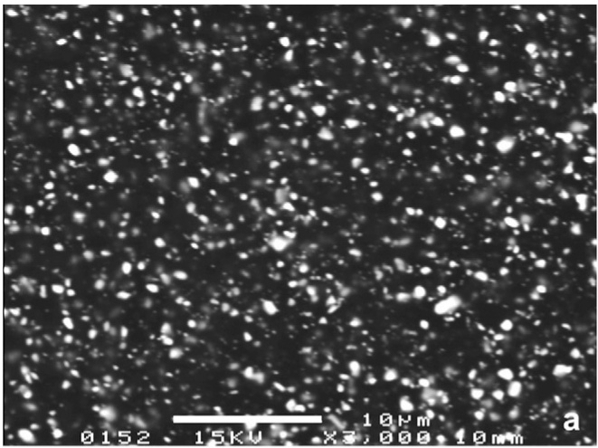
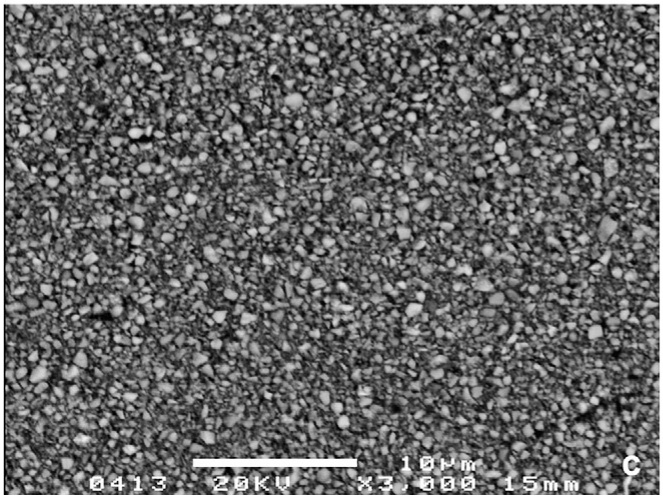
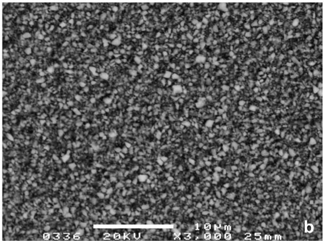
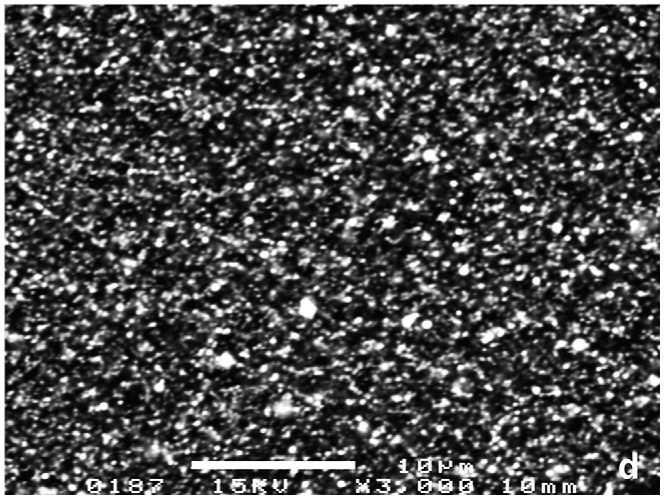
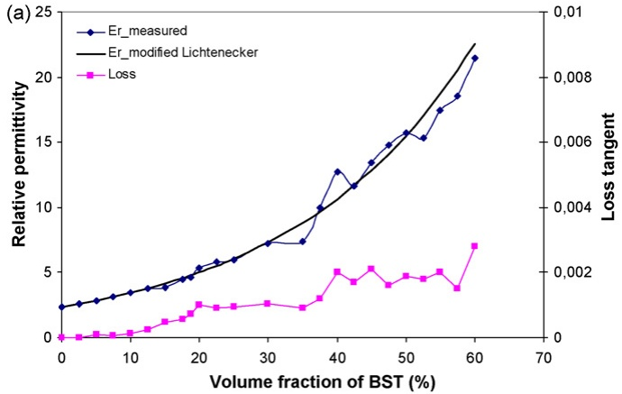
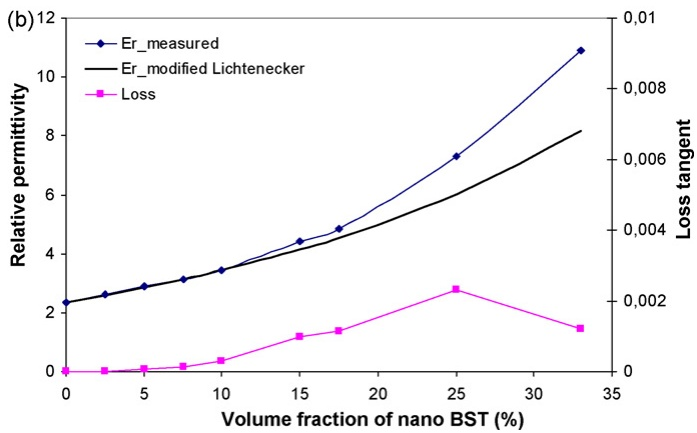
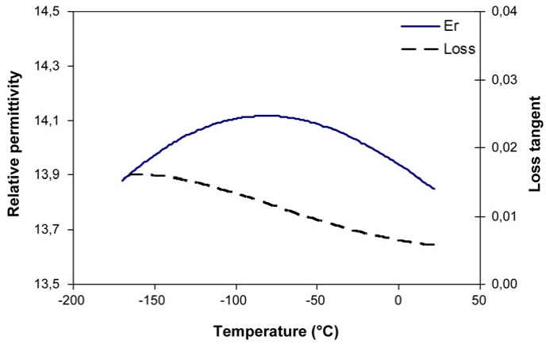

www.elsevier.com/locate/jeurceramsoc

# Dielectric properties of BST/polymer composite

Tao Hu a,∗, Jari Juuti a, Heli Jantunen a, Taisto Vilkman b

a Microelectronics and Materials Physics Laboratories, EMPART Research Group of Infotech Oulu,

P.O. Box 4500, FIN-90014 University of Oulu, Finland

b Premix Oy, FIN-05201 Rajam äki, Finland

Available online 23 March 2007

## Abstract

A composite of barium strontium titanate (BST) and thermoplastic cyclic olefin copolymer (COC) was investigated with different BST loadings using common and nanosize ceramic powders. The relative permittivity and loss tangent of the composites were measured as a function of loading at 1 GHz and as a function of temperature at 0.1 MHz. A relative permittivity of 6.0 and a loss tangent of 0.0009 at 1 GHz (room temperature) were obtained for a BSTc-COC composite with 25 vol.% loading using common-size particles of BST. The values for a BSTn-COC composite loaded with 25 vol.% of nanosize BST particles were 7.3 and 0.0023, respectively. A modified Lichtenecker logarithmic equation showed good correspondence with measured relative permittivity of the BSTc-COC composite, but especially at a higher loading level, the model failed with the BSTn-COC composite.

© 2007 Elsevier Ltd. All rights reserved.

Keywords: Composites; Dielectric properties; Microstructure-final; BST-COC

## 1. Introduction

Materials used in microelectronic packaging have to simultaneously fulfill diverse requirements, like low dielectric loss, moderate relative permittivity and moisture absorption resistance, as well as a low coefficient of thermal expansion (CTE) and high dimensional stability and mechanical stiffness.1 Ceramic–polymer composites, especially type 0-3, form a potential material group suitable for producing demanding and functional packages that combine the electrical properties of ceramic and the mechanical flexibility, chemical stability, and processing possibilities of polymers. The feasibility of these composites for use in piezoelectric and pyroelectric applications, flexible sensors, transducers, thick film dielectrics, embedded capacitors, tunable antennas and other multilayer RF devices has been studied.2–4 The research has mainly concentrated on epoxy-ceramic composites,5–8 but also other polymers, such as PVDF,9 P(VDF–TrFE),10 silicon-rubber,11 polyimide,12 polyvinylchloride (PVC),13 cyanoethylated cellulose polymer (CR-S),14 polystyrene,15 and polyurethane,16 have been used. However, only a few composites that use thermoplastic polymers have been reported.17,18 These polymers have excellent chemical stability and good mechanical processing possibilties, as they can be net-shaped at elevated temperatures to make, e.g. sheets or a 3D structure, using injection molding, lamination or extrusion. Thus, thermoplastic polymers are attractive candidates for 0-3 type ceramic–polymer composites.

The main goal of this research was to introduce a novel 0-3 type ceramic–polymer composite made of thermoplastic polymer (cyclic olefin copolymer, COC) with different loadings of ferroelectric barium strontium titanate (BST). Recently it has also been reported that the nanosize ceramic powders of 0-3 type ceramic–polymer composites could enhance the composite’s loading and microstructure.19,20 Thus, an additional objective of the research was to examine how the dielectric properties differ when the particle size of the ceramic filler is decreased from micro to nano-scale. The loading effect of two different BST materials $\mathrm{(Ba_{0.55}Sr_{0.45}TiO_{3})}$ with micrometer-scale particles and $\mathrm{Ba}_{0.5}\mathrm{Sr}_{0.5}\mathrm{TiO}_{3}$ with nanometer-scale particles) on the microstructure and dielectric properties of the composite was analyzed and discussed.

## 2. Experimental procedure

BST-COC composites were manufactured from commercial BST powders and a granular COC polymer in a HAAKE Rheocord mixer system (CG-5902 Torque Rheometer, Thermo

Electron Corporation, USA). The COC was Topas® 8007S-04 (Ticona GmbH, Germany) with a density of $1.02    g/cm ^3$ and a melting temperature of $1 9 0 { - } 2 5 0   ^ { \circ } \mathrm { C }$ The commonsize $\mathrm{Ba}_{0.55}\mathrm{Sr}_{0.45}\mathrm{TiO}_{3}$ powder (Filtronic Comtek Ltd., UK) was calcined at $1 1 0 0   ^ { \circ } \mathbf { C }$ for 4 h with a fired density of $5 . 5   \mathrm { g } / \mathrm { c m } ^ { 3 }$ for a bulk sample. The nanosize $\mathrm{Ba}_{0.5}\mathrm{Sr}_{0.5}\mathrm{TiO}_{3}$ powder (Sigma–Aldrich Chemie GmbH, Germany) had a fired density of $4 . 9   \mathrm { g } / \mathrm { c m } ^ { 3 }$ . First the COC polymer was weighed and put into the chamber of the Torque Rheometer at a $2 3 0   ^ { \circ } \mathbf { C }$ temperature, followed by slow addition of the BST powder. After mixing at a speed of 32–64 rpm for 10–20 min, the BST-COC composite was taken from the chamber and hot-pressed at a $2 0 0   ^ { \circ } \mathbf { C }$ temperature to form samples for measurements.

The volume fraction indicating the final loading level of the ceramic was calculated using the weight and density of pure BST and COC. Microstructure analyses were done using scanning electron microscopy (SEM, Jeol JSM-6400, Jeol Ltd., Japan) and X-ray diffraction spectrometry (XRD, Siemens D5000, Siemens AG, Germany), utilizing the JCPDS data file (International Center for Diffraction Data 1992, USA). The specific surface area of the BST powders was measured with a COUL-TER OMNISORP 360CX (Coulter Electronics Ltd., UK).

Composite samples with a length and width of 20–30 mm and a thickness of 1.5–2 mm were made by hot-pressing for electrical measurements. The samples were polished to ensure good surface quality and parallel surfaces. Relative permittivity and the loss tangent at a frequency of 1 GHz were measured at room temperature with an Agilent E4991A RF Impedance/Material Analyzer (Agilent Technologies Inc., USA). Electrodes were manufactured by sputtering a copper layer on both surfaces. Wires were soldered on the copper electrodes and the dielectric properties were measured as a function of temperature at 0.1 MHz using a HP 4284A precision LCR meter (Agilent Technologies Inc., USA) and a LINKAM temperature control system (a TMS94 temperature controller and an LNP94 automated liquid nitrogen cooling pump, Linkam Scientific instruments Ltd., UK).

## 3. Results and discussions

The thermoplastic polymer chosen for this research, COC made from ethylene and norbornene, is an amorphous and transparent copolymer with high insulation resistance, very low dielectric loss and excellent chemical resistance to aqueous acids and most polar solvents. The measured relative permittivity and dielectric loss of pure COC at 1 GHz were 2.4 and 0.0001, respectively. BST, which is widely used in various applications because of its high relative permittivity and relatively low loss, was chosen as the ceramic filler. The BST was also selected for the way it exhibited a paraelectric state with low loss at ambient temperature. The relative permittivity and loss tangent of the pure BST bulk (made with common-size $\mathrm{Ba}_{0.55}\mathrm{Sr}_{0.45}\mathrm{TiO}_{3}$ powder and sintered at $1 4 0 0   ^ { \circ } \mathrm { C }$ for 4 h) measured at room temperature were 1757 and 0.001 at 0.1 MHz, respectively.

Fig. 1. SEM images of the BSTc-COC composites with BST loading of (a) 10, (b) 40, (c) 60 vol.%, and (d) the BSTn-COC composite with BST loading of 10 vol.%.

In addition to the electrical performance of the basic composite materials, the final properties of the 0-3 ceramic–polymer composite depend on the loading, particle size, size distribution, and microstructure21 of the ceramic filler. Thus, the main interest was in studying these effects.

The particle size of the common BST powder was in the range of $0 . 2 { - } 2   \mu \mathrm { m } ,$ , with an average size of ∼1 -m, whereas the particle size of the nano-BST powder was <200 nm. The BET surface area measurement gave SSA values of 7.8 and $1 3 . 7   \mathrm { m } ^ { 2 } / \mathrm { g }$ for the common BST powder and the nano-BST powder, respectively. The XRD analysis showed that both powders had a structure of polycrystal barium strontium titanate, confirming that the starting ceramic materials were the ones expected.

Composites with different BST loadings in the range of 2.5–60 vol.% were fabricated from common-size BST powder (BSTc-COC). Similarly, composites with BST nano-powder were manufactured (BSTn-COC) with a 2.5–33 vol.% of BST. The microstructures (SEM images in the back-scattering electron mode) of the BSTc-COC composites with 10, 40, 60 vol.% BST and BSTn-COC with 10 vol.% BST are shown in Fig. 1. Gradually increased loading of BST and homogeneously distributed ceramic particles can be clearly seen in the COC polymer matrix.

The SEM image of BSTn-COC (Fig. 1d) shows more uniform and delicate distribution of the ceramic particles and smaller distances between them compared with BSTc-COC with the same volume fraction of 10 vol.% (Fig. 1a). Therefore, the polymer matrix dominates the behavior of the BSTc-COC composite with higher loadings than the BSTn-COC composites, which will be discussed later on.

In processing the composites, it was also observed that the nano-powder was easier to mix with the polymer than was the common powder at lower BST loadings. However, mixing became more difficult at higher loadings, as also reported by others,19 because of the effect of the high SSA and thus the larger ceramic volume. Research is going on to improve mixing, inhibit agglomeration and obtain higher nano-powder loadings.

The relative permittivity of the BSTc-COC composites at 1 GHz rapidly increased from 2.6 to 21.4 as the volume fraction of BSTc was increased from 2.5 to 60 vol.%, as shown in Fig. 2a. The increase became more profound when the loading level of 25 vol.% was exceeded. As the loading increased, a slow increase of the loss tangent at 1 GHz from 0.001 to 0.003 was also observed.

The BSTn-COC composites had similar behavior as a function of BST loading as did the BSTc-COC composites. Their relative permittivity and loss tangent increased when the volume fraction of nano-BST powder was increased (Fig. 2b), but at lower loading of BST (≤10 vol.%) their dielectric properties are dominated by the main continuous phase of the polymer matrix.

Fig. 2. Relative permittivities and loss tangents of (a) the BSTc-COC composites and (b) the BSTn-COC composites at 1 GHz as a function of BST loading.

Differences occur at higher BST loading (>10 vol.%), where the relative permittivity and losses of the composite increase more rapidly with the addition of nano-powder than with common powder. For example, composites with 10 vol.% loading of common and nano-BST powders had the same relative permittivity of 3.5, but at 15 vol.% and 25 vol.% BST loadings the BSTc-COC had a relative permittivity of 3.9 and 6.0, whereas the BSTn-COC had a relative permittivity of 4.4 and 7.3, respectively. Correspondingly, the loss tangent of the BSTc-COC was 0.0005 and 0.0009 at 15 and 25 vol.% BST loading, while for the BSTn-COC, values of 0.0010 and 0.0023, respectively, were measured. Thus, the nano-powder significantly increased relative permittivity when the BST loading was above 15 vol.%, but it also generated higher losses. The results are assumed to be a consequence of the higher SSA of the nano-powder, which has more surface area connected with the polymer matrix, thus creating a large ‘interaction zone’ or region of altered polymer behavior. Changes in the polymer morphology and the space charge distribution, reduction in the internal field caused by the decrease in the size of the particles, and a scattering mechanism might be the other factors influencing the dielectric properties.22 However, more research is required on this topic. An abnormal decrease in the loss value of BSTn-COC with 33 vol.% of BST also requires further investigation.

The relative permittivities of the BSTc-COC and BSTn-COC composites were calculated with a modified Lichtenecker loga-

Fig. 3. Relative permittivity and loss tangent of the BSTc-COC composite with 40 vol.% of BST at 0.1 MHz.

rithmic law equation.14,23

$$
\log \varepsilon = \log \varepsilon_ {\mathrm{p}} + v _ {\mathrm{b}} (1 - k) \log \left(\frac {\varepsilon_ {\mathrm{b}}}{\varepsilon_ {\mathrm{p}}}\right)
$$

where k is a fitting constant of the composite, $\nu _ { \mathrm { b } }$ the volume fraction of ceramic, and $\varepsilon _ { \mathrm { p } }$ and $\varepsilon _ { \mathrm { b } }$ are the relative permittivities of pure polymer and ceramic, respectively. For $k ,$ a value of 0.3 for well-dispersed polymer–ceramic composites has been reported.23 For our composites, $k   =   0 . 4 3$ was used, and the relative permittivities of the pure BST bulk and COC polymer were 1760 and 2.4, respectively. The modified Lichtenecker equation showed very good correspondence with the measurement results of the BSTc-COC composite (Fig. 2a) up to relatively high loadings. In the case of the BSTn-COC composite, the equation shows good matching with measurement results at a $\leq   1 0 \%$ volume fraction. However, a significant discrepancy can be observed at higher loadings of the nano-BST powder because of the high SSA of the nanopowder. In a composite system with high loading of ceramic filler and/or high surface area of the filler, the interfacial bonding region between the polymer and ceramic becomes larger and is very significant to the dielectric properties of the composites.19,22,24 Other models especially made for nanocomposites, such as the interphase power law model (IPL model),24 need to be used.

The relative permittivity and loss of the BSTc-COC composite with 40 vol.% of BST as a function of temperature (from $-165  to   22   ^{\circ} C )$ at 0.1 MHz is shown in Fig. 3. The results show that the Curie peak is hard to define, which is understandable since the ceramic loading was still relatively low. The presented composites could thus be feasible for applications requiring relatively stable but moderately high relative permittivity. A higher loading level or modification of the polymer matrix is needed, however, if electrical tuning of relative permittivity available with ferroelectric composites is desired.

## 4. Conclusions

Novel thermoplastic 0-3 type BST-COC composites were studied using common-size $\mathrm{(Ba_{0.55}Sr_{0.45}TiO_{3})}$ and nanosize $\mathrm{(Ba_{0.5}Sr_{0.5}TiO_{3})}$ BST powders and a thermoplastic COC polymer (TOPAS® 8007S-04). The composites were prepared with different volume fractions of BST powders. The microstructures of the composites showed homogeneous distribution of the BST fillers in the COC polymer matrix in all the samples. The relative permittivity and loss tangent were investigated as a function of BST loading at 1 GHz and as a function of temperature at 0.1 MHz. The results showed that the relative permittivity and loss tangent of the composites gradually increased as the volume fraction of BST was increased. The BSTn-COC composite with nanopowder showed higher relative permittivity and loss at BST loading over 10 vol.% compared with the composites with common-size BST powder. Using a 25% volume fraction of BST, a relative permittivity of 7.3 and a loss tangent of 0.0023 were obtained for the BSTn-COC nanocomposite at 1 GHz, and 6.0 and 0.0009, respectively, for the common BSTc-COC composite. The modified equation of the Lichtenecker logarithmic law showed good correspondence for composites made from common-size BST powder, but discrepancies were observed in composites with nano-BST powder at >10 vol.% loading.

## Acknowledgements

This research was supported by the CoNaPo project (No. 40135/05, 40116/06). The authors would like to acknowledge the Finnish Funding Agency for Technology and Innovation (Tekes), Perlos Oyj, Pulse Finland Oy, Premix Oy, Ticona Norden Finland Oy, and Aspocomp Technology Oy for funding the project, and Mr. Timo Vahera for preparation of the samples.

## References

1. Dietz, H. K., Fine lines in high yield (Part CXXIV): high performance dielectrics. CircuiTree, 2006, 19(1), 52–53.

2. Dias, C. J. and Das-Gupta, D. K., Inorganic ceramic/polymer ferroelectric composite electrets. IEEE Trans. Dielectr. Electr. Insul., 1996, 3(5), 706–734.

3. Reichmanis, E., Katz, H., Kloc, C. and Maliakal, A., Plastic electronic devices: from materials design to device applications. Bell Labs Tech. J., 2005, 10(3), 87–105.

4. Rao, Y., Yue, J. and Wong, C. P., High K polymer-ceramic nano-composite development, characterization, and modeling for embedded capacitor RF application. In IEEE Conference Proceedings of Electronic Components and Technology, 2001, pp. 1408–1412.

5. Kuo, D. H., Chang, C. C., Su, T. Y., Wang, W. K. and Lin, B. Y., Dielectric properties of three ceramic/epoxy composites. Mater. Chem. Phys., 2004, 85, 201–206.

6. Cho, S. D., Jan, K. W., Hyun, J. G., Lee, S., Paik, K. W., Kim, H. et al., Epoxy/BaTiO3 composite films and pastes for high dielectric constant and low-tolerance embedded capacitors fabrication in organic substrates. IEEE Trans. Dielectr. Electr. Pack. Manuf., 2005, 28(4), 297–303.

7. Rao, Y., Takahashi, A. and Wong, C. P., Di-block copolymer surfactant study to optimize filler dispersion in high dielectric constant polymer–ceramic composite. Compos. Part A, 2003, 34, 1113–1116.

8. Ramajo, L., Reboredo, M. and Castro, M., Dielectric response and relaxation phenomena in composites of epoxy resin with BaTiO3 particles. Compos. Part A, 2005, 36, 1267–1274.

9. Muralidhar, C. and Pillai, P. K. C., Dielectric behaviour of barium titanate (BaTiO3)/polyvinylidene fluoride (PVDF) composite. J. Mater. Sci. Lett., 1987, 6, 346–348.

10. Adkary, S. U., Chan, H. L. W., Choy, C. L., Sundaravel, B. and Wilson, I. H., Characterisation of proton irradiated Ba0.65Sr0.35TiO3/P(VDF-TrFE) ceramic-polymer composites. Compos. Sci. Tech., 2002, 62, 2161–2167.

11. Liou, J. W. and Chiou, B. S., Dielectric tunability of barium strontium titanate/silicone-rubber composite. J. Phys. Condens. Matter, 1998, 10, 2773–2786.

12. Xie, S. H., Wei, X. Z., Xu, Z. K. and Xu, Y. Y., Polyimide/BaTiO3 composites with controllable dielectric properties. Compos. Part A, 2005, 36, 1152–1157.

13. Olszowy, M., Pawlaczyk, Cz., Markiewicz, E. and Kulek, J., Dielectric and pyroelectric properties of BaTiO3-PVC composites. Phys. Stat. Sol. (a), 2005, 202(9), 1848–1853.

14. Chiang, C. K. and Popielarz, R., Polymer composites with high dielectric constant. Ferroelectrics, 2002, 275, 1–9.

15. Badheka, P., Magadala, V., Devaraju, N. G., Lee, B. I. and Kim, E. S., Effect of dehydroxylation of hydrothermal barium titanate on dielectric properties in polystyrene composite. J. Appl. Polym. Sci., 2006, 99, 2815–2821.

16. Abbas, S. M., Chandra, M., Verma, A., Chatterjee, R. and Goel, T. C., Complex permittivity and microwave absorption properties of a composite dielectric absorber. Compos. Part A, 2006, 37, 2148–2154.

17. Wang, Y. and Huang, J., Single screw extrusion compounding of particulate filled thermoplastics: state of dispersion and its influence on impact properties. J. Appl. Polym. Sci., 1996, 60, 1779–1791.

18. Bahadur, S. and Sunkara, C., Effect of transfer film structure, composition and bonding on the tribological behaviour of polyphenylene sulfide filled with nano particles of TiO2, ZnO, CuO and SiC. Wear, 2005, 258, 1411–1421.

19. Hanemann, T., Boehm, J., Henzi, P., Honnef, K., Litfin, K., Ritzhaupt-Kleissl, E. et al., From micro to nano: properties and potential applications of micro- and nano-filled polymer ceramic composites in microsystem technology. IEE Proc. Nanobiotechnol., 2004, 151(4), 167–172.

20. Dias, C. J., Igreja, R., Marat-Mendes, R., Inacio, P., Marat-Mendes, J. N. and ´ Das-Gupta, D. K., Recent advances in ceramic–polymer composite electrets. IEEE Trans. Dielectr. Electr. Insul., 2004, 11(1), 35–40.

21. Lee, H. G. and Kim, H. G., Ceramic particle size dependence of dielectric and piezoelectric properties of piezoelectric ceramic-polymer composites. J. Appl. Phys., 1990, 67(4), 2024–2028.

22. Roy, M., Nelson, J. K., MacCrone, R. K., Schadler, L. S., Reed, C. W., Keefe, R. et al., Polymer nanocomposite dielectrics—the role of the interface. IEEE Trans. Dielectr. Electr. Insul., 2005, 12(4), 629–643.

23. Rao, Y., Wong, C. P., Qu, J. and Marinis, T., Self-consistent model for dielectric constant prediction of polymer–ceramic composite. In Proceedings of International Symposium on Advanced Packaging Materials, 2000. p. 44–9.

24. Todd, M. and Shi, F., Dielectric characteristics of complex composite systems containing interphase regions. In Proceedings of 9th International Symposium on Advanced Packaging Materials, 2004. p. 112–7.