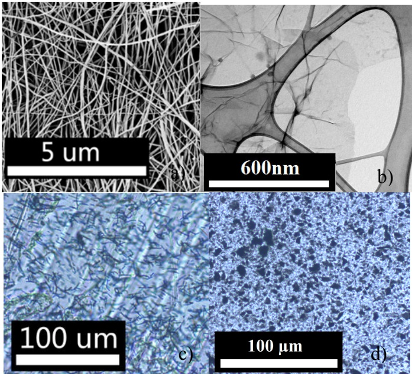
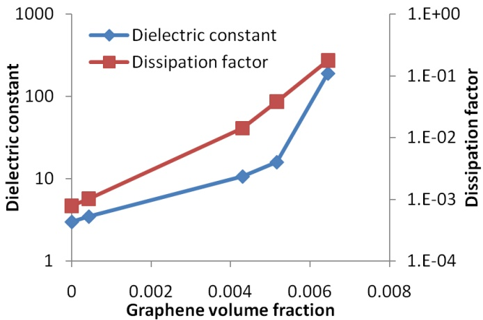
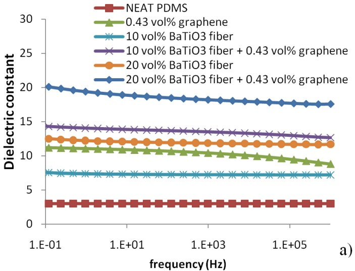
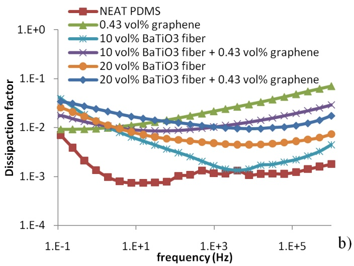
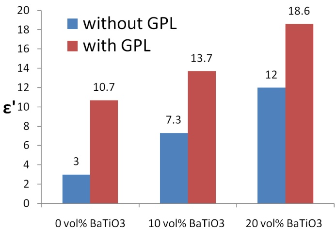
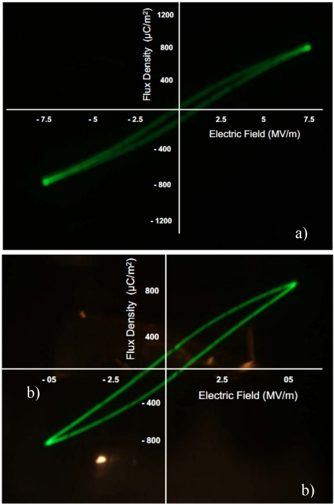

# Dielectric Properties of Electrospun Barium Titanate Fibers/Graphene/Silicone Rubber Composites

Z. Wang, J.K. Nelson, N. Koratkar, L.S. Schadler

Rensselaer Polytechnic Institute

110 8th Street

Troy, NY 12180 USA

H. Hillborg, S. Zhao ABB AB, Corporate Research, Power Technology Västerås, SE-721 78 Sweden

**Abstract- The ability to increase the dielectric constant of an insulator by embedding spherical particles is limited at low volume fraction as described by the rule of mixtures. High aspect ratio fillers are predicted to be able to increase the dielectric constant more efficiently than spherical fillers. In this work, barium titanate fibers were synthesized by electrospinning a sol-gel, followed by a heat treatment to obtain a perovskite crystal structure. Graphene platelets were synthesized by a thermal shock method. Dielectric spectroscopy showed that a larger dielectric constant increase was achieved by this means, and a combination of barium titanate and graphene platelets yielded the highest value when used in a polydimethyl siloxane matrix. The increase in dielectric loss over the pure matrix was small when the volume fraction was below the percolation threshold of graphene platelets. The electric flux density-electric field (D-E) measurements showed a linear dielectric constant in barium titanate filled composites and higher loss when graphene was added. The mechanisms that lead to those phenomena are discussed in this work. This is a promising route for creating high dielectric constant, low loss materials, for use as capacitor and electric field grading materials.**

## I. INTRODUCTION

To increase the dielectric constant of polymer composites , ferroelectric ceramic particles are widely used because of their high dielectric constant and low dielectric loss [1,2]. The other approach is to use conductive particles at a volume fraction close to the percolation threshold [3]. However, the ability of spherical particles to increase the dielectric constant is small at low volume fractions, according to the rule of mixtures [4]. Higher volume fractions of ceramic particles lead to increased dielectric constant, but also to a reduction in mechanical properties [5-8]. Composites with high aspect ratio fillers exhibit higher dielectric constant at lower loading [4], thereby potentially maintaining the mechanical properties. High aspect ratio fillers, however, have not been studied as extensively as their spherical counterparts because of challenges in manufacturing high aspect ratio fillers [9,10]. In this work, the dielectric properties of a polymer composite containing BaTiO3 fibers and graphene platelets (GPLs) are investigated and discussed.

## II. EXPERIMENTAL

## A. Preparation of BaTiO3 Fibers

BaTiO3 fibers were prepared by electrospinning of a mixture consisting of BaTiO3 sol-gel and poly(vinyl pyrrolidone) $\mathrm{PVP}, \mathrm{M_w} = 1, 300, 000 \mathrm{g}$ mol-1) solution [11]. A positive voltage (16 kV) was applied on the needle tip of a syringe, and an grounded aluminum foil was used as counter electrode. The distance between the needle tip and the counter electrode was 25 cm. The precursor was fed at a constant rate (30 µl/min) by a syringe pump.

Synthesized BaTiO3/PVP fibers were subjected to a heat treatment to remove the PVP polymer, and to obtain the desired Perovskite crystal structure. Fibers were annealed in an oven at 500 °C for 12 hours to remove the residual solvent and most of the PVP. They were then calcinated at $1 2 0 0 ~ ^ { \circ } \mathrm { C }$ to crystallize. In the heat treatment process, a fast heating rate of over 2000 °C/min was achieved by inserting the sample into a preheated oven. The fibers were then cooled to room temperature in air. A scanning electron microscope (SEM) image of prepared BaTiO3 fibers is shown in Fig. 1a.

## B. Preparation of Graphene Platelet (GPL)

The GPLs were obtained by the one-step thermal exfoliation and reduction of graphite oxide. In this method, graphite oxide is subjected to a thermal shock (rapid heating rate of about 2000° C/min) which exfoliates and reduces the graphite oxide into GPL. The GPL are several micrometers in in-plane dimensions and are comprised of \~3-4 graphene sheets within each platelet. The total platelet thickness is less than 2 nm.

## C. Preparation of Composites

Sylgard 184 (Dow Corning), consisting of poly(dimethyl siloxane) (PDMS) and a reinforcing silica filler was used as polymer matrix. The calcinated BaTiO3 fibers were directly mixed into the precursor Sylgard 184A using a FlackTek Speed Mixer at 3000 rpm for 10 minutes. Composites were then prepared by carefully mixing the precursors Sylgard 184A (containing the fibers) and Sylgard 184B (crosslinker) at a ratio of 10:1 by mass, followed by curing in a mold at 150 °C for 12 hours. Planar samples with a diameter of 3.2 cm and a thickness of around 300 µm were obtained. Prepared samples were dried in an oven at 120 °C for 12 hours prior to any dielectric testing to remove any trapped moisture. The dispersion of composites is shown in Fig. 1c and Fig. 1d.

## D. Characterization

Thermogravimetric analysis (TGA) was carried out to determine the weight fraction of fibers in the composites, using a TA Instruments Q50 thermogravimetric analyzer. Parameters

Fig. 1 (a) SEM image of BaTiO3 fibers; (b) TEM image of GPLs; (c) and (d) Optical microscope images showing dispersion of BaTiO3 fibers and GPLs

from the literature and the manufacturer datasheet $\mathrm{(BaTiO_{3})}$ $\mathrm{density} = 6.02\ \mathrm{g/cm^{3}}$ , PDMS density $1.03\  g/cm ^{3}$ were used to calculate the filler volume fraction. The composite samples were tested in a Novocontrol Alpha high resolution dielectric/impedance analyzer for dielectric spectroscopy at room temperature. A frequency range from $1 \dot { 0 } ^ { - 1 }$ to $1 0 ^ { 6 }$ Hz was utilized. The morphology of the fibers was investigated using a Carl Zeiss Supra scanning electron microscope. The electric flux density-electric field (D-E) measurement was taken in an ambient of dielectric mineral oil at $2 0 \; ^ { \circ } \mathrm { C }$ following the ASTM standard D3487.

## III. RESULTS AND DISCUSSION

## A. Dielectric Spectroscopy

The dielectric constant and dissipation factor of composites filled with GPLs are shown in Fig. 2. Both the dielectric constant and dissipation factor exhibit a large increase at a small volume fraction of GPLs. The sheet morphology and high aspect ratio of GPLs lead to a low percolation threshold of less than 0.01 in volume fraction. The large dissipation factor above the percolation threshold is caused by the leakage current. The high dielectric constant can be explained by percolation theory [12], which describes the critical behavior of composites when the volume fraction of conductive fillers approaches the percolation threshold. However, a large dissipation factor is usually not desired in electrical applications. A GPL volume fraction of 0.0043 was chosen for the three-phase composite preparation. At this loading, the dielectric constant is improved with only a moderate increase of the dissipation factor.

High aspect ratio conductive fillers such as carbon nanotubes [13] and carbon fibers [14] have been used to prepare high dielectric constant composites in the literature. 2-dimensional

GPLs are expected to increase the dielectric constant at even a lower volume fraction from the rule of mixtures [4]. The dielectric properties of graphene-filled composites were not reported until recently [15]. In our work, the GPLs prepared by the thermal shock method have a smaller thickness, and thus the percolation was reached at a lower volume fraction.

The dielectric spectroscopy of several representative composites is shown in Fig. 3. The real relative dielectric constant $\varepsilon ^ { \prime }$ is flat in the tested frequency range, indicating the absence of conduction effects. The relative dielectric constant increase over the neat polymer is significantly larger than that of the composites filled with spherical or irregular $\mathrm{BaTiO}_{3}$ particles reported in the literature [5-7]. For example, the dielectric constant of 20 vol% $\mathrm{BaTiO}_{3}$ fiber filled composites is 400% compared to that of the neat polymer. Using the same volume fraction of spherical $\mathrm{BaTiO}_{3}$ particle, the increases of the dielectric constant is about 200% [8]. This difference agrees with the prediction from the rule of mixtures. The increase in dielectric constant of the composites is summarized in Fig. 4. By adding 0.43 vol% of GPLs into the $\mathrm{BaTiO}_{3}$ fiber/PDMS composites, the dielectric constant was further increased to 13.7 and 18.6 for 10 vol% and 20 vol% BaT $\mathrm { { \mathrm { { \mathrm { { i O } } } } } } _ { 3 }$ fiber composites respectively.

The dissipation factor of the composites is shown in Fig. 3b. The dissipation factor of the composites is about one order of magnitude higher than that in the neat PDMS. Generally the dielectric loss increases with the volume fraction of fibers and the GPLs. Adding 0.43 vol% of GPLs into the Ba $\mathrm { T i O } _ { 3 }$ fiber composites results in an increased dissipation factor which is, however, not higher than the pure GPL/PDMS composites. By combining the two types of fillers, the three-phase composite shows a larger dielectric constant than either of the two-phase composites without a further increase in loss factor.

In the three-phase composites reported in the literature [14,16,17], a combination of conductive fillers and high dielectric constant ceramic fillers is generally used. Considering the ceramic-polymer composite as the base matrix, percolation theory is applicable when adding conductive fillers. By using high aspect ratio ceramic fillers to increase the dielectric cons--tant of the base matrix, the dielectric constant of the final composites is further enhanced.

Fig. 2 Dielectric constant and dissipation factor of composites filled with various volume fractions of GPLs. The testing frequency is 60 Hz.

Fig. 3 Dielectric spectroscopy at 60 Hz of composites filled with BaTiO3 fibers and GPLs, showing (a) permittivity and (b) loss factor.

Fig. 4 Dielectric constant at 60 Hz of composites filled with various volume fractions of BaTiO3 fibers, with and without addition of GPLs.

## B. D-E Measurement

The high voltage behavior of materials was investigated through D-E measurements. Both $\mathrm{BaTiO}_{3}$ fiber composites and three-phase composites were tested under several field conditions below the breakdown strength of materials. Fig. 5 shows the results for each composite under the highest measured field.

The relative permittivity was calculated using an approach found in the literature [18]. The real dielectric constant for composites is listed in Table I. From the literature, ferroelectric ceramics such as barium titanate usually exhibit a nonlinear dielectric constant. Depending on the microstructure and crystal morphology, the dielectric constant of barium titanate can either increase [19] or decrease [20] with increasing field strength. In our result, however, the dielectric constant remains unchanged at elevated electrical field. The difference between the one-phase ceramics and the composites is attributed to the field distribution in the composites. The

Fig. 5 D-E measurement of (a) 20 vol% BaTiO3 fibers composite and (b)20 vol% BaTiO3 fibers+0.43vol% graphene filled composite. Note the scale difference of the applied electric fields.

large dielectric constant of $\mathrm{BaTiO}_{3}$ fibers leads to a field concentration in the polymer phase and reduced electric field in the ceramics. When the field in the ceramics is less than the “threshold field” [19], a linear dielectric constant is expected.

The degree of hysteresis is more pronounced at higher field. The three-phase composite also has a larger loop area, compared to the Ba $\mathrm { T i O } _ { 3 }$ composite. It indicates a higher dielectric loss, which matches with the dielectric spectroscopy data under a low field condition.

TABLE I

REAL RELATIVE PERMITTIVITY OF COMPOSITES AT ELEVATED FIELD

| AC field (kV/mm) | 20 vol% BaTiO3 fibers | 20 vol% BaTiO3 fibers +0.43 vol% GPLs |
| --- | --- | --- |
| Low fielda | 12 | 18.6 |
| 2 | 11.9 | 17.5 |
| 5 | 11.7 | 18.1 |
| 7.5 | 11.8 | - |

a The value of low field (about 3 V/mm) dielectric constant is from the dielectric spectroscopy measurement.

## IV. SUMMARY

Two types of high aspect ratio fillers, $\mathrm{BaTiO}_{3}$ fibers and graphene platelets (GPLs), were mixed into a silicone rubber matrix. The dielectric spectroscopy showed that the high aspect ratio $\mathrm{BaTiO}_{3}$ fibers resulted in a higher dielectric constant than their spherical counterparts while still maintaining a moderate dissipation factor. The GPLs alone can increase the dielectric constant at a very low filler volume fraction. However, the loss increased dramatically when the loading reached the percolation threshold. By combining those two fillers and avoiding the percolation of $\operatorname { G P L s } _ { : }$ the highest dielectric constant was reached without further increase in the dissipation factor. The dielectric constant increased linearly at increasing applied electric field. The low volume fraction of fillers can potentially create a mechanical robust composite, which is suitable for capacitor and field grading applications.

## ACKNOWLEDGMENT

This work is primarily supported by ABB. The authors are also grateful to the support from US National Science Foundation and Nanoscale Science and Engineering Center. H. Hillborg also acknowledges support from the Swedish Research Council (IFA 2007-5095).

## REFERENCES

[1] Y. Rao, S. Ogitani, P. Kohl, and C. Wong, “Novel polymer–ceramic nanocomposite based on high dielectric constant epoxy formula for embedded capacitor application,” J. Appl. Polym. Sci., vol. 83, 2002, pp. 1084–1090.

[2] G. Subodh, V. Deepu, P. Mohanan, and M.T. Sebastian, “Dielectric response of high permittivity polymer ceramic composite with low loss tangent,” Appl. Phys. Lett., vol. 95, 2009, pp. 062903-062903.

[3] C. Pecharromán and J.S. Moya, “Experimental evidence of a giant capacitance in insulator- conductor composites at the percolation threshold,” Adv. Mater., vol. 12, 2000, pp. 294-297.

[4] A. Sihvola, “Mixing rules with complex dielectric coefficients,” Subsurf. Sens. Technol. Appl., vol. 1, 2000, pp. 393–415.

[5] Y. Bai, Z.Y. Cheng, V. Bharti, H.S. Xu, and Q.M. Zhang, “Highdielectric-constant ceramic-powder polymer composites,” Appl. Phys. Lett., vol. 76, 2000, pp. 3804-3806.

[6] K.C. Cheng, C.M. Lin, S.-F. Wang, S.T. Lin, and C.F. Yang, “Dielectric properties of epoxy resin–barium titanate composites at high frequency,” Mater. Lett., vol. 61, 2007, pp. 757-760.

[7] S. Cho, J. Lee, J. Hyun, and K. Paik, “Study on epoxy/BaTiO3 composite embedded capacitor films (ECFs) for organic substrate applications,” Mater. Sci. Eng., B, vol. 110, 2004, pp. 233-239.

[8] T. Hu, J. Juuti, H. Jantunen, and T. Vilkman, “Dielectric properties of BST/polymer composite,” J. Eur. Ceram. Soc., vol. 27, 2007, pp. 3997-4001.

[9] N. Guo, S.A. DiBenedetto, P. Tewari, M.T. Lanagan, M.A. Ratner, and T.J. Marks, “Nanoparticle, size, shape, and interfacial effects on leakage current density, permittivity, and breakdown strength of metal oxide−polyolefin nanocomposites: experiment and theory,” Chem. Mater., vol. 22, 2010, pp. 1567-1578.

[10] L.F. Chen, Y.P. Hong, X.J. Chen, Q.L. Wu, Q.J. Huang, and X.T. Luo, “Preparation and properties of polymer matrix piezoelectric composites containing aligned BaTiO3 whiskers,” J. Mater. Sci., vol. 39, 2004, pp. 2997-3001.

[11] J. Yuh, J. Nino, and W. Sigmund, “Synthesis of barium titanate (BaTiO) nanofibers via electrospinning,” Mater. Lett., vol. 59, 2005, pp. 3645-3647.

[12] A. Efros and B. Shklovskii, “Critical behaviour of conductivity and dielectric constant near the metal-non-metal transition threshold,” Phys. Status Solidi B, vol. 76, 1976, pp. 475–485.

[13] C. Yang, Y. Lin, and C.W. Nan, “Modified carbon nanotube composites with high dielectric constant, low dielectric loss and large energy density,” Carbon, vol. 47, 2009, pp. 1096-1101.

[14] Z. Dang, “Study on dielectric behavior of a three-phase CF/(PVDF+BaTiO3) composite,” Chem. Phys. Lett., vol. 369, 2003, pp. 95-100.

[15] J. Yu, X. Huang, C. Wu, and P. Jiang, “Permittivity, thermal conductivity and thermal stability of poly (vinylidene fluoride)/graphene nanocomposites,” IEEE Trans. Dielectr. Electr. Insul., vol. 18, 2011, pp. 478–484.

[16] Z.M. Dang, Y. Shen, and C.W. Nan, “Dielectric behavior of threephase percolative Ni–BaTiO3/polyvinylidene fluoride composites,” Appl. Phys. Lett., vol. 81, 2002, pp. 4814-4816.

[17] L. Qi, B.I. Lee, W.D. Samuels, G.J. Exarhos, and S.G. Parler, “Three-phase percolative silver–BaTiO3–epoxy nanocomposites with high dielectric constants,” J. Appl. Polym. Sci., vol. 102, 2006, pp. 967-971.

[18] J. Robertson and D. A. Hall, “Nonlinear dielectric properties of particulate barium titanate–polymer composites,” J. Phys. D: Appl. Phys., vol. 41, 2008, p. 115407-115414.

[19] D.A. Hall, “Review nonlinearity in piezoelectric ceramics,” J. Mater. Sci., vol. 36, 2001, pp. 4575–4601.

[20] L. Curecheriu, M.T. Buscaglia, V. Buscaglia, Z. Zhao, and L. Mitoseriu, “Grain size effect on the nonlinear dielectric properties of barium titanate ceramics,” Appl. Phys. Lett., vol. 97, 2010, pp. 242909-242911.