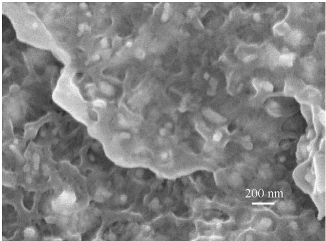
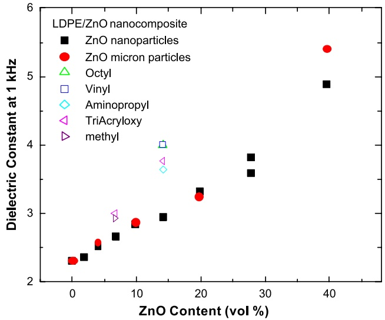
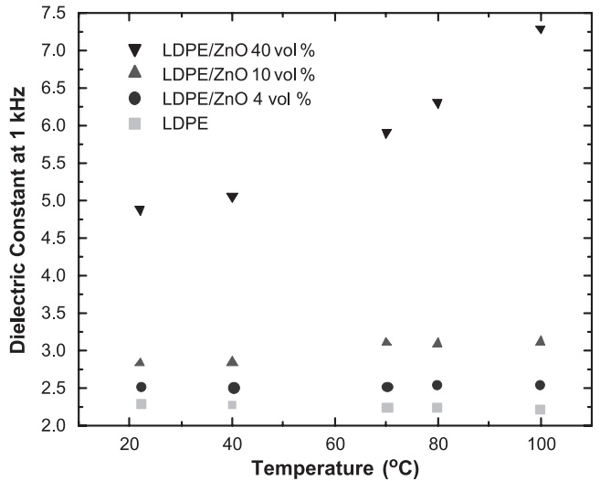
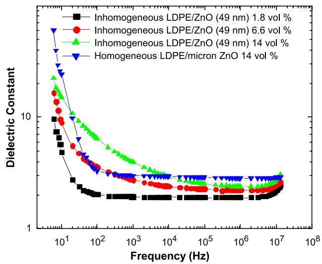

www.elsevier.com/locate/matlet

# Dielectric properties of zinc oxide/low density polyethylene nanocomposites

J.I. Hong\*, P. Winberg, L.S. Schadler, R.W. Siegel

Materials Science and Engineering Department and Rensselaer Nanotechnology Center, Rensselaer Polytechnic Institute, Troy, NY 12180, United States

Received 30 August 2004; accepted 11 October 2004 Available online 27 October 2004

## Abstract

ZnO/low density polyethylene (LDPE) nanocomposites with either homogeneous or controlled inhomogeneous dispersions of ZnO nanoparticles were prepared. The dielectric constants of the composites with filler concentrations up to 40 vol.% were measured and compared with the dielectric constants of conventional submicron size ZnO filled LDPE composite. The filler particles were coated with silane coupling agents and mixed with LDPE to take advantage of the high surface area of nanoparticles for the introduction of high dipole moment molecules to the composite. The effect of filler distribution on the dielectric constant was also examined and the observed differences are attributed to the differences in the two kinds of interfaces present: one formed between the touching ZnO particles and the other formed between LDPE and ZnO.

D 2004 Elsevier B.V. All rights reserved.

Keywords: Nanocomposite; ZnO; LDPE

## 1. Introduction

Polymers are generally known to be good insulating materials due to their stable physical and chemical properties [1]. Both the mechanical and electrical properties of polymers, however, can be further improved or modified with the addition of inorganic fillers [2] as demonstrated by increases in the mechanical strength of the composite [3] and changes in the electrical conductivity [4,5]. It is known that the composite properties can also change with the dispersion state, geometric shape, and surface quality of the filler particles as well as the particle size. For example, Sumita et al. [6] studied the effect of carbon black dispersion in polymer blends on the electrical conduction properties of the composite, and the dependence of electrical properties on the shape and distribution of the filler particles was reported by Flandin et al. [7].

Owing to the recent commercial availability of nanoparticles, the outlook for composite materials with new or modified physical properties became even brighter. Nanoscale fillers are different from bulk materials and conventional micron-size fillers due to their small size and corresponding increase in surface area [8–11]. It is expected that the addition of nanoparticles into polymers would lead to unprecedented ability to control the electrical properties of filled polymers [12,13]. Furthermore, nanocomposite materials with length scales smaller than 1 Am are becoming necessary as the size of modern electronic devices reaches down to submicron scales. Therefore, understanding how to control the resistivity and permittivity of nanofilled polymer nanocomposites is an essential step toward the controlled engineering of nanocomposite materials in future electrical applications.

In the present work, we attempt to understand the effects of filler particle size and spatial distribution on the permittivity of composites. Low density polyethylene (LDPE) was chosen as a representative polymer matrix because it is widely used for electrical insulation in the cable and wire industry owing to its high breakdown strength and resistivity [14]. Another advantage of LDPE is that it is relatively easy to mix with inorganic fillers by simple melt mixing; good dispersion of the filler particles is readily achieved [25]. ZnO fillers were used, since ZnO is a wide band gap semiconducting material well known for its nonlinear electrical conductivity properties and it has also been studied by many researchers [15–17]. By combining the special properties of ZnO nanoparticles [18–20] with LDPE, a polymeric nanocomposite material with controlled properties could be expected. The conductivity of ZnO is much higher than that of LDPE and is dominated by the properties of its surfaces [20]. The conductivity of the ZnO/ LDPE composite is thus expected to change with the volume fraction of $\mathrm { Z n O } ,$ as well as its particle size and particle surface chemistry. However, the detailed relationship between the filler concentration and the permittivity of the composite is still uncertain [2]. The behavior near the percolation threshold, $p _ { \mathrm { c } }$ (the filler concentration at which the resistivity starts to change rapidly), is also of interest [21]. Classical percolation theory predicts a steep increase in permittivity as the filler concentration increases past $p _ { \mathrm { c } }$ [21,22]. However, $p _ { \mathrm { c } }$ and the dependence of permittivity on filler volume fraction are system and processing dependent [28,23,24]. The percolation behavior needs to be understood carefully with consideration of the physical conditions and properties of both filler and matrix that constitute the composite.

## 2. Experimental procedure

ZnO/LDPE nanocomposites were produced by melt mixing commercial grade LDPE (DOW 681I) and 49 nm ZnO nanoparticles in a Haake batch mixer. ZnO nanoparticles were donated by Nanophase Technologies, and ZnO micron-size particles were purchased from Alfa Aesar to examine the filler size effect on the composite properties. To avoid any thermal degradation of the polymer matrix [25], the mixing time was set to 10 to 15 min at $2 0 0 ~ ^ { \circ } \mathrm { C } .$ The specimen was then hot pressed with a Carver press into a disc shape with a diameter of 6.35 cm and a thickness of approximately 0.04 cm for the measurements of permittivity.

To observe dispersion, the composites were cooled below their glass transition temperature in liquid nitrogen and fractured to expose the surfaces with internal microstructure. The fracture surface was then examined with a field emission scanning electron microscope (FESEM, JEOL JSM-6335F) operated at 3 to 5 kV. As shown in Fig. 1, the particles were well dispersed homogeneously. In this representative scanning electron micrograph, nanoparticles are shown as white spheres dispersed throughout the entire area examined.

Composites with controlled inhomogeneous filler distributions were also fabricated to see the effects of spatial filler distribution. LDPE powder obtained from Ultra Chemical was ball milled with ZnO nanoparticles. The result was LDPE particles with nanoparticles embedded in the surfaces of the LDPE particles. The mixtures were then hot pressed in a mold to a disc shape, the same as that for the homogeneous samples. The microstructures of these composites were also examined with FESEM [30].

Fig. 1. SEM images of the ZnO/LDPE nanocomposites. Good dispersion of nanoparticles in the LDPE matrix is confirmed from no observation of nanoparticle agglomeration.

The permittivities of the nanocomposites were measured using a Quadtech 1689 LCR meter and an HP 4192A impedance analyzer with the specimen loaded in a homemade electrode fixture at frequencies ranging from 10 Hz to 10 GHz. A grounded guard ring was incorporated to minimize edge effects during the measurements of capacitance.

## 3. Results and discussion

The permittivity of the nanocomposites with homogeneous filler distribution was found to be roughly proportional to the volume fraction of ZnO particles in the composites, as seen in Fig. 2. The Maxwell–Garnett approximation,

$$
\varepsilon = \frac {v _ {\mathrm{m}} \varepsilon_ {\mathrm{m}} \left(\frac {2}{3} + \frac {\varepsilon_ {\mathrm{d}}}{3 \varepsilon_ {\mathrm{m}}}\right) + v _ {\mathrm{d}} \varepsilon_ {\mathrm{d}}}{v _ {\mathrm{m}} \left(\frac {2}{3} + \frac {\varepsilon_ {\mathrm{d}}}{3 \varepsilon_ {\mathrm{m}}}\right) + v _ {\mathrm{d}}},
$$

predicts the dielectric constant for a mixture of spherical particles with dielectric constant $\varepsilon _ { \mathrm { d } }$ dispersed in a matrix with lower dielectric constant, $\varepsilon _ { \mathrm { m s } }$ with volume fractions of $\nu _ { \mathrm { d } }$ and $\nu _ { \mathrm { m s } }$ respectively [26]. The trend shown in Fig. 2 is the same for both nanoparticle and micron-particle filled composites up to a filler concentration of 40 vol.% in spite of the much higher specific surface area of the nanoparticles. From the FESEM micrographs, it is clear that the filler particles were well dispersed. Therefore, the interfaces between ZnO fillers and LDPE matrix do not appear to contribute to the permittivity of the composite. This indicates that there is no dipole moment associated with the ZnO/LDPE interface. Up to 40 vol.%, rapid increase in dielectric constant was not observed, i.e., no percolation behavior was observed from the measurement of dielectric constant, although the same composite specimens used in this work exhibited percolation behavior in the measurement of electrical dc resistivity [27].

Fig. 2. Dielectric constants of nanocomposites with various ZnO contents and surface treatment with various coupling agents, measured at 1 kHz.

Although the ZnO/LDPE interfaces do not contribute to the bulk dielectric constant, the high surface area of the nanoparticles can be used to introduce extra organic material into the composite. This can be accomplished by coating the nanoparticle surfaces with silane coupling agents prior to mixing with the LDPE. When such a coating is placed on the surfaces of the particles, the permittivity can be increased depending on the dielectric properties of the coating agent. This was demonstrated with composites at filler concentrations of 7 and 14 vol.% by coating the nanoparticle fillers with various coupling agents as shown in Fig. 2.

The temperature dependence of the permittivity of the composites with homogeneous filler distributions was also measured by placing the electrode and specimen in a silicone oil bath at elevated temperatures (Fig. 3). Pure polyethylene exhibited a slight decrease of permittivity as temperature increased. For the composites, the decrease of permittivity at higher temperatures is compensated by the increasing permittivity of the ZnO filler particles with temperature. At about 4 vol.% of $\mathrm { Z n O } _ { 3 }$ the permittivity remained essentially constant over the temperature range tested, while for the 10 vol.% ZnO samples a measurable increase was observed at higher temperatures. The composites with the higher concentration of $\mathrm { Z n O }$ measured (40 vol.%) exhibited a strong increase of permittivity with temperature. The same behavior of increasing permittivity with increasing temperature was observed with LDPE/ZnO micron-size particle composites. This is in contrast to the slightly decreasing or almost constant permittivity with temperature of the insulating ceramic particle filled polymer composites observed by Dang et al. [28] and Yu et al. [29]

Fig. 3. Temperature dependence of the dielectric constant at 1 kHz for LDPE and various ZnO contents.

The difference can be understood with consideration of the semiconducting nature of ZnO. The increased permittivity appears to be from the dipole moments due to the electrons that are thermally excited to the conduction band from the valence band of ZnO.

The dielectric constant of the composites with inhomogeneous filler distributions was measured as a function of frequency (Fig. 4). The permittivity was measured to arise higher than that of the composite with homogeneous filler distribution at a given filler concentration. As a comparison, the permittivity of LDPE/14 vol.% ZnO composite with homogeneous filler distribution was plotted as a function of frequency in Fig. 4. In the inhomogeneous composite, the filler particles are not well dispersed, but rather stay touching other particles forming interfaces between ZnO particles [30]. This is in contrast to the homogeneous composites in which all the nanoparticles stay separated from one another by polymer layers. The interface dipoles associated with ZnO/ZnO interfaces are thus apparently responsible for the increased permittivity in the frequency range below 10 kHz. These interface dipole moments are thought to arise from the electrons that are trapped at the ZnO/ZnO interface electronic states. The energy levels of these states are different from those of ZnO/LDPE interface states and hence the electrons in those states respond to different frequencies.

Fig. 4. Dielectric constant of the composites with inhomogeneous filler distributions as a function of frequency.

## 4. Conclusions

The permittivity of the ZnO/LDPE nanocomposites with homogeneous filler distribution followed the Maxwell– Garnett approximation and no percolation behavior was observed for the permittivity. The small particle size of the ZnO nanoparticles did not affect the permittivity of the composite. Therefore, the interfaces between ZnO and LDPE do not appear to contribute to the dielectric properties. On the other hand, the high surface area of the nanoparticle fillers can be utilized to introduce surface coating agents with higher permittivity into the composites in order to alter the dielectric behavior of the nanocomposites. When the filler particles were distributed inhomogeneously in the composite, the ZnO/ZnO interfaces formed from the touching of neighboring ZnO particles possessed dipole moments that contributed to an increased permittivity at frequencies up to approximately 10 kHz. The combination of nanoparticle surface treatment and control of nanoparticle dispersion should yield excellent opportunities to engineer the dielectric behavior of a wide range of nanocomposites.

## Acknowledgements

We acknowledge ABB for funding this work and Nanophase Technologies for donating nanoparticles. We also thank Eva M3rtensson at ABB for discussions and advice. This work was also funded in part by the Nanoscale Science and Engineering Initiative of the National Science Foundation under NSF Award Number DMA-0117792.

## References

[1] M. Ieda, M. Nagao, M. Hikita, IEEE Trans. Dielectr. Electr. Insul. 1 (1994) 934.

[2] C. Brosseau, P. Quéffélec, P. Talbot, J. Appl. Phys. 89 (2001) 4532.

[3] C.B. Ng, B.J. Ash, L.S. Schadler, R.W. Siegel, Adv. Compos. Lett. 10 (2001) 101.

[4] K.T. Chung, A. Sabo, A.P. Pica, J. Appl. Phys. 53 (1982) 6867.

[5] X.W. Zhang, Y. Pan, Q. Zheng, X.S. Yi, J. Polym. Sci., B, Polym. Phys. 38 (2000) 2739.

[6] M. Sumita, K. Sakata, S. Asai, K. Miyasaka, H. Nakagawa, Polym. Bull. 25 (1991) 265.

[7] L. Flandin, M. Verdier, B. Boutherin, Y. Brechet, J.Y. Cavaille, J. Polym. Sci., B, Polym. Phys. 37 (1999) 805.

[8] M. Kawasumi, N. Hasegawa, M. Kato, A. Usuki, A. Okada, Macromolecules 30 (1997) 6333.

[9] Y. Wang, N. Herron, J. Phys. Chem. 95 (1991) 525.

[10] R.W. Siegel, Nanostruct. Mater. 3 (1993) 1.

[11] H. Gleiter, J. Weissmqller, O. Wollersheim, R. Wurschum, Acta Mater. 49 (2001) 737.

[12] D.Y. Godovsky, Adv. Polym. Sci. 153 (2000) 163.

[13] R. Gangopadhyay, A. De, Chem. Mater. 12 (2000) 608.

[14] M.S. Khalil, A. Gastli, IEEE Trans. Power Deliv. 14 (1999) 699.

[15] E.E. Hahn, J. Appl. Phys. 22 (1951) 855.

[16] T.K. Gupta, J. Am. Ceram. Soc. 73 (1990) 1817.

[17] Y. Nakamura, T. Hrada, H. Kuribara, A. Kishimoto, N. Motohira, H. Yanagida, J. Am. Ceram. Soc. 82 (1999) 3069.

[18] J. Lee, J.H. Hwang, J.J. Mashek, T.O. Mason, A.E. Miller, R.W. Siegel, J. Mater. Res. 10 (1995) 2295.

[19] E.A. Meulenkamp, J. Phys. Chem., B 102 (1998) 5566.

[20] C.W. Nan, A. Tshfpe, S. Holten, H. Kliem, R. Birringer, J. Appl. Phys. 85 (1999) 7735.

[21] D. Stauffer, A. Aharony, Introduction to Percolation Theory, Taylor & Francis, Washington, DC, 1991.

[22] F. Carmona, Physica, A 157 (1989) 461.

[23] M.B. Heaney, Phys. Rev., B 52 (1995) 12477.

[24] Y. Rao, J. Qu, T. Marinis, C.P. Wong, IEEE Trans. Compon. Packag. Technol. 23 (2000) 680.

[25] J.I. Hong, K.S. Cho, C.I. Chung, L.S. Schadler, R.W. Siegel, J. Mater. Res. 17 (2002) 940.

[26] W.D. Kingery, H.K. Bowen, D.R. Uhlmann, Introduction to Ceramics, John Wiley and Sons, New York, 1991.

[27] J.I. Hong, L.S. Schadler, R.W. Siegel, E. M3rtensson, Appl. Phys. Lett. 82 (2003) 1956.

[28] Z.-M. Dang, L.-Z. Fan, Y. Shen, C.-W. Nan, Chem. Phys. Lett. 369 (2003) 95.

[29] S. Yu, P. Hing, X. Hu, J. Appl. Phys. 88 (2000) 398.

[30] J.I. Hong, L.S. Schadler, R.W. Siegel, E. M3rtensson J. Mater. Sci. (2003) (in press).