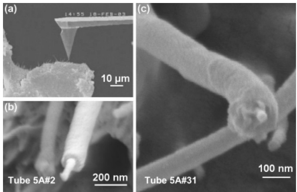
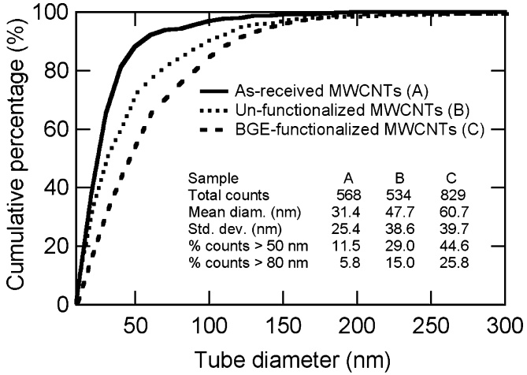
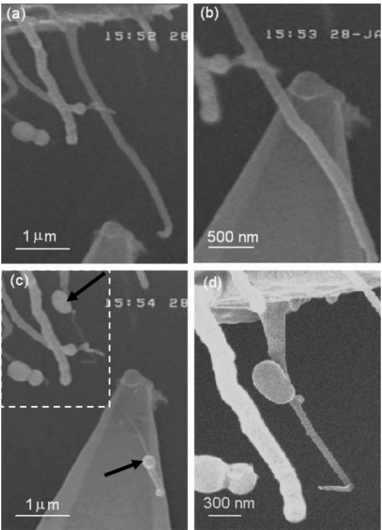
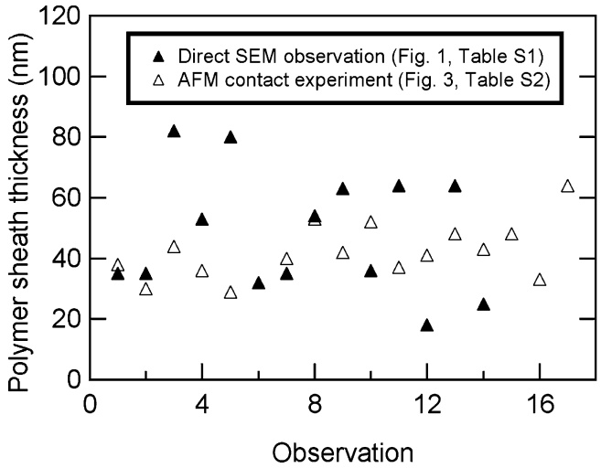
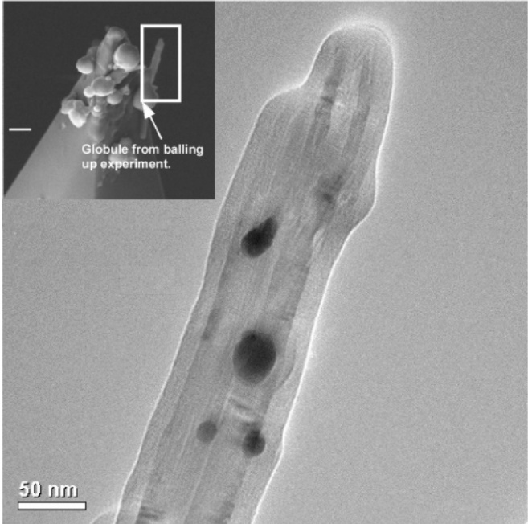
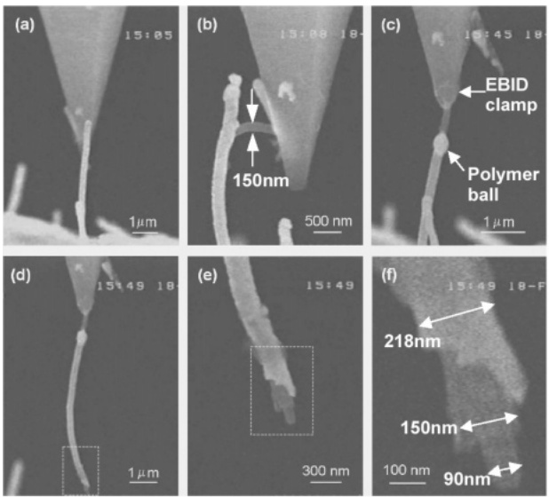

# Direct Observation of Polymer Sheathing in Carbon Nanotube−Polycarbonate Composites

**NANO LETTERS**

**2003 Vol. 3, No. 11 1593**-**1597**

**W. Ding,**<strong>†</strong> **A. Eitan,‡ F. T. Fisher,† X. Chen,† D. A. Dikin,† R. Andrews,§ L. C. Brinson,† L. S. Schadler,‡ and R. S. Ruoff\*,†**

Department of Mechanical Engineering, Northwestern UniVersity, EVanston, Illinois 60208, Materials Science and Engineering, Rensselaer Polytechnic Institute, Troy, New York 12180, and Center for Applied Energy Research, UniVersity of Kentucky, Lexington, Kentucky 40511

Received August 4, 2003; Revised Manuscript Received September 12, 2003

## ABSTRACT

**A series of observations of polymer sheathing in multiwalled carbon nanotube (MWCNT)**−**polycarbonate composites are presented. This sheathing was observed in images of the composite fracture surface and is consistent with diameter distributions of the as-received and embedded MWCNTs. A novel nanomanipulation experiment, where the sheathing balls up when contacted by an AFM tip, confirms this phenomenon. This sheathing layer is direct evidence of substantial MWCNT**−**polymer interaction and will influence the mechanical properties of MWCNT-polymer composites.**

Due to the outstanding physical properties of carbon nanotubes, intense activity is being devoted to the development of carbon nanotube-polymer composites.1 Specifically, carbon nanotube-reinforced polymer composites have demonstrated high strength and stiffness,2 which suggest their potential use as alternative materials for structural applications. Multifunctional nanotube-polymer composites are also under development, where in addition to improved mechanical properties, increases in electrical conductivity3 and improved thermal properties4 are obtained with small amounts of embedded nanotubes.

One of the significant differences between micron-sized carbon fiber-filled polymers and nanotube-filled polymers is the large interfacial area of the nanotubes. This interfacial area provides an opportunity for altering the mobility and properties of a significant volume of polymer near the interface (i.e., the interphase region). Both the interface and interphase regions will play key roles in optimizing load transfer between the nanotube and the polymer matrix. While for traditional composites a variety of experimental techniques have been developed in an effort to quantify the fibermatrix interface,5 for nanotube-polymer composites these tests are exceedingly difficult because of the small size of the nanotubes. In the process of developing nanoscale pullout tests of individual multiwalled carbon nanotubes from a polymer matrix, we have found several forms of evidence that suggest multiple polymer layers sheath the embedded nanotubes. This polymer sheathing is consistent with models of a nonbulk polymer interphase region that has been identified in nanotube-polymer composite systems.6

The results presented in this paper are consistent with the findings of other researchers regarding the existence of intimate MWCNT-polymer interaction in nanotubepolymer composites. For example, strong polymer adherence has been reported in previous TEM studies of nanotubepolymer nanocomposite samples.7 Potschke et al. studied the rheological behavior of nanotube-polycarbonate composites, and their SEM observation of the fracture surface showed that the apparent nanotube diameters at the fracture surface were larger than the diameters of the original carbon nanotube material, indicating significant polymer wetting on the nanotube surface.8 However, to date a detailed study of this polymer sheathing phenomenon in carbon nanotubepolymer nanocomposites has not been undertaken. We present here a series of direct observations on MWCNT-polycarbonate samples that unambiguously support this polymer sheathing phenomenon, including (i) SEM images of the fracture surface showing an annular coating on the nanotube; (ii) a significant increase in the “apparent” diameter of nanotubes protruding from the fracture surface in comparison to the diameters of the as-received MWCNTs; (iii) a “balling up” effect that has been observed in an SEM when this annular coating is touched by an AFM tip; and (iv) the presence of multiple layers of polymer sheathing adhered to a MWCNT pulled from the composite fracture surface. An understanding of this polymer sheathing phenomenon and its impact on the physical properties of the interphase region will be critical as methods to quantitatively characterize the nanotube-polymer interface in these systems are developed.

<small>\* Corresponding author. E-mail: r-ruoff@northwestern.edu. Phone: 847-467-6596. Fax: 847-491-3915.</small>

<small>† Northwestern University.</small>

<small>‡ Rensselaer Polytechnic Institute</small>

<small>§ University of Kentucky.</small>

The MWCNTs used in this study were produced at the University of Kentucky by thermal chemical vapor deposition of a xylene-ferrocene feedstock at $7 0 0 ~ ^ { \circ } \mathbf { C }$ in a quartz tube furnace; a detailed discussion of this process is given elsewhere.9 For the preparation of MWCNT-reinforced polycarbonate composites at RPI, Bisphenol A polycarbonate (Lexan 121, General Electric) was chosen as the polymer matrix due to its relatively high melt flow index. MWCNTs were dispersed in tetrahydrofuran (THF) by ultrasonication in an ice water bath for 3 h. Polycarbonate pellets were dried at $1 2 5 ~ ^ { \circ } \mathrm { C }$ for 2 h, followed by separate dissolution in THF. The MWCNT dispersion and the polycarbonate solution were then mixed together and ultrasonicated for an additional hour. This mixture was then dropped into stirred methanol causing precipitation of the composite material. The composite material was dried at $7 0 ~ ^ { \circ } \mathrm { C }$ under vacuum for 3 h and then melted at $2 7 0 ~ ^ { \circ } \mathbf { C }$ in order to eliminate any residual crystallinity in the polymer. Dog-bone-shaped samples were prepared using a DACA injection molding machine with a barrel temperature of $2 9 0 \; ^ { \circ } \mathrm { C } ,$ a mold temperature of $1 4 0 ^ { \circ } \mathrm { C } ,$ and an injection pressure of 862 kPa. The dimensions of the samples were $2 5 . 0 \times 4 . 0 \times 1 . 5 \; \mathrm { m m } ^ { 3 }$ (sample length, width, and thickness, respectively). Samples with 2 wt % MWCNTs (sample 2A) and 5 wt % MWCNTs (sample 5A) were fabricated. THF and methanol (Aldrich) were used as received.

The fracture surfaces studied here resulted from macroscale tensile tests of the above samples at room temperature. (The results of these tensile tests will be described elsewhere.10) The fracture surfaces were coated with a thin layer (∼5 nm) of gold (Sputter Coater 208 HR, Cressington Scientific, Cranberry Twp, PA) to allow subsequent scanning electron microscope (SEM) study at Northwestern, using both Hitachi S4500 and LEO 1525 FEG SEMs. (The gold coating thickness is subtracted in the analysis of the polymer sheath thickness below, when applicable.) Nanomanipulation experiments were performed in the Hitachi SEM using a homebuilt nanomanipulator that can probe, select, and handle nanometer-scale structures, and has been used for a variety of nanoscale mechanical and electrical experiments.11 Silicon cantilevers (NSC12, MikroMasch USA), with nominal lengths of 300 and 350 µm and nominal force constants of 0.30 and 0.35 N/m, respectively, were mounted on the nanomanipulator and served as the manipulation tools. The entire experiment is video-recorded via SEM video output, and later digitized for subsequent data analysis. A LEO 1525 SEM was used to obtain additional sample images at higher resolution.

SEM images of the nanomanipulation experiment and the fracture surface of the carbon nanotube-polycarbonate composite are shown in Figure 1. Such images revealed that the structures protruding from the fracture surface seemed to have larger diameters than the as-grown MWCNTs used in the sample preparation, and in many cases resembled a thin tube partially covered with a thick coating. These observations suggest that the structures protruding from the fracture surface were not pure carbon nanotubes but rather MWCNTs covered with an adhered layer of polycarbonate. This hypothesis is consistent with the diameter distributions measured via SEM image analysis for the as-received MWCNTs and those “apparent” MWCNTs projecting from the composite fracture surface shown in Figure 2.12 In addition, Figure 2 shows the diameter distribution on the composite fracture surface for MWCNTs treated with butyl glycidyl ether (BGE, Miller Stephenson, Danbury, CT) short chain linkers prior to composite fabrication to enhance nanotube-polymer interaction.13 This chemical functionalization led to an additional increase in the average apparent diameters of nanostructures protruding from the fracture surface in comparison to the unfunctionalized MWCNTs. While these initial results for the functionalized MWCNTs are critical in that they suggest that the interphase region discussed in this paper can be manipulated through chemistry (and hence tuned to optimize the mechanical properties of a particular MWCNT-polymer system), we stress that the results presented throughout the remainder of this paper are for unfunctionalized MWCNTs.

Figure 1. (a) Far-field SEM image of the nanomanipulation experiment inside the Hitachi S4500 SEM. (b,c) High-resolution images (LEO 1525) of nanotube structures coated with a polymer sheath protruding from the MWCNT-polycarbonate fracture surface. The inner and outer diameters of the polymer sheaths are 46 and 151 nm in Figure 1b and 41 and 166 nm in Figure 1c, respectively.

Figure 2. Cumulative percentage of SEM diameter measurements versus tube diameter for as-received MWCNTs (A), unfunctionalized MWCNT-PC composite fracture surface (B), and BGE-functionalized MWCNT-PC composite fracture surface (C).

Figure 3. SEM time-lapsed images of balling up of the polymer sheath after contact with the AFM tip. (a) The AFM tip approaches a coated MWCNT. (b) The AFM tip is brought into contact with the coated MWCNT. (c) After contact, the MWCNT fractures and the polymer coating balls up on each side of the contact point as highlighted by the arrows. (d) Higher magnification image of the upper polymer globule identified in (c), which formed after contact with the AFM tip (this last image acquired in a LEO 1525 SEM).

For the unfunctionalized MWCNT-polycarbonate samples, in some cases the structures protruding from the composite fracture surface were only partially covered along their lengths by this polymer sheathing layer (as seen in the two examples shown in Figure 1). In these cases it was possible to measure both the inner and outer diameters of the nanotube coating directly from the SEM images, from which the approximate thickness of the polymer sheath can be determined. For the 14 cases measured, the average and standard deviation of the polymer sheath thicknesses were 48 and 20 nm, respectively (see Table S1 in the Supporting Information). The layer thickness of the polymer coating as observed in this manner is significant and comparable in size to the diameter of the as-received MWCNTs.14 Further discussion of these measured layer thicknesses will be presented below.

In the process of developing an individual nanotube pullout test to quantitatively characterize the nanotube-polymer interface, we discovered an unusual effect that further supports our hypothesis of polymer sheathing. When the AFM tip of the nanomanipulator was brought into contact with an “apparent” MWCNT protruding from the composite fracture surface, the outer layer suddenly contracted and balled up, exposing a much thinner section as shown in Figure 3.15 While the MWCNT shown in Figure 3 has fractured, either due to contact with the AFM tip or the subsequent balling of the polymer coating, in many other cases the MWCNT did not fracture during this experiment. This “balling up” phenomenon was further explored by conducting similar tests on an additional 26 tubes protruding from the same MWCNT-PC sample (sample 2A), with 22 tubes demonstrating a similar “balling up” response. Real time videos of this balling up observation for two coated MWCNTs are provided in the Supporting Information.

Figure 4. Comparison of polymer sheath thicknesses measured via direct SEM observation of the fracture surface and the AFM tip contact balling up experiment for two different sets of MWCNTs.

Typically this “balling up” occurred upon initial contact of the AFM tip to the outer surface of the protruding tube, while some cases required repeated touching or bending by the AFM tip. Generally, one or two polymer balls were formed after the apparent outer polymer coating balled up. From video recording of these in situ SEM experiments, the apparent outer diameters of the coated MWCNTs before and after this balling up phenomenon were measured. The volume of the newly formed globules (treating them as spheres) matched the apparent decrease in volume of the coated MWCNT (within experimental error). Note that the diameters of these globules are much too large to be due solely to the thin layer of gold that was sputtered on the samples for SEM imaging.

Based on pre- and post-imaging of these MWCNT-AFM contact experiments, the thicknesses of the polymer coating that “balls up” were tabulated and compared with the coating thicknesses directly observed in the SEM in Figure 4. (The raw data used to calculate these polymer sheath thicknesses for both the direct SEM observation and the AFM contact balling up experiment are provided in the Supporting

Figure 5. TEM image of a sheathed MWCNT after the outer layer of polymer has been removed during a “balling up” experiment. Even after the balling up experiment a thin layer of polymer remains adhered to the nanotube. (Inset) SEM image of the sheathed MWCNT still attached to the AFM tip after the balling up experiment, highlighting the location of the TEM image. Scale bar in the inset ) 300 nm.

Information.) We note that while the average coating thicknesses found using these two techniques are approximately equal (48 nm from direct observation of the fracture surface versus 42 nm from the “balling up” experiment), the scatter in the measured sheath thicknesses is much smaller for the latter case. Efforts to elucidate the differences between the sheath thicknesses measured in these two ways are ongoing.

A transmission electron microscopy (TEM) image of a sheathed nanotube after the balling up experiment, shown in Figure 5, shows that even after the outer polymer layer has balled up, there still appears to be a thin polymer layer coating the MWCNT. (This coating is not observed in TEM observations of the as-received MWCNTs.9) The dark locations in the image are small gold particles that remain from the initial gold sputtering of the sample for SEM imaging, as confirmed by energy dispersive X-ray (EDX) analysis (results not shown). This suggests the presence of multiple polymer layers coating the MWCNT; an outer, loosely adsorbed layer which balls up when contacted by the AFM tip, and an inner, more tightly bound polymer layer which remains coating the MWCNT after the outer layer is removed. This initial evidence of multiple sheathing layers was confirmed by the additional nanomanipulation experiments described below.

While the diameter distribution patterns and the observed balling up effect on contact with the AFM tip indicate the existence of a adsorbed polymer layer, initial results for MWCNT pullout tests from the fracture surface provided further evidence of polymer sheathing. For those cases where the balling up of the polymer sheath did not occur, the coated tubes were clamped to the AFM tips via the electron beam induced deposition (EBID) process and tensile loading experiments performed. As shown in Figure $^ { 6 , }$ at the end where the coated MWCNT was pulled from the fracture surface, high-resolution SEM images reveal what appears to be two distinct polymer layers coating the fractured MWCNT. This is consistent with our earlier results which indicate that there are (in some cases) at least two polycarbonate layers with different properties coating the MWCNT. This suggests that for MWCNT-polycarbonate composites there are two distinct interfaces that will influence the effective mechanical properties of the system: the MWCNT-inner polymer layer and inner polymer layer-outer polymer layer interfaces.

Figure 6. Evidence of multiple polymer sheathing observed during nanomanipulation contact experiments. (a) Initial contact with a protruding (coated) MWCNT by the AFM tip. (b) Inner structure partially detaches from the outer sheath during bending. (c) The outer sheath balls up and the inner structure is clamped to the AFM tip using the EBID method. (d) During tensile loading the structure breaks close to the composite fracture surface. (e) The broken end of the coated MWCNT shows evidence of a double polymer sheath. (f) Higher magnification image of the broken end of the tube showing measured diameters. All images are from video of the nanomanipulation experiment within the Hitachi SEM.

Briefly, we believe that these distinct interfaces result from differences between primary adsorbed polymer chains (to the surface of the MWCNT) and secondary adsorbed polymer chains (adsorbed/entangled with the primary adsorbed later). As the secondary adsorbed layer is in a shallow equilibrium energy state, when energy is added to the system via the disturbance caused by contact with the AFM tip this secondary adsorbed layer balls up to achieve a lower energy state. However, as shown in Figure 5, the primary adsorbed layer, which remains in contact with the MWCNT after the balling-up experiment, is more strongly adhered to the MWCNT surface. This interpretation is also consistent with the results of Figure 6 showing multiple sheathing layers coating the MWCNT. This polymer sheathing phenomenon is consistent with theoretical and experimental studies of the formation of adsorbed polymer layers on solid surfaces, which is recognized as thermodynamic in nature.16 Ongoing work will attempt to quantify the strength of the MWCNT-primary adsorbed layer and the primary-secondary adsorbed layer interfaces.

In conclusion, we have made a series of direct nanoscale observations of polymer sheathing in MWCNT-polycarbonate composites. This annular polymer coating was initially observed in SEM images of the composite fracture surface. Further, diameter distribution patterns show that unfunctionalized and BGE-functionalized MWCNTs embedded in polycarbonate have larger apparent diameters at the fracture surface than the as-received MWCNTs, which we attribute to a nonbulk polymer layer coating the MWCNT. Additional experiments where the polymer sheath was observed to ball up when contacted by an AFM tip further support the hypothesis of polymer sheathing. Finally, nanoscale tensile loading pullout experiments of coated MWCNTs revealed multiple layers of this polymer sheathing on a MWCNT pulled from the composite fracture surface. Further studies are underway to better understand the formation mechanisms and mechanical properties of these polymer layers and their impact on the load transfer and effective mechanical properties of these materials.

**Acknowledgment.** The Northwestern researchers gratefully acknowledge the grant support from the NASA University Research, Engineering and Technology Institute on Bio Inspired Materials (BIMat) under award No. NCC 1-02037. R.S.R. and L.C.B. appreciate additional support from the NASA Langley Research Center Computational Materials: Nanotechnology Modeling and Simulation Program, and R.S.R. and W.D. from the Office of Naval Research Mechanics of Nanostructures (Award No. N000140210870). A.E. and L.S.S. acknowledge the support of the U.S. Army SBCCOM, Natick Soldier Center. R.A. thanks the MRSEC Advanced Carbon Materials Center (DMR-98.9686) for support. SEM and TEM were performed using the NUANCE facilities at Northwestern University.

**Supporting Information Available:** Real-time observation of the AFM contact experiment and the balling up of the polymer sheath are available in \*.mpg movie format. The raw data used to determine the polymer sheathing thickness determined via both direct SEM observation and the AFM contact balling up experimental is available as a Microsoft Word document. This material is available free of charge via the Internet at http://pubs.acs.org.

## References

(1) Lau, K. T.; Hui, D. Composites Part B 2002, 33, 263. Thostenson, E. T.; Ren, Z. F.; Chou, T. W. Compos. Sci. Technol. 2001, 61, 1899.

(2) Qian, D.; Dickey, E. C.; Andrews, R.; Rantell, T. Appl. Phys. Lett. 2000, 76, 2868. Qian, D.; Dickey, E. C. J. Microscopy 2001, 204, 39.

(3) Sandler, J.; Shaffer, M. S. P.; Prasse, T.; Bauhofer, W.; Schulte, K.; Windle, A. H. Polymer 1999, 40, 5967.

(4) Biercuk, M. J.; Llaguno, M. C.; Radosavljevic, M.; Hyun, J. K.; Johnson, A. T.; Fischer, J. E. Appl. Phys. Lett. 2002, 80, 2767. Wei, C.; Srivastava, D.; Cho, K. Nano Lett. 2002, 2, 647. Hone, J.; Llaguno, M. C.; Biercuk, M. J.; Johnson, A. T.; Batlogg, B.; Benes, Z.; Fischer, J. E. Appl. Phys. A-Mater. Sci. Process. 2002, 74, 339.

(5) Kim, B. W.; Nairn, J. A. J. Compos. Mater. 2002, 36, 1825. Zhandarov, S.; Pisanova, E.; Mader, E.; Nairn, J. A. J. Adhes. Sci. Technol. 2001, 15, 205. Pisanova, E.; Zhandarov, S.; Mader, E.; Ahmad, I. Young, R., Composites, Part A 2001, 32, 435.

(6) Shaffer, M. S. P.; Windle, A. H. AdV. Mater. 1999, 11, 937. Fisher, F. T., Ph. D. Thesis, Northwestern University, 2002. Fisher, F. T.; Eitan, A.; Andrews, R.; Schadler, L. S.; Brinson, L. C. AdV. Composites Lett. 2003, submitted. Barber, A. H.; Cohen, S. R.; Wagner, H. D. Appl. Phys. Lett. 2003, 82, 4140.

(7) Lourie, O.; Wagner, H. D. Appl. Phys. Lett. 1998, 73, 3527. Bower, C.; Rosen, R.; Lin, J.; Han, J.; Zhou, O. Appl. Phys. Lett. 1999, 74, 3317. Cadek, M.; Coleman, J. N.; Barron, V.; Hedicke, K.; Blau, W. J. Appl. Phys. Lett. 2002, 81, 5123.

(8) Potschke, P.; Fornes, T. D.; Paul, D. R. Polymer 2002, 43, 3247.

(9) Andrews, R.; Jacques, D.; Rao, A. M.; Derbyshire, F.; Qian, D.; Fan, X.; Dickey, E. C.; Chen, J. Chem. Phys. Lett. 1999, 303, 467.

(10) Eitan, A.; Ding, W.; Fisher, F. T.; Chen, X.; Andrews, R.; Brinson, L. C.; Ruoff, R. S.; Schadler, L. S., in preparation.

(11) Yu, M.-F.; Dyer, M. J.; Skidmore, G. D.; Rohrs, H. W.; Lu, X.; Ausman, K. D.; von Ehr, J. R.; Ruoff, R. S. Nanotechnology 1999, 10, 244. Yu, M.-F.; Lourie, O.; Dyer, M.; Moloni, K.; Kelly, T. F.; Ruoff, R. S. Science 2000, 287, 637. Yu, M.-F.; Yakobson, B. I.; Ruoff, R. S. J. Phys. Chem. B 2000, 104, 8764. Yu, M.-F.; Files, B. S.; Arepalli, S.; Ruoff, R. S. Phys. ReV. Lett. 2000, 84, 5552. Yu, M.-F.; Dyer, M. J.; Chen, J.; Qian, D.; Liu, W. K.; Ruoff, R. S. Phys. ReV. B 2001, 64, 241403. Yu, M.-F.; Wagner, G. J.; Ruoff, R. S.; Dyer, M. J. Phys. ReV. B 2002, 66, 073406. Dikin, D. A.; Chen, X.; Ding, W.; Wagner, G.; Ruoff, R. S. J. Appl. Phys. 2003, 93, 226.

(12) The differences in average diameters for the as-received, unfunctionalized, and BGE functionalized MWCNTs presented in Figure 2 are much smaller than the polymer sheath thicknesses determined from other results discussed in this paper. The smaller and more flexible/fragile MWCNTs may be preferentially damaged or covered by the gold sputtering process used to image the samples in the SEM. In addition, the smaller diameter MWCNTs have shorter exposed ends protruding from the fracture surface, making it difficult to access them for the nanomanipulation experiments discussed later in this paper.

(13) Eitan, A.; Jiang, K.; Dukes, D.; Andrews, R.; Schadler, L. S. Chem. Mater. 2003, 15, 3198.

(14) As discussed later in this paper, additional results suggest that there may be multiple layers of polymer sheathing surrounding the nanotube. In this case, it may be possible that what we refer to as the inner diameter is in fact a MWCNT covered with a thin polymer layer.

(15) A close review of initial SEM images of the fracture surface indicates that a small number of similar polymer globules were present prior to the nanomanipulation experiments. In addition, subsequent SEM imaging three months after the nanomanipulation experiments showed the presence of a greater number of polymer globules, which indicates that the balling up phenomenon is not solely dependent on contact with the AFM tip. This observation is also consistent with our hypothesis regarding the thermodynamic nature of this phenomenon, which is briefly presented later in this paper.

(16) van der Gucht, J.; Besseling, N. A. M.; Fleer, G. J. Macromolecules 2002, 35, 6732. Haouam, A.; Pefferkorn, E. Colloids Surf. 1989, 34, 371. Starr, F. W.; Schroder, T. B.; Glotzer, S. C. Macromolecules 2002, 35, 4481.

NL0345973