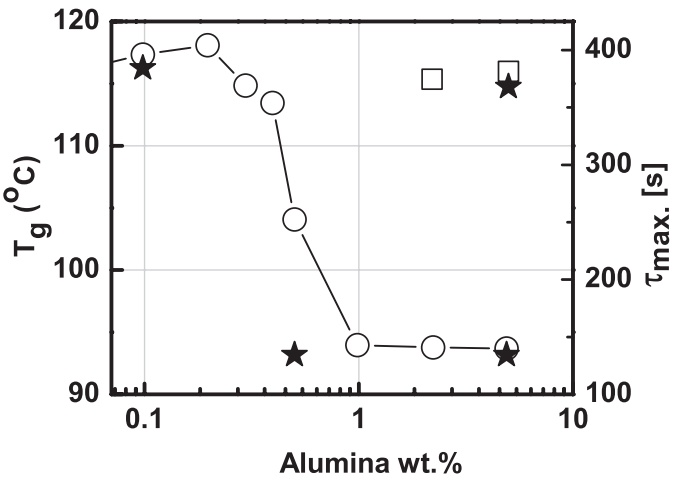
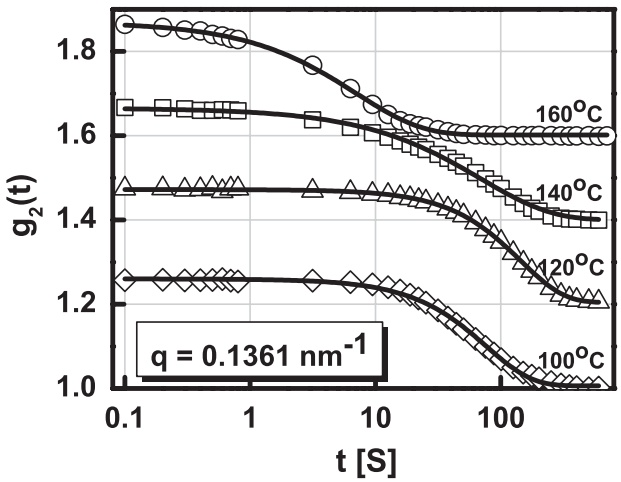
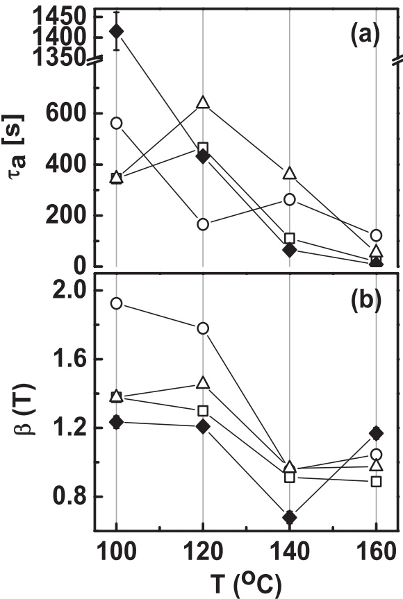
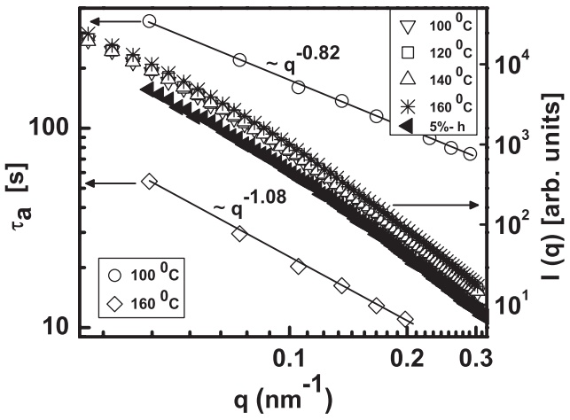
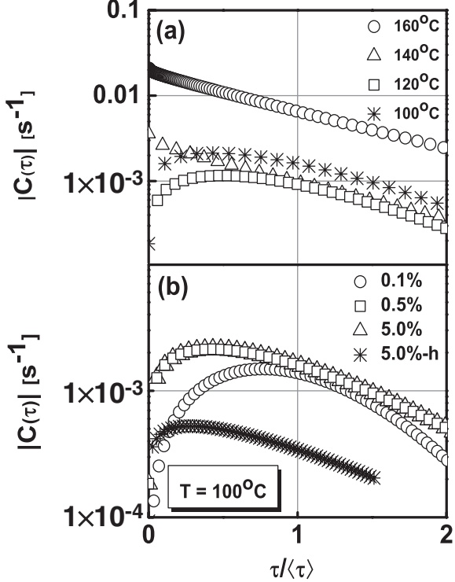

# Dynamics and Internal Stress at the Nanoscale Related to Unique Thermomechanical Behavior in Polymer Nanocomposites

R. Aravinda Narayanan,1,\* P. Thiyagarajan,1 S. Lewis,2 A. Bansal,2,† L. S. Schadler,2 and L. B. Lurio3

1Intense Pulsed Neutron Source Division, Argonne National Laboratory, Argonne, Illinois 60439, USA 2Department of Materials Science and Engineering, Rensselaer Polytechnic Institute, Troy, New York 12180, USA 3Department of Physics, Northern Illinois University, DeKalb, Illinois 60115, USA (Received 5 May 2006; published 16 August 2006)

A small amount of alumina nanoparticles in polymethylmethacrylate causes a sharp depression of the glass transition temperature $( T _ { g } )$ accompanied by a toughening of the composite. We investigated this phenomenon using multispeckle x-ray photon correlation spectroscopy. Measurements reveal a dynamic structure factor that has the form $\widetilde { \exp [ - ( t / \tau _ { a } ) ^ { \beta } ] } ,$ with $\beta$ greater than 1. We show for the first time that -T tracks the internal stress at the polymer-particle interface. The internal stress, which we propose arises due to the entropic penalty that the polymer faces in the presence of the nanoparticles, engenders temporally heterogeneous dynamics. In the jammed glassy state, we show that the dominant fast relaxation mode $\text{— } \tau_{ max }$ —aided by a weak dewetting interface relieves the stress and follows the variations in $T _ { g }$

DOI: [10.1103/PhysRevLett.97.075505](http://dx.doi.org/10.1103/PhysRevLett.97.075505)

Polymer nanocomposites have generated tremendous interest due to their novel thermomechanical properties [1]. Generally, the larger ratio of nanoparticle interfacial area to volume, which translates to a large volume of the polymeric material affected by the polymer-particle interaction, seems to play a strong role in determining the properties. Alumina-polymethylmethacrylate (PMMA) nanocomposites considered in this investigation showed dramatic changes in properties [2,3] which serve as a model system to explain the thermomechanical behavior of polymer nanocomposites. Upon addition of just 0.2 wt.% of 26 nm alumina particles to PMMA the $T _ { g }$ begins to decrease and rapidly reduces by $2 0   ^ { \circ } \mathbf { C }$ for 1 wt.% alumina, and stabilizes at this value (Fig. 1). This $T _ { g }$ reduction was accompanied by a brittle-to-ductile transition at room temperature in the same range of alumina concentrations. While the latter phenomenon was understood to be due to a dewetting alumina-PMMA interface which leads to shear yielding when subjected to an external load, it is not clear why $T _ { g }$ experiences such a huge drop: interparticle spacing in alumina-PMMA (>100 nm) which is larger than the PMMA chain dimension (10 nm) rules out confinement effects that explain changes in $T _ { g }$ in similar systems [4,5], and furthermore, such low concentrations of the nanoparticles do not significantly alter the free volume. The ultra-small-angle x-ray scattering (USAXS) measurements of alumina-PMMA nanocomposites do show an increase in particle agglomeration with increase in alumina concentration; however, these changes alone cannot explain the reduction in $T _ { g } .$

Structurally, dispersed nanoparticles in a polymer convert it into a cellular solid in which stresses are localized around the nanoparticles and these cause changes in local mobility, which is related to $T _ { g }$ . Recent computer simula-

PACS numbers: 61.10.Eq, 62.25.+g, 64.70.Pf, 83.85.St

tions have attempted to quantify the mechanical heterogeneity caused by internal stresses, which is the key to understanding the thermomechanical properties of polymer nanocomposites [6]. Experimentally this can be accomplished by probing together the slow relaxation dynamics of the polymer and the particle near $T _ { g }$ over a few interparticle distances, where the internal stress can be expected to be augmented. We therefore employed x-ray photon correlation spectroscopy (XPCS) [7], whose length (10 nm–150 nm) and time $( 1 0 ^ { - 3 }   \mathrm { s e c - } 1 0 ^ { 3 }$ sec) scales are appropriate. In XPCS, the intensity autocorrelation $[ g _ { 2 } ( q , t ) ]$ is measured as a function of the delay time (t) and the wave vector (q)

FIG. 1. Plot of $T _ { g }$ [3] of alumina-PMMA nanocomposites $( \bigcirc )$ against alumina weight fraction. On heat treatment the $T _ { g }$ of neat PMMA is nearly recovered (). Relaxation time $[ \tau _ { \mathrm { m a x } } ]$ (?) at the nanoscale closely follows the $T _ { g } .$

$$
g _ {2} (q, t) = \frac {\langle I (t _ {1} + t) I (t _ {1}) \rangle_ {T}}{\langle I (t _ {1}) \rangle_ {T} ^ {2}}.\tag{1}
$$

Here $I ( t _ { 1 } )$ is the observed intensity at the detector at time $t _ { 1 }$ , and the angular brackets denote the time averages over the total experimental time T. In this Letter, by drawing an analogy between polymer nanocomposites and jammed soft systems, we show that the internal stress at the particle-polymer interface can be measured using XPCS, and the dominant stress relaxation time follows the thermodynamics of the system.

Alumina particles in a PMMA matrix serve as an excellent system for XPCS to illustrate the dynamics at the particle-polymer interface, because of its large x-ray scattering contrast. Polymer nanocomposites for this study were prepared by the free-radical polymerization of the monomer with spherical particles of  alumina— 26 nm average diameter (Nanophase Technologies Corporation). We considered three concentrations of alumina — 0.1, 0.5, 5 wt.%, which spans the ‘‘transition’’ region of $T _ { g }$ in Fig. 1. The molecular weight of the PMMA matrix was about 150 $\mathrm { k g   m o l ^ { - 1 } }$ [3]. Samples were compression molded into flat specimens for the experiments.

In the XPCS measurements performed at IMMCAT (8- ID) of the Advanced Photon Source, a partially coherent xray beam of energy 7.5 keV and size 40 $\mu \mathrm { m } \times 4 0$ m illuminated the sample, and the scattered intensity was recorded by a fast CCD area detector (Princeton Instruments model EEV-37) as a function of time and temperature. The correlation was performed over about 500 frames with a total exposure time restricted to about 2 minutes to minimize radiation damage of the sample. The total measurement time including the shutter delays and data acquisition time was 10 minutes. In theoretical formulations, the dynamics is described by the dynamic structure factor $[ f ( q , t ) ]$ which is related [8] to $g _ { 2 } ( q , t )$ as follows: $g _ { 2 } ( q , t ) = 1 + A | f ( q , t ) | ^ { 2 }$ . Here A is the Siegert factor representing the coherence of the x-ray beam. Figure 2 shows an example of $g _ { 2 } ( t )$ at different temperatures. The decay occurs in a single step spread over three decades in time, and it is well described by a stretched exponential function: $f ( q , t ) = \exp [ - ( t / \tau _ { a } ) ^ { \beta } ] : \tau _ { a }$ is the characteristic relaxation time related to the dynamics at the interface and $\beta$ is the stretched exponent characterizing the line shape. A stretched exponential function, in general, indicates the presence of multiple relaxation processes in disordered systems [9].

FIG. 2. Representative plot of $g _ { 2 } ( t )$ at different temperatures for 5 wt.% alumina in PMMA at a given $q .$ The solid lines are stretched exponential fits described in the text. The curves are arbitrarily shifted vertically for clarity. Typically $g _ { 2 } ( t )$ decays to a value 1 (uncorrelated intensity) from about 1.2.

It can be seen in Fig. 3(a) that $\tau _ { a }$ increases with decrease in temperature down to $1 2 0   ^ { \circ } \mathbf { C }$ as expected for neat polymers. However, below $1 2 0   ^ { \circ } \mathbf { C } ,   \tau _ { a }$ decreases for samples containing 0.5 and 5 wt.% alumina, but it registers an increase for the sample with 0.1 wt.% alumina. The dynamics seen here is distinctly different from that usually observed in supercooled liquids [10] in which the microscopic structural relaxation time varies by over 10 orders of magnitude as $T _ { g }$ is approached from the melt; $\beta ( T )$ which reflects the contraction of the potential energy configuration space tends to 1 at higher temperatures and decrease to values less than 1 as $T _ { g }$ is approached [9]. However, XPCS of alumina-PMMA show that $\tau _ { a }$ varies by about 3 orders of magnitude and $\beta$ assumes values between 1.2 and 1.9 as $T _ { g }$ is approached [Fig. 3(b)] differing from values found for supercooled liquids.

FIG. 3. For various alumina wt.% the plot shows the temperature dependence of (a) $\tau _ { a } ,$ and (b) - at $q = 0 . 0 5 ~ \mathrm { n m ^ { - 1 } }$ . 0.1% (); 0.5% (); 5% (4); 5%-h (filled diamond) sample heated to $2 2 0   ^ { \circ } \mathbf { C }$ and cooled. The lines connecting the points are a guide to the eye. The plot shows the data at the lowest $q$ that were measured, as it spans the correlations in the largest length scale.

Multispeckle dynamic light scattering experiments on a variety of jammed soft materials such as colloidal fractal gels have revealed slow dynamics that have been shown by Cipelletti et al. [11] to be well described by a stretched exponential function with an exponent $\beta = 1 . 5 .$ The slow dynamics was attributed to stress relaxation for which $\tau _ { a }$ varied as $q ^ { - 1 }$ instead of $q ^ { - 2 }$ that is expected for thermally activated diffusion of particles. In their model, $\beta$ is a qualitative measure of the internal stress. They argued [12] that poor solvent quality, for example, in colloidal gels can cause local shrinking of the continuous elastic medium leading to the development of local internal stress fields. We reckon that a similar scenario exists in alumina-PMMA nanocomposites. Stress fields may locally develop due to the poor wetting of the alumina-PMMA interface which is evident from transmission electron microscopy that revealed ‘‘holes‘‘ around nanoparticles in the glassy state [3]; and SAXS studies that showed the formation of voids under an external load [3]. More generally, at the interface, stress fields may develop to counter the reduction in the entropy of the polymer due to its interactions with the particle surface [13] as evidenced in experiment [14] and computer simulation [15]. Figure 4 showing that $\tau _ { a }$ is proportional to $q ^ { - 1 }$ in alumina-PMMA nanocomposite supports the explanation for the observed dynamics.

FIG. 4. Plot shows for 5 wt% alumina in PMMA, the $q ^ { - 1 }$ dependence of $\tau _ { a }$ valid at both high and low temperatures; and a nearly identical slope for $I ( q )$ vs $q ,$ obtained by time averaging the correlations, at all temperatures and for the 5%-h sample at $1 0 0   ^ { \circ } \mathbf { C } .$ , indicates that there is no restructuring of static inhomogeneities with temperature or heat treatment, that could explain the observed changes in the dynamics.

The argument that $\beta$ is a measure of the internal stress helps in understanding its temperature dependence [Fig. 3(b)]. At temperatures much higher than $T _ { g } , \; \beta$ is close to 1, the least stressed state for all the samples, which increases to values greater than 1 as $T _ { g }$ is approached: the less rapid increase of $\beta$ as it approaches $T _ { g }$ suggests that the stress in the jammed glassy state could be locked in. However, the final value of $\beta$ near $T _ { g }$ would depend on both the weak alumina-PMMA interfacial area which increases at higher alumina concentrations and on the consequent increase in the interaction of stress fields. The reduction in the configurational entropy in the polymer mentioned earlier results in the depletion of polymer layers adjacent to the particle surface. This creates nonuniform forces at the weak interface, which at higher alumina concentrations, lead to a faster relaxation of the stress. For instance, the value of $\beta$ drops from 1.9 at 0.1 wt.% to 1.4 for 0.5 and 5 wt.% alumina. This decrease in stress contributes to the drop in $T _ { g }$ and it is likely the reason for the reduction in the yield stress of the nanocomposite [2].

It will be useful to interpret the meaning of the stretched exponential decay in terms of the distribution of relaxation times [jCj] obtained from ft [Fig. 5] [16]: jCjd provides the number of mobile scatterers with a relaxation time between  and $\tau +$ d at a given q. As the temperature decreases [Fig. 5(a)] an overall decrease of the amplitude of jCj occurs, reflective of the decrease in the number of mobile scatterers. Interestingly, at $1 0 0   ^ { \circ } \mathrm { C } , | C ( \tau ) |$ is greater than that at $1 2 0   ^ { \circ } \mathbf { C }$ which is likely due to local shear yielding of the polymer caused by the greater internal stress at the interface. At $1 6 0   ^ { \circ } \mathbf { C } ,$ jCj follows a power law; and as the temperature decreases towards $T _ { g } ,$ , a peak develops in it at $\tau < \langle \tau \rangle$ —the average relaxation time of the distribution, reminiscent of the distribution of interparticle normal forces near the glass and jamming transitions [17]. The peak indicates the dominance of faster relaxation modes [18]; and usually, for this to occur near $T _ { g }$ cooperatively rearranging fast and slow domains [19] are required as large scale changes in configuration are otherwise impossible due to the lack of thermal energy. In the present case, this is facilitated by the weak alumina-PMMA interface. When the stress in the jammed region locally increases above a threshold, it loosens the structure, and the polymer and nanoparticles motion ensues. This new mobile region could now become the center for faster relaxation for other jammed structure(s) adjacent to it leading to the formation of a string of mobile regions [20] providing an easy path for energy dissipation. Indeed, for 0.5 and 5 wt.% alumina in PMMA, the peak shifts to $\tau / \langle \tau \rangle \ll 1   [ \mathrm { F i g . ~ } 5 \mathrm { ( b ) ] }$ . Supporting the above explanation, $\tau _ { \mathrm { m a x } } = \tau _ { a } \exp [ \ln ( 1 - \beta ^ { - 1 } ) / \beta ]$ corresponding to the peak in jCj remarkably follows the bulk $T _ { g } ~ ( \mathrm { F i g . ~ 1 } )$

FIG. 5. jCj is plotted against $\tau / \langle \tau \rangle$ (a) for $5$ wt.% alumina in PMMA at various temperatures, and (b) for various alumina concentrations as well for the heat treated sample at $1 0 0   ^ { \circ } \mathbf { C } ,$ in the glass transition region.

To demonstrate that XPCS differentiates the effects due to polymer mobility and the polymer-particle interface we studied a PMMA sample containing 5 wt.% alumina (5%- h) heated to $2 2 0   ^ { \circ } \mathbf { C } ,$ and slowly cooled which caused the $T _ { g }$ to increase to a value close to the neat PMMA (Fig. 1). This heat treatment, we believe, considerably removed the mechanical heterogeneities in the polymer matrix, as reflected by the smallest $\beta$ [Fig. 3(b)] and caused a large increase in $\tau _ { a }$ at $1 0 0   ^ { \circ } \mathbf { C }$ [Fig. 3(a)]. Although the peak in jCj for this sample [Fig. 5(b)] still occurs at $\tau / \langle \bar { \tau } \rangle \ll 1$ due to the interface, the amplitude of jCj is significantly reduced indicating a considerable decrease in the mobile scatterers. Remarkably again, $\tau _ { \mathrm { m a x } }$ for this sample follows the $T _ { g }$ and proportionally increases to a value close to that for the 0.1 wt.% sample (Fig. 1).

XPCS measurements presented here represent a method to track the internal stress at the polymer-nanoparticle interface, which leads us to suggest an alternate mechanism to explain the dramatic changes observed in the thermomechanical properties of alumina-PMMA nanocomposites. Such internal stress measurements can differentiate between thermodynamic routes, as shown in the case of the heat treated sample, and will be helpful as new strategies are being developed to disperse the nanoparticles in polymer [21]. Furthermore, it can shed light on the role of the interface in a number of cases such as promotion of ductility due to particle motion in polymer nanocomposites under high stress fields [22].

We gratefully acknowledge the suggestion of Professor S. Kumar (RPI) regarding the heat treated sample. We thank Drs. A. Sandy and S. Narayanan (APS) for their support during the XPCS measurements. This work benefitted from the use of IPNS and experimental facilities at the APS. Both are supported by the U.S. DOE (BES) under Contract No. W-31-109-ENG-38 to the University of Chicago. This work was supported by the ONR under Grant number N00014-99-1-0187. R. A. N acknowledges the support of the US DOE (BER) under Contract No. DE-AC05-00OR22725 with ORNL managed and operated by UT-Batelle, LLC, CSMB (BER - KP1101010) and thanks Drs. D. A. Myles and V. S. Urban (ORNL) for useful discussions.

\*Corresponding author. Present address: Chemical Sciences Division, Oak Ridge National Laboratory, Oak Ridge, TN 37831. Email address: raghavanan@ornl.gov

†Present address: Polymer Applications Laboratory, GE Global Research, Niskayuna, New York 12309, USA.

[1] J. Jordan et al., Mater. Sci. Eng. A 393, 1 (2005).

[2] B. J. Ash et al., Polymer Composites 23, 1014 (2002).

[3] B. J. Ash, R. W. Siegel, and L. S. Schadler, Macromolecules 37, 1358 (2004).

[4] A. Bansal et al., Nat. Mater. 4, 693 (2005).

[5] E. P. Giannelis, Adv. Mater. 8, 29 (1996).

[6] G. J. Papakonstantopoulos et al., Phys. Rev. E 72, 031801 (2005).

[7] G. Grübel and F. Zontone, J. Alloys Compd. 362, 3 (2004).

[8] B. Chu, Laser Light Scattering (Academic, New York, 1991), p. 84.

[9] J. C. Phillips, Rep. Prog. Phys. 59, 1133 (1996).

[10] M. D. Ediger, Annu. Rev. Phys. Chem. 51, 99 (2000).

[11] L. Cipelletti et al., Faraday Discuss. 123, 237 (2003).

[12] L. Cipelletti, S. Manley, R. C. Ball, and D. A. Weitz, Phys. Rev. Lett. 84, 2275 (2000).

[13] S. Asakura and F. Oosawa, J. Chem. Phys. 22, 1255 (1954); C. Allain, D. Ausserre, and F. Rondelez, Phys. Rev. Lett. 49, 1694 (1982).

[14] A. I. Nakatani et al., Polymer 42, 3713 (2001).

[15] F. W. Starr, T. B. Schrøder, and S. C. Glotzer, Macromolecules 35, 4481 (2002).

[16] $\begin{array} { r } { f ( t ) = \int _ { 0 } ^ { \infty } C ( \tau ) \delta ( t - \tau ) d \tau = \int _ { 0 } ^ { \infty } C ( \tau ) d \tau , } \end{array}$ and the distribution function is obtained as $C ( \tau ) = d f ( t ) / d t | ^ { t = \tau } ,$ as described in C. Hashimoto, P. Panizza, J. Rouch, and H. Ushiki, J. Phys. Condens. Matter 17, 6319 (2005).

[17] C. S. O’Hern, S. A. Langer, A. J. Liu, and S. R. Nagel, Phys. Rev. Lett. 86, 111 (2001).

[18] R. E. Weeks et al., Science 287, 627 (2000).

[19] S. Merabia and D. Long, Eur. Phys. J. E 9, 195 (2002).

[20] J. P. Garrahan and D. Chandler, Proc. Natl. Acad. Sci. U.S.A. 100, 9710 (2003).

[21] M. E. Mackay et al., Science 311, 1740 (2006).

[22] D. Shah et al., Adv. Mater. 17, 525 (2005).