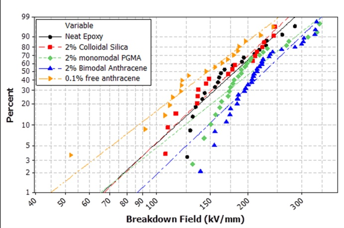
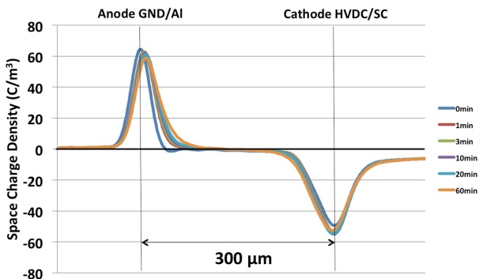
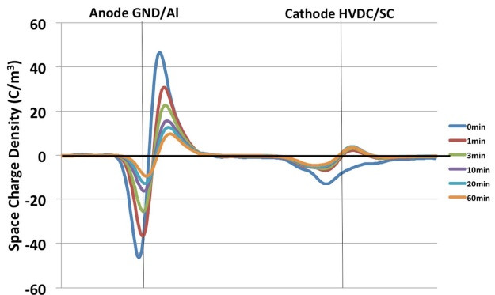
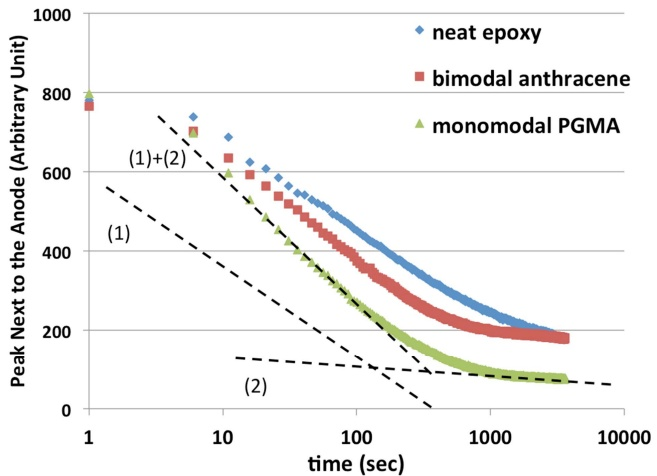
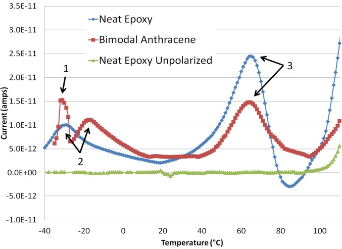

# Enhanced Charge Trapping in Bimodal Brush Functionalized Silica-Epoxy Nanocomposite Dielectrics

Timothy M. Krentz, Yanhui Huang, J. Keith Nelson,

and Linda S. Schadler

Dept. of Materials Science and Engineering Rensselaer Polytechnic Institute Troy, NY USA

Michael Bell and Brian Benicewicz Dept. of Chemistry and Biochemistry University of South Carolina Columbia, SC USA

Su Zhao and Henrik Hillborg

Power Technology ABB AB, Corporate Research Västerås, Sweden

**Abstract— This manuscript details the processing, and investigates the dielectric properties, of surface ligand engineered epoxy nanocomposites. They display significant improvements in dielectric breakdown strength (DBS). Thermally stimulated depolarization current (TSDC) measurements and pulsed electroacoustic analysis (PEA) results are used to investigate space charge evolution and trapping. These techniques reveal the potential underlying phenomena behind the DBS enhancement.**

## I. INTRODUCTION

It is commonly accepted that nanocomposite dielectrics can display improved dielectric breakdown strength (DBS)[1]. However, the mechanisms remain elusive [2], though the novel properties can be traced back to electronic activity of the fillermatrix interface [1]. Interestingly, varying the electronic character of the interface with electron-accepting and donating functional groups to create a highly polar surface has been shown to significantly affect the DBS of the composite [3].

The high specific surface area of nanofillers creates both an opportunity to effect change in bulk composite properties, but also presents a problem in avoiding agglomeration. Interfacial energy drives agglomeration. Energy penalties are largely due to mismatch in surface energies between filler and matrix and may be addressed with brushes of matrix compatible polymer chains covalently grafted to the filler surface [4]. A solution is to adopt two populations of surface ligands: one of dense short chains for enthalpic shielding and one of long, disperse chains to suppress autophobic dewetting. This has been shown to be effective with short molecules of chemistry dissimilar to the matrix [5], opening up an opportunity to introduce electrical functionality onto the surface of the particle without hindering the mixing properties of the composite. The applicability of this functional bimodal brush technique in improving DBS in epoxy/silica nanocomposites has been demonstrated [6]. In these studies, TSDC and PEA measurements are used to investigate the effect of ligand engineered filler particles on trapped charge and the evolution of space charge in the composite.

## II. EXPERIMENTAL METHODS

## A. Chemistry

## 1) Mercaptothiazoline activated anthracene

2-(Anthracen-9-yl)acetic acid was prepared as described previously [7]. 2-(Anthracen-9-yl)acetic acid (1.00 g, 4.2 mmol) was dissolved into 30ml dichloromethane along with 2- mercaptothiazoline (0.56 g, 4.7 mmol), and 4- dimethylaminopyridine (50 mg, 0.4 mmol). The solution was cooled to 0 ᵒC and flushed with $\mathrm{N}_{2}$ for 20 minutes. N,N’- dicyclohexylcarbodiimide (0.87 g, 4.2 mmol) was dissolved into a minimal amount of dichloromethane and added dropwise to the anthracene acetic acid solution. The solution was allowed to warm to room temperature and stir over night. The solids were then removed via vacuum filtration and solvent was removed under reduced pressure. The crude product was then purified via column chromatography $\left[ \mathrm{SiO}_{2}, 7:3 \right]$ dichloromethane:hexane) leaving the product as a yellow powder (0.62 g) with 43% final yield.

## 2) Anthracene Coated Particles

A suspension (10 g) of 30 wt % colloidal silica in methylethyl ketone was added to a 100 ml round bottom flask with 3-ethoxydimethylsilyl-1-propanamine (90 mg, 0.56 mmol). The solution was diluted to 50ml with tetrahydrofuran (THF) and stirred for 4 hours at 70 ᵒC under $\mathbf { N } _ { 2 }$ atmosphere. Next the particles were precipitated in a large amount of hexane and centrifuged at 3,000 RPM for $5$ minutes, the supernatant was discarded, and the particles were dispersed back into THF. This was repeated 3 times. Then the particles were dispersed into 30ml of THF for subsequent use. The resultant particle solution was cooled to $_ \textrm { \scriptsize 0 } \textrm { c c }$ and flushed with N2 before adding mercaptothiazoline activated anthracene (0.23 g, 0.68 mmol) in THF dropwise via syringe. The solution was then allowed to warm to room temperature and stir overnight. The anthracene coated particles were then precipitated into a large amount of 1:1 hexane:THF solution and centrifuged at 3,000 RPM for 5 minutes, the supernatant was discarded, and the particles were dispersed back into THF.

This was repeated 3 times; then the particles were dispersed into 30 ml of THF for subsequent use.

## 3) Anthracene + CPDB coated particles

Activated 4-cyanopentanoic acid dithiobenzoate (CPDB) was prepared as described previously [8]. The anthracenecoated particles described above were dispersed into 50 ml THF along with 3-ethoxydimethylsilyl-1-propanamine. The solution was stirred at $7 0   \mathbf { \mathring { C } }$ for 4 hours. After cooling to room temperature, the anthracene + amine coated particles were precipitated into a large amount of hexane and centrifuged at 3,000 RPM for 5 minutes, the supernatant was discarded, and the particles were dispersed back into THF. This was repeated 3 times. The the particles were then dissolved into 50 ml THF. The resultant particle solution was cooled to $_ { 0 \mathrm { ~ } ^ { \circ } \mathrm { C } }$ and flushed with $\mathrm{N}_{2}$ for 20 min before adding a solution of activated CPDB (61 mg, 0.16 mmol) in THF dropwise via syringe. The solution was allowed to warm to room temperature and stir overnight. The anthracene + CPDB coated particles were then precipitated into a large amount of hexane and centrifuged at 3,000 RPM for 5 minutes, the supernatant was discarded, and the particles were dispersed back into THF. This was repeated 3 times; then the particles were then dried in vacuum.

## 4) PGMA + anthracene particles

CPDB + anthracene anchored silica nanoparticles (1 g) with glycidal methacrylate (1.4 g, 9.8 mmol), azobisisobutyronitrile (AIBN) (0.3 mg, 2.0 μmol), and dry THF (3ml) were added to a 25 ml Schlenk tube. The particles were dispersed into the solution via sonication for 1 minute, and subsequently degassed by 4 sequential freeze pump thaw cycles. The flask was then placed into an oil bath at 60 ᵒC for 4 hours. The resultant polymer grafted particles were then isolated by centrifugation at 20,000 RPM for 1 hour. The supernatant was discarded and the particles were dispersed into THF. This washing process was repeated 3 times.

## B. Sample Preparation

Nanoparticles as modified in Table I in solution were mixed with Huntsman Araldite GY 2600; a bisphenol-A based epoxy resin using a Hauschild high shear mixer. Solvent was then evaporated in vacuum. Silica loading was measured with thermo gravimetric analysis (TGA), whereupon the composite resin was diluted to achieve the desired loading and mixed with aliphatic amine based Huntsman Aradur 956-2 using the same high shear mixer and cast into samples. A formulation was also made with free 9-anthracenemethanol in epoxy at a 0.1 wt% loading. Recessed samples for breakdown tests and flat samples for TSDC and PEA were prepared as described in the literature [6].

TABLE I

SAMPLE SPECIFICATIONS

| Sample Name | Short Brush/graft density | PGMA Mw/graft density |
| --- | --- | --- |
| Colloidal Silica | NA | NA |
| Monomodal PGMA | NA | 17k/0.15 nm-2 |
| ABntihmroacdeanle | A /0n.t2h8ra ncmen-2e | Short Chains/0.11 nm-2 |

## C. Pulsed Electro-acoustic (PEA) Test

The PEA test used an aluminum bottom electrode and a carbon black loaded semi-conductive polymer upper. Transformer grade silicone fluid was used between the sample and the electrode to reduce the acoustic attenuation. The probe pulse used had a width of 10 ns, a repetition frequency of 140 Hz and amplitude of 300 V. A dc voltage of -20 kV (electric field = 60 kV/mm) was applied to samples via the top electrode for 1 hour at room temperature and the depolarization charge profile was measured immediately after voltage removal for 1 hour.

## D. Thermally Stimulated Depolarization Current (TSDC)

TSDC tests were carried out on flat samples identical to those used for PEA tests. The samples were heated to 120 °C and polarized at 15 kV/mm for 20 minutes. They were then quenched with liquid nitrogen. Surface charges were removed with a 5 minute short-circuit, and the sample was shorted across a sensitive current meter while the temperature was ramped at 0.5 °C/min.

## III. RESULTS AND DISCUSSION

## A. DBS

The distribution of breakdown strength values for the tested composites are shown in Fig. 1. Of note are the progressive improvements seen in the DBS, (Table II). Filler modified with a monomodal brush (PGMA) for matrix compatibility shows a small improvement, while anthracene and PGMA bimodally modified fillers (Anth) show greater improvements up to 27% over the neat polymer.

Fig. 1. Weibull fits of breakdown data for neat epoxy, and epoxy filled with 2 wt% of silica of the composites listed in Table I

TABLE II

WEIBULL FIT PARAMETERS

<table><tbody><tr><td rowspan="2">Sample</td><td colspan="3">Weibull Fit Parameters</td></tr><tr><td>Shape</td><td>(k SVc/amlem)</td><td>i 9n5te%rv caoln (fkiVd/emncme)</td></tr><tr><td>Neat Epoxy</td><td>4.3</td><td>198</td><td>21</td></tr><tr><td>Colloidal Silica</td><td>4.4</td><td>192</td><td>22</td></tr><tr><td>Monomodal PGMA</td><td>3.7</td><td>228</td><td>25</td></tr><tr><td>Bimodal Anthracene</td><td>4.4</td><td>246</td><td>20</td></tr><tr><td>Free Anthracene</td><td>3.5</td><td>164</td><td>22</td></tr></tbody></table>

## B. PEA

The space charge profile of neat epoxy during polarization is shown in Fig. 2. The displacement of the peak front indicates the presence of injected charges of the same polarity as the electrode. Most injected charge was trapped in the vicinity of the electrode without traveling into the bulk, in agreement with previous results [9]. Little difference was observed for each sample in the space charge profile under field due to the strong influence of the image charges and limited spatial resolution of the test system.

The depolarization space charge profile confirmed that the injected charges were trapped near the electrode (Fig. 2). The signal from the cathode is less accurate due to the attenuation and dispersion of the acoustic wave, so we concentrated our analysis on the decay of the homocharge peak close to the anode, where the acoustic signal is collected. The space charge decay profiles are plotted in Fig. 3. The space charge density was obtained by integrating the homocharge peak next to the anode. The detrapping model proposed by Dissado [9] (eqns 1-3) was applied, wherein a square distribution of traps was assumed and the charge density was found to be logarithmically proportional to the decay rate.

$$
\rho (t) = \rho (0), t <   [ \nu \exp (- \Delta_ {m i n} / k T) ] ^ {- 1}\tag{1}
$$

$$
\rho (t) \approx [ \rho (0) k T / (\Delta_ {m a x} - \Delta_ {m i n}) ] (\alpha - \ln (t)),
$$

$$
[ \nu \exp (- \Delta_ {m i n} / k T) ] ^ {- 1} <   t <   [ \nu \exp (- \Delta_ {m a x} / k T) ] ^ {- 1}\tag{2}
$$

$$
\rho (t) = 0, t > [ \nu \exp (- \Delta_ {m a x} / k T) ] ^ {- 1}\tag{3}
$$

Here ν is the attempt to escape frequency; ρ(t) is the space charge density at time t; ∆\_max and ∆\_min represents the maximum and minimum trap depth respectivly; and a is the time independent factor. A plateau can be clearly seen for monomodal PGMA and bimodal anthracene samples, implying the existence of deep traps. Therefore two square distributions of traps were used to better capture the decay (shown as two lines in Fig. 3). The minimum trap depth was taken as 0.79 eV for all samples, calculated from the minimum observable relaxation time of 5 seconds. The maximum trap depths were calculated from the longest relaxation times taken from the intercept value on the time axis for each fitted line respectively. The occupation percent for each distribution is calculated from the total charge and decay associated with each distribution. The results are summarized in Table III. The introduction of silica nanoparticles increased the maximum trap depth for holes by 0.10 eV while the anthracene modified silica nanoparticles increased the depth by 0.22 eV.

<table><tbody><tr><td rowspan="2" colspan="8">Sample Neat epoxy Mo PnGoMmAodal A Bntihmroacdeanle</td></tr><tr></tr><tr><td rowspan="2">Trap Depth (eV)</td><td>min</td><td>0.79</td><td>0.92</td><td>0.79</td><td>0.91</td><td>0.79</td><td>0.91</td></tr><tr><td>max</td><td>0.92</td><td>1.04</td><td>0.91</td><td>1.14</td><td>0.91</td><td>1.26</td></tr><tr><td colspan="2">Occupation%</td><td>63%</td><td>37%</td><td>85%</td><td>15%</td><td>71%</td><td>29%</td></tr></tbody></table>

Fig. 2. Space charge measured at various times duiring polarization (upper plot) and depolarization (lower plot) of neat epoxy. The anode is the bottom electrode and the cathode is the top electrode.

Fig. 3. The decay space charge density of various samples, each at a 2% loading. Refer to Table I for sample specifications. Dotted lines are fitted to the slopes of the decay curves, one for each trap distribution

## TABLE III PEA TRAP DEPTH FITTING RESULTS

## C. TSDC

TSDC data was collected from unfilled epoxy samples and from samples filled with silica nanoparticles bimodally modified with PGMA and anthracene. The data, seen in Fig. 4, demonstrates an additional peak at low temperatures, as well as a shift in the location of the intrinsic neat epoxy low temperature peak. The appearance of a new peak is attributed to the introduction of a uniform population of traps related to the anthracene modified filler. The shift to higher temperatures of the low temperature intrinsic peak is likewise attributed to

Fig. 4. Thermally stimulated depolarization current data from a neat epoxy sample and a bimodal anthracene composite polarized at 15 kV/mm . Peaks are labeled corresponding to Table IV

TABLE IV

TSDC TRAP DEPTH FITTING RESULTS

|  | Neat epoxy | A Bntihmroacdeanle |
| --- | --- | --- |
| 1 | NA | 1.5 |
| Trap Depth of 2 | 0.35 | 0.43 |
| Peak (eV) |  |  |
| 3 | 0.51 | 0.68 |

enhanced trapping of charge due to the filler, which slows the decay of charge, as seen in the PEA results. The values of the activation energy for these peaks were calculated per the Bucci-Fieschi theory, and can be seen in Table IV.

The DBS results demonstrate the efficacy of a ligand engineered filler with a high graft density of functional molecules and a low graft density of a matrix compatible polymer brush. Additionally, the nanofiller's role in spatially controlling the functional molecule is critical, as the epoxy with free anthracene displays a significant decrease in DBS compared to the neat epoxy, while anthracene grafted to the nanofiller surface significantly improved DBS. We attribute this to the traps associated with the anthracene. When evenly distributed as free molecules, they may increase hopping conduction and thus reduce the DBS. Conversely, when they are localized at isolated particle surfaces, their trapping behavior reduces the mobility of space charge, increasing the DBS. This theory is supported by the trap population analysis obtained from space charge decay results in the PEA tests. Detectable increases in deeper traps are attributed to the nanoparticle filler, and significantly enhanced by surface modification of the filler with anthracene. TSDC results corroborate this theory, revealing increases in trap depth similar to those seen in the PEA, as well as revealing a new type of trap in the composite.

## IV. CONCLUSIONS

Surface modification of nanofiller particles can significantly increase DBS, and these increases are correlated with increases in the number, depth, and occupancy of deeper traps. These traps are associated with the filler surface ligands, but the ligand molecules by themselves are not sufficient to generate the improvements in DBS. Thus, both the surface chemistry of the filler, and the inhomogeneous physical distribution of traps are central to the properties seen in these composites. Ongoing work will expand these studies to reveal the most important functional molecule properties that lead to the improvements in DBS and investigate their applicability across other material systems.

## ACKNOWLEDGMENT

This work was supported by ABB and by the Nanoscale Science and Engineering Center for Directed Assembly of Nanostructures at Rensselaer Polytechnic Institute as well as funding from the Office of Naval Research under grant N000141-01-02-4-4.

## REFERENCES

[1] M. Roy, J. K. Nelson, R. K. MacCrone, L. S. Schadler, C. W. Reed, R. Keefe, and W. Zenger, “Polymer nanocomposite dielectrics - the role of the interface,” IEEE Trans. Dielectr. Electr. Insul., vol. 12, no. 4, pp. 629–643, Aug. 2005.

[2] C. Green and A. Vaughan, “Nanodielectrics-How Much Do We Really Understand?,” Electr. Insul. Mag. IEEE, 2008.

[3] S. Siddabattuni, T. P. Schuman, and F. Dogan, “Dielectric properties of polymer-particle nanocomposites influenced by electronic nature of filler surfaces.,” ACS Appl. Mater. Interfaces, vol. 5, no. 6, pp. 1917–27, Mar. 2013.

[4] A. Balazs, T. Emrick, and T. Russell, “Nanoparticle polymer composites: where two small worlds meet,” Science, vol. 314, no. 5802, pp. 1107–1110, 2006.

[5] D. Maillard, S. K. Kumar, A. Rungta, B. C. Benicewicz, and R. E. Prud’homme, “Polymer-grafted-nanoparticle surfactants.,” Nano Lett., vol. 11, no. 11, pp. 4569–73, Nov. 2011.

[6] S. Virtanen, T. M. Krentz, J. K. Nelson, L. S. Schadler, M. Bell, B. C. Benicewicz, H. Hillborg, and S. Zhao, “Dielectric Breakdown Strength of Epoxy Bimodal-Polymer-Brush-Grafted Core Functionalized Silica Nanocomposites,” IEEE Trans. Dielectr. Electr. Insul., vol. 21, no. 2, pp. 563–570, 2014.

[7] J. R. Shah, P. D. Mosier, B. L. Roth, G. E. Kellogg, and R. B. Westkaemper, “Synthesis, structure-affinity relationships, and modeling of AMDA analogs at 5-HT2A and H1 receptors: structural factors contributing to selectivity.,” Bioorg. Med. Chem., vol. 17, no. 18, pp. 6496–504, Sep. 2009.

[8] C. Li, J. Han, C. Y. Ryu, and B. C. Benicewicz, “A Versatile Method To Prepare RAFT Agent Anchored Substrates and the Preparation of PMMA Grafted Nanoparticles,” Macromolecules, vol. 39, no. 9, pp. 3175–3183, May 2006.

[9] L. Dissado, V. Griseri, W. Peasgood, E. S. Cooper, K. Fukunaga, and J. Fothergill, “Decay of space charge in a glassy epoxy resin following voltage removal,” IEEE Trans. Dielectr. Electr. Insul., vol. 13, no. 4, pp. 903–916, 2006.