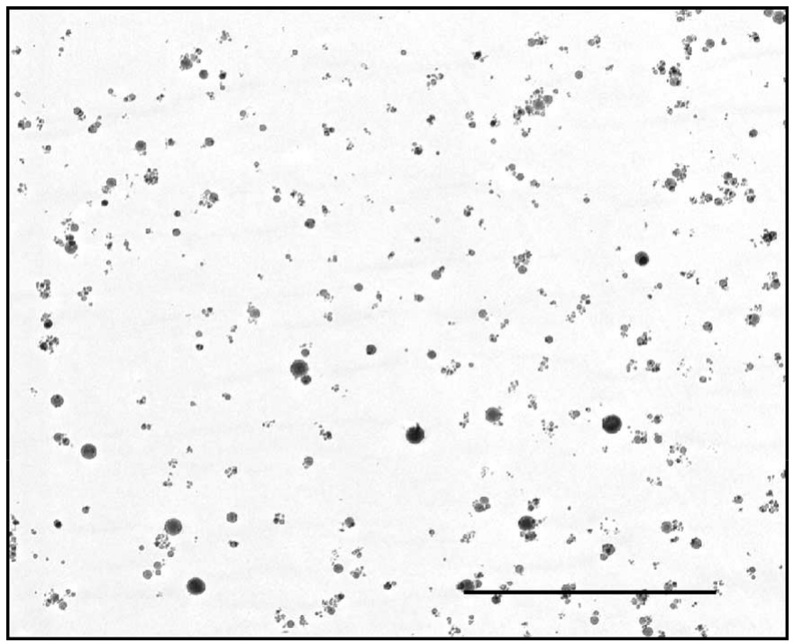
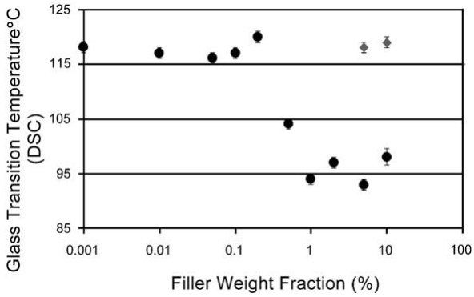

# Glass transition behavior of alumina/polymethylmethacrylate nanocomposites

B.J. Ash, L.S. Schadler\*, R.W. Siegel

Department of Materials Science and Engineering and Rensselaer Nanotechnology Center, Rensselaer Polytechnic Institute, MRC 142, 110 8th Street, Troy, NY 12180-3590, USA

Received 10 September 2001; accepted 21 September 2001

## Abstract

Alumina/polymethylmethacrylate (PMMA) nanocomposites were synthesized using 39-nm nanoparticles and in situ freeradical polymerization. At filler concentrations greater than 0.5 wt.%, the glass transition temperature, $T _ { \mathrm { g } } ,$ was observed to decrease precipitously by $^ \textrm { \scriptsize 2 5 } \textrm { } ^ { \scriptsize \circ } \mathbf { C }$ compared to the neat polymer. At smaller weight fractions, there were no changes in the composite $T _ { \mathbf { g } } .$ The abrupt changes seem to indicate a threshold at which a significant volume fraction of polymer has higher mobility that brings about the decrease in $T _ { \mathbf { g } ^ { \bullet } }$ Consistent with this behavior, the $T _ { \mathrm { g } }$ depression was suppressed by coating the nanoparticles to make them compatible with the matrix. D 2002 Elsevier Science B.V. All rights reserved.

Keywords: PMMA; Nanocomposite; Glass transition temperature

## 1. Introduction

The incorporation of fillers into a polymer matrix can bring about changes in the mechanical and thermal characteristics of the resulting composite. One benchmark used to compare the thermal behavior of composites is the glass transition temperature, $T _ { \mathrm { g } } .$ Changes in the $T _ { \mathrm { g } }$ as a function of the filler content have been reported for polymer composites containing a wide variety of fillers and polymers, but most recently for composites containing nanoscale fillers. Most researchers report an increase in the $T _ { \mathrm { g } }$ as a function of filler content [1– 3]; however, decreases in the $T _ { \mathrm { g } }$ have also been reported [1,4].

In general, nanofillers are ceramic and therefore do not directly contribute to the $T _ { \mathrm { g } }$ of the matrix. Instead, the interaction of the polymer chains with the surface of the particles can drastically alter the chain kinetics in the region immediately surrounding the particle due to the presence of the interface. One of the unique features of nanofillers is their extremely high specific surface area. For a well-dispersed system, even low filler volume fractions provide an enormous amount of interfacial area through which the bulk properties of the polymer can be altered [5]. Securing, through adsorption or grafting, the polymer onto a surface restricts molecular mobility of the affected chains, changes the density of packing of polymer chains, and modifies the conformation and orientation of chain segments in the neighborhood of the surface [6]. On the other hand, interfaces characterized by greater mobility are found in freestanding polymer films [7]. In these cases, the less restrictive nature of the free surface can increase the segmental mobility at the air/ polymer interface. The change from the interfacial to bulk properties takes place in a gradual fashion over a finite distance, the extent of the so-called interface region.

<small>\* Corresponding author. Tel.: +1-518-276-2022; fax: +1-518-276-8554.</small>

<small>E-mail address: schadl@rpi.edu (L.S. Schadler).</small>

In a previous paper [4], we showed that with the introduction of 5 wt.% alumina nanoparticles into a polymethylmethacrylate (PMMA) matrix, a 600% average increase in strain-to-failure was achieved. This dramatic change in mechanical properties was accompanied by a $T _ { \mathrm { g } }$ depression. Further studies of these composites have now yielded new insight into the mechanism leading to the $T _ { \mathrm { g } }$ depression.

## 2. Experimental procedure

Alumina nanoparticles $( \mathrm { A l } _ { 2 } \mathrm { O } _ { 3 } ,$ , 39-m average diameter obtained from Nanophase Technologies) were used in their as-received state (uncoated) or coated with glycidoxypropyltrimethoxysilane (GPS,

Gelest). For the bulk polymerization, methylmethacrylate (MMA) monomer, the initiator, 2,2-azobisisobutyronitrile (98% Aldrich), and chain transfer agent, 1-decanethiol (96% Aldrich Chemical). All of these chemicals as well as those referenced below were used as received.

The alumina nanoparticles were coated similarly to the procedure found in Ref. [8]. Twenty grams of nanoparticles were suspended in ethanol through 10 min of sonication (VCX-400 Sonics Materials Vibracell) at 70% power. The power setting refers to the percentage of maximum sonic power (400 W) that is directed into the sample. A 95%:5% solution of ethanol and distilled water was prepared and pH adjusted to 4.5 through addition of acetic acid. GPS was added to the mixture followed by 10 min of stirring for silanol formation. The amount of GPS added was based on an average of 10 reactive sites per square nanometer. Following stirring/sonication, the GPS mixture was added to the alumina/ethanol slurry and refluxed for 8 h. The mixture was then placed in a refrigerator to rapidly cool. The particles were too small to be washed in a Soxhlet extractor; instead, hexane was added to the ethanol/particle slurry to precipitate the particles, followed by centrifugation. The GPS-coated particles were washed twice with hexanes and then allowed to dry overnight at room temperature under vacuum.

Fig. 1. TEM micrograph showing the dispersion of as-received nanoparticles in the polymer matrix at 5 wt.%. The scale bar represents 2 Am. (Phillips CM 200 TEM).

The composite polymerization procedure was developed based on the work of Balke and Hamielec [9] and is discussed in detail in a previous paper [4]. The resulting nanocomposite was compression molded into flat bars ( f 1-mm thick) in a hydraulic press (Carver 12 ton) at $1 8 0 ~ \mathrm { ~ } ^ { \circ } \mathrm { C }$ and 2.5 mtons. Specimens were allowed to cool to room temperature under pressure for a period of 6 h and, after removal, were sanded (400 grit) to remove flashing.

Differential scanning calorimetry (DSC) (Shimadzu DSC-50) was used to obtain the $T _ { \mathrm { g } } ,$ with a temperature ramp from 25 to $1 9 0 ~ ^ { \circ } \mathbf { C }$ at $1 0 ^ { \circ } \mathrm {  ~ \mathring { C } ~ m i n ~ } ^ { - 1 }$ Dynamic mechanical thermal analysis (DMTA) was carried out on a Rheometric Scientific DMTA V using single cantilever bending at 1 Hz, with 0.1% strain. Temperature ramps from 15 to $2 0 0 ~ ^ { \circ } \mathbf { C }$ at $2 ^ { \circ } \mathbf { C }$ min were used to determine the $T _ { \mathrm { g } }$ of the materials in order to have complementary measurements to the DSC. The $T _ { \mathrm { g } }$ was determined by the corresponding peak of the loss modulus $( E ^ { \prime \prime } )$ curve. Infrared spectroscopy data were obtained on a Nicolet Magna-IR 750 Spectrometer.

## 3. Results

The PMMA matrix in both the neat PMMA and nanocomposite preparations has a molecular weight of approximately 150,000, average polydispersity of 1.5, and averages 57% syndiotactic as previously reported [4]. The composites exhibit excellent dispersion as shown in the TEM micrograph of Fig. 1. The silane coupling agent, GPS, was determined to be present on the surface of the particles through IR spectroscopy.

The glass transition temperature determined by DSC of the polymer nanocomposite shows a dramatic decrease following the addition of 0.5 wt.% of 39-nm diameter alumina particles, as shown in Fig. 2. For composites with less than 0.5 wt.% nanoparticles, the $T _ { \mathrm { g } }$ is stable, within experimental error, at $1 1 9 \; ^ { \circ } \mathbf { C } _ { \mathbf { ; } }$ the $T _ { \mathrm { g } }$ of the neat PMMA. Also shown in Fig. 2 is a stable $T _ { \mathrm { g } }$ for composites with the silane-modified nanoparticles at 5 and 10 wt.%. The $T _ { \mathrm { g } }$ values obtained by DMTA (not shown) were, on average, all $7 ^ { \mathrm { ~ \scriptsize ~ o ~ } } \mathbf { C }$ higher than those determined by DSC, but followed the same trends.

Fig. 2. Glass transition temperatures (by DSC) plotted against filler weight fraction. . — as-received nanoparticles, — coated nanoparticles. (5 wt.% corresponds to 1.67 vol.%).

## 4. Discussion and conclusions

As stated in the Introduction, most researchers find an increase in the composite $T _ { \mathrm { g } }$ as fillers are added to a polymer. However, Becker et al. [1] showed that the $T _ { \mathrm { g } }$ can decrease as well. Unfortunately, these researchers concentrated on the immobilization of the matrix and subsequent increases in $T _ { \mathrm { g } }$ achieved by coating the silica with methacryloxypropyltrimethoxysilane (MPTS) and offered no explanation for the decreases in $T _ { \mathrm { g } }$ observed with both coated (acetoxypropyltrimethoxysilane — APTS) and as-received silica. Over the range of volume fractions considered (0– 10 vol.%), the $T _ { \mathrm { g } }$ of their APTS treated silica filled system decreased by ${ 1 6 } { \mathrm { ~  ~ ^ { \circ } { C } , ~ } }$ while that of their composites prepared with as-received filler decreased by $9   ^ { \circ } \mathbf { C }$

The $T _ { \mathrm { g } }$ of a polymer system can fall for a variety of reasons, including changes in tacticity, molecular weight, and retained monomer. As we recently reported [4], however, the method of synthesis used in producing our nanophase alumina/PMMA nanocomposites does not alter either the tacticity or the molecular weight of the resulting composites. In addition, the retained monomer concentrations, obtained through liquid NMR, are also very low ( < 1%). We expect that the observed change in the $T _ { \mathrm { g } }$ is therefore due solely to the interaction of the polymer (or lack thereof) with the filler particles.

Recent works on ultrathin polymer films less than 100 nm in thickness may provide a starting point to explain the results presented above. Although it has long been known that the surfaces of polymers appear to have liquid-like characteristics, recent work has attempted to determine to what depth the air/polymer interface influences the bulk thermal behavior. Working with ultrathin films, researchers have sought to investigate the length scales associated with the polymer $T _ { \mathrm { g } } .$ By creating films whose thicknesses approach the correlation length, where large-scale cooperative motion can occur, the changes in $T _ { \mathrm { g } }$ as a function of film thickness has been studied [7,10].

Initial work on both freestanding and supported ultrathin films showed that the $T _ { \mathrm { g } }$ of the bulk polymer displays a gradually increasing downturn as the film thickness decreases [10]. From these efforts, it appeared that the film thickness alone drove the apparent bulk $T _ { \mathrm { g } }$ decrease. Working with polystyrene (PS) freestanding ultrathin films, however, Mattson et al. [7] determined that the molecular weight of a polymer also plays a large role in determining whether a film will display a $T _ { \mathrm { g } }$ decrease. Their work also corroborates the initial findings by showing that below a certain molecular weight (317,000 in PS), $T _ { \mathrm { g } }$ behavior is governed by a finite-size effect, where the thickness of the film alone decides whether the $T _ { \mathrm { g } }$ will fall. However, the magnitude of the decrease in $T _ { \mathrm { g } }$ in higher molecular weight films (greater than 514,000 in PS) was shown to increase with molecular weight and decreasing film thickness, in a linear fashion.

In a previous paper [4], we discussed the decrease in $T _ { \mathrm { g } }$ shown in Fig. 2 in terms of an interparticle distance. We translated this into a thin film thickness and hypothesized that the $T _ { \mathrm { g } }$ decrease was expected for particles that show little or no interfacial interaction with the host polymer. In effect, the free internal surface surrounding the nanoparticles existing throughout the composite mimics the ultrathin film results. This hypothesis is further supported in the present work by two new sets of data. Firstly, at weight fractions less than 0.5 wt. $\mathcal { S } _ { z }$ there is no change in $T _ { \mathrm { g } }$ as evidenced by both the DMTA and DSC measurements. Secondly, by coupling the surface of the particles to the matrix, the $T _ { \mathrm { g } }$ depression disappears entirely. Clearly, this is the result of a drastically different interface dynamic between the polymer and particle.

The abrupt nature of the phenomenon with regard to weight fraction is reminiscent of the percolation effect seen in other filled systems, such as carbon black in rubber, the difference here being that the connected regions are polymer, not filler. The interconnectivity of mobile polymer regions existing around the particles seems to be driving the decrease in $T _ { \mathrm { g } } .$ As was pre-viously mentioned, the $T _ { \mathrm { g } }$ appears to depend on the distance (thickness) between interfaces and the molecular weight. For 0.2, 0.5, and 1.0 wt.% filler, the interparticle (or interface) distance for 39-nm monodisperse particles arranged in simple cubic packing would be approximately 320, 230, and 170 nm, respectively. All of these values are much higher than the thicknesses of the ultrathin films the current research has focused upon; however, the ultrathin films are constrained in only one dimension (thickness), while the nanocomposites represent a three dimensional thin film problem. The addition of the two dimensions surely alters the polymer dynamics allowing more degrees of freedom for chain relaxation. Therefore, the strongly correlated motions associated with the $T _ { \mathrm { g } }$ could occur at larger interfacial spacings in the nanocomposite than those seen in the ultrathin film research.

Unfortunately, the hypothesis presented above does not fit with the constant depressed $T _ { \mathrm { g } }$ displayed by nanocomposites with larger filler concentrations. Instead of additional reductions in $T _ { \mathrm { g } } ,$ as would be expected as the interparticle distance decreased further, the $T _ { \mathrm { g } }$ remains relatively constant at the lowest values initially displayed at about 1.0 wt.%. In addition, the coupling of the particles to the polymer appears to only mitigate the $T _ { \mathrm { g } }$ depression instead of increasing the $T _ { \mathrm { g } }$ above the neat polymer value as was seen in Becker’s work [1]. The next step in this research is to graft PMMA onto the surface of the nanoparticles. By choosing the grafted polymer’s molecular weight to be above and below the entanglement length of the matrix, the effects of the nanoparticles on the surrounding matrix could be examined more thoroughly.

In conclusion, we have provided a novel hypothesis for observed glass transition temperature depressions found in polymer nanocomposites. Nanofilled systems continue to provide unique opportunities to advance our understanding of engineering polymers.

## Acknowledgements

The authors would like to thank Prof. S.S. Sternstein, Prof. B.C. Benicewicz, and Prof. T. Apple of RPI for many thoughtful hours of discussion. We would also like to acknowledge NASA Langley Research Center for the use of equipment and facilities in the Advanced Materials and Processing Branch during a co-op tour by B.J. Ash. Dr. Theo Dingemans of ICASE at NASA LaRC was especially helpful in general chemistry techniques required during the coating progress. We are grateful to Dr. Roy Crooks of Lockheed-Martin (assigned to NASA LaRC) for the TEM micrograph presented in Fig. 1 and to Diana Rogers of RPI who performed the GPC and NMR of the composites. Special thanks go to Nanophase Technologies for providing the alumina nanopowders and the National Science Foundation for funding this research under CTS-9871894.

## References

[1] C. Becker, H. Krug, H. Schmidt, Mater. Res. Soc. Symp. Proc. 435 (1996) 237.

[2] W. Hergeth, U. Steinau, H. Bittrich, G. Simon, K. Schmutzler, Polymer 30 (1989) 254.

[3] K. Iisaka, K. Shibayama, J. Appl. Polym. Sci. 22 (1978) 3135.

[4] B.J. Ash, J. Stone, D.F. Rogers, L.S. Schadler, R.W. Siegel, B.C. Benicewicz, T. Apple, Mater. Res. Soc. Symp. Proc. 661.

[5] P.H.T. Vollenberg, J.W. DeHaan, L.J.M. Van de Ven, D. Heikens, Polymer 30 (1989) 1663.

[6] L. Nielsen, R. Landel, Mechanical Properties of Polymers and Composites, Marcel Dekker, New York, 1994.

[7] J. Mattsson, J.A. Forrest, L. Bö rjesson, Phys. Rev. E 62 (2000) 5187.

[8] R. Brotzman, US Patent No. 05993967, 1999.

[9] S.T. Balke, A.E. Hamielec, J. Appl. Polym. Sci. 17 (1973) 905.

[10] J.L. Keddie, R.A.L. Jones, R.A. Cory, Europhys. Lett. 27 (1994) 59.