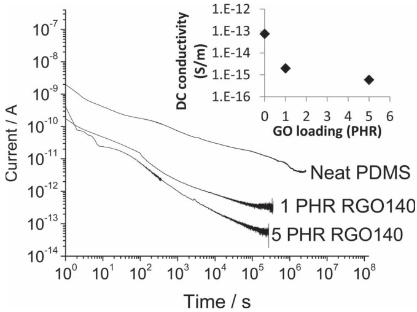
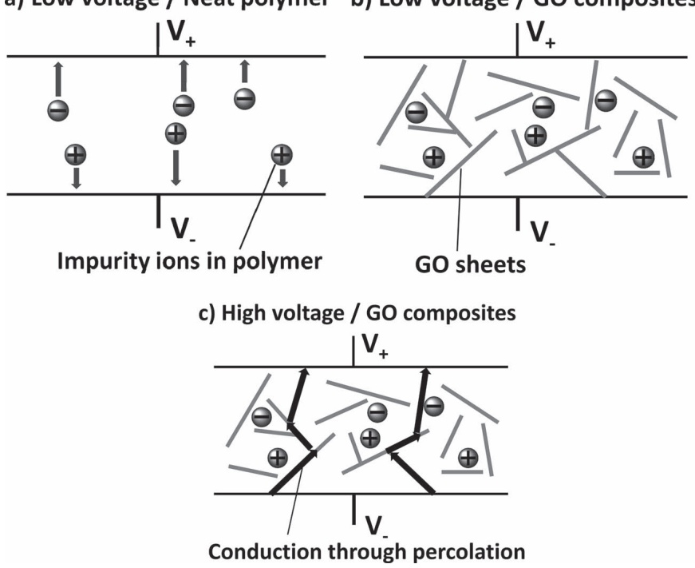
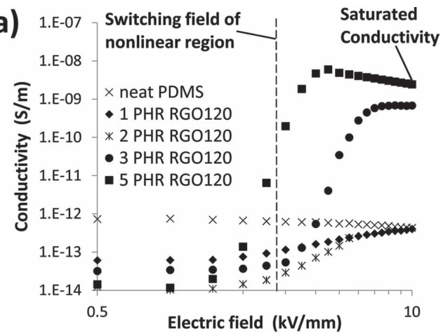
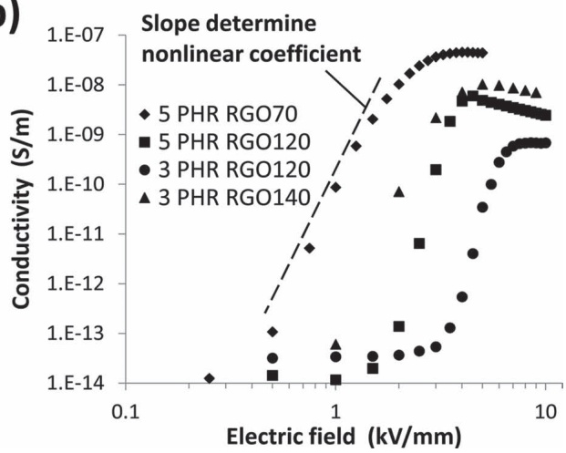
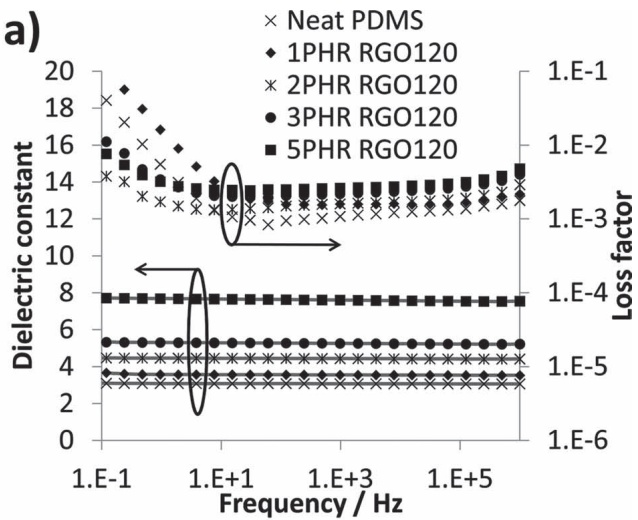
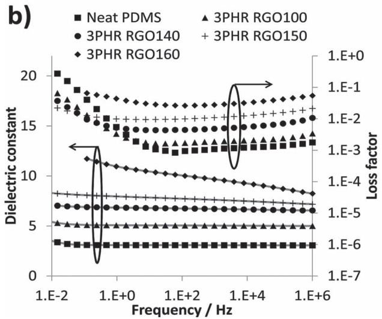

# Graphene Oxide Filled Nanocomposite with Novel Electrical and Dielectric Properties

Zepu Wang , \* J. Keith Nelson , Henrik Hillborg , Su Zhao , and Linda S. Schadler

The globally increasing demand of energy is a technical challenge for the electrical generation, transmission and distribution systems. This requires often contradictory features such as increasing voltage levels in combination with more compact designs in urban environments. This leads to an increased electric stress on the insulation systems. This can be addressed by using insulating materials with tunable non-linear conductivity, as well as high dielectric constant and low loss, for electric fi eld grading applications. [1] Current fi eld grading materials consist of polymer, semi-conducting ceramic particles such as SiC, ZnO etc., as well as lower amounts carbon black, embedded in a polymer matrix. [2,3] The nonlinear electrical conductivity is created by the percolated structure of these particles within the matrix, at a typically volume loading of 30% to 40%. As a result of the high fi ller level, current fi eld grading materials are limited in terms of poor mechanical properties, high weight and tendency to overheat at elevated electric fi elds.

Graphene oxide (GO) is commonly prepared from natural fl ake graphite by the Hummers method and serves as an intermediate product to prepare graphene. [4] It has disrupted $s p ^ { 2 }$ bonding orbitals and abundant surface groups such as epoxy, hydroxyl and carboxylic acid groups. Due to the hydrophilic nature of these surface groups, GO is easily dispersed in aqueous solution with 80% of the GO in the form of single layer platelets. [5] The GO can be reduced by various chemical or thermal approaches to restore the $s p ^ { 2 }$ network and the conductivity. [4] Therefore one can control the electrical properties of GO by adjusting the oxidation states. [6] In this work, composites of poly(dimethyl siloxane) (PDMS) fi lled with graphene oxide (GO) or slightly thermally reduced GO exhibit unusual nonlinear electrical conductivity at a small fi ller loading of about 3 vol.%: 1) A large nonlinear coeffi cient of 16 around the switching fi eld; 2) the conductivity saturates beyond the switching fi eld, which avoids the overheating typically seen in commercial fi eld grading materials; 3) the switching fi eld and saturation conductivity can be controlled by fi ne tuning the oxidation state of the GO and the loading; 4) the composite conductivity is lower than that of the neat polymer at low fi eld, which is rare in polymer nanocomposites. As signifi cantly, the composites exhibit a relatively high dielectric constant with a small loss factor, which means that they can be used both as resistive and capacitive fi eld grading materials. These unique dielectric and electrical responses open up new design space for fi eld grading materials in high voltage electrical applications.

The relaxation behavior and conductivity can be observed from **Figure 1** which shows the absorption current as a function of time after an electric fi eld of 1 $\mathrm { k V ~ m m ^ { - 1 } }$ is applied. The samples are denoted with their GO loading and reduction temperature. For example, 3PHR-RGO140 means the loading was 3 PHR (parts per hundred parts of resin) and the GO was thermally reduced at $1 4 0 ~ ^ { \circ } \mathrm { C } .$ The inset shows the conductivity as a function of GO loading. The current of the 5 PHR composite samples reduced to below the sensitivity of the equipment after about 3 hours, indicating a conductivity of less than $6 \times 1 0 ^ { - 1 6 } \mathrm { ~ S ~ m ^ { - 1 } ~ }$ . On the other hand, the current for the neat PDMS samples started with a higher initial value, and dropped continuously during 6 days to a stable value of $[ 7 . 5 4 \times 1 0 ^ { - 1 4 } \mathrm { ~ S ~ m ^ { - 1 } }$ . The absorption current plot of the 1 PHR composite lies between the other two. Since the fi eld strength was 1 $\mathrm { k V m m ^ { - 1 } }$ , charge injection from the electrodes is unlikely. Therefore, the origin of the measured current is attributed to motion of ions in the polymer matrix, originating a) Low voltage / Neat polymer

Figure 1 . Plot of absorption current as a function of time after switching on an electric fi eld of 1 kV mm − 1 for the neat PDMS and composites fi lled with GO reduced at $1 4 0 \; ^ { \circ } \mathsf { C }$ (inset shows the conductivity calculated from the stable current at the end of the measurement.)

<small>DOI: 10.1002/adma.201200827</small>

b) Low voltage / GO composites

Figure 2 . Schematics that show a) impurity ion movement in neat polymer; b) ion movement inhibited by GO network at low electric fi eld; c) Conduction through percolated GO network at high electric fi eld.

from impurities. We hypothesize that the faster decay of current and lower conductivity in the GO fi lled composites is due to a tortuous path of ion movements created by the GO network as illustrated in **Figure 2** a-b. In neat PDMS, the impurity ions can travel through the whole sample between two electrodes. But in the GO composites, they are either forced to take a more circuitous route or completely constrained in narrow spaces inside the GO network. Thus the current drops quickly as ions encounter the GO, and the conductivity of the composites is two orders of magnitude lower than that of the neat polymer, three hours after applying the voltage. It is worth noting that there is almost no electronic current passing along the GO network because they are insulating at low fi eld, as will also be shown in the following paragraph.

polymer composites. [2] For the 1 PHR and 2 PHR samples, the high fi eld conductivity of the composites is the same as that of the neat PDMS because the GO loading is below percolation. For the 3 PHR and 5 PHR samples, the conductivity increased several orders of magnitude at high fi eld, due to the intrinsic fi eld-dependent conductivity of GO. [7] The abundant surface groups lead to a disrupted sp2 structure and act as energy barriers for charge transport along the carbon network. [6] The electrons are blocked by those energy barriers at low electric fi eld and become capable of tunneling through them only at high electric fi eld. Thus the electronic conduction along the GO network is facilitated at elevated fi eld and becomes the major contribution to the total current in the percolated samples as shown in Figure 2 c. The percolation threshold is thus between 2 PHR and 3 PHR, comparable to that reported in the literature. [8,9] After percolation, further increase in the volume fraction did not result in any distinct change of the high fi eld conductivity, which agrees with the behavior of composites fi lled with percolated conductive fi llers. After the nonlinear region, the conductivity reached a plateau and did not increase further with fi eld strength. This suggests that

**Figure 3** a shows the conductivity for composites fi lled with $1 2 0 ~ ^ { \circ } \mathrm { C }$ reduced GO as a function of electric fi eld. At low fi eld strength (below 1 kV mm − 1 ), all composites exhibit a lower conductivity than that of the neat PDMS. At higher fi eld, the conductivity of the composites increases dramatically while the electronic current becomes dominant over the ionic current. This non-linear conductivity can be described by the switching fi eld, and the slope in the non-linear region, as shown in Figure 3 a-b. The slope corresponds to the nonlinear coeffi cient α , which can be defi ned in the function σ∝Eα − 1 , [1] where σ is the conductivity of material and E is the fi eld strength. In the non-linear region of GO fi lled composites, α has a value of 16 which is considered to be a large value in the fi eld grading applications. [1] In addition it is unusual that the conductivity of GO composites saturates at fi elds beyond the nonlinear region. Typically, the conductivity continues to increase at higher electric fi elds in other nonlinear most of the conduction paths along the GO network had been “switched on” and the maximum current was limited by the electron transport along the GO network.

Figure 3 b shows the ability to tailor the properties of the composites by altering the GO oxidation state. Each energy barrier, from either the GO surface groups or the contact between GO platelets, possesses a characteristic voltage above which the electrons can tunnel through. The total switching voltage of the composites should be the sum of those characteristic voltages. Thus adjusting the oxidation state of GO can affect the energy barriers from surface groups [6] and eventually change the total switching voltage. By increasing the reduction temperature from 120 ° C to 140 ° C (3PHR-RGO120 vs. 3PHR-RGO140) the switching fi eld was shifted from 4 kV mm − 1 to 2 kV mm − 1 . It is suggested that this was due to a reduced number of oxidized surface groups, as well as the number of energy barriers. The saturated conductivity can also be changed by tuning the oxidation state of GO. The conductivity of a percolated composite can be described by $\sigma   = \sigma _ { f } ( f   -   f _ { c } ) ^ { t }$ , where σ is the conductivity of the fi ller, f and f c are the actual and critical fi ller volume fraction respectively and t is the critical exponent. Because the conductivity of GO increases when reduced at a higher temperature, the saturated current also increased by an order of magnitude for the 140 ° C GO composites. Interestingly, the 5PHR-RGO70 was found to possess a lower switching fi eld and higher saturated conductivity compared to that of 5PHR-RGO120, which seems to be inconsistent with previous analysis. This is likely due to the rearrangement of functional groups on the GO surface during the heat treatment process. Before heat treatment, the surface groups should be randomly scattered across the

Figure 3 . Plot of conductivity with respect to fi eld strength, a) composite with different loading of GO reduced at ${ 1 1 0 ~ ^ { \circ } \mathsf { C } } ;$ b) composite with GO reduced at different temperatures.

GO surface after freeze-drying. In the heating process, epoxy groups tend to line up to reduce the total strain of graphene sheet. [10–12] These linear surface group clusters are more effi - cient energy barriers against electron transport compared to the scattered surface groups. Thus the total switching voltage increased even though the total number of surface groups might have been reduced. Then upon the further reduction at higher temperature, intensive detachment of the epoxy and other surface groups caused a decrease of the switching voltage as discussed before.

In addition to the interesting nonlinear response leading to resistive fi eld grading effect, these composites can also provide capacitive fi eld grading effects from their increased dielectric constant. The dielectric spectroscopy of the GO composites is shown in **Figure 4** . The dielectric constant increased to 8 in the 5PHR-RGO120 sample, which is signifi cant considering the low fi ller volume fraction. High aspect ratio fi llers can increase the dielectric constant of polymer composites more effi ciently, [13] and the GO platelets used in this work possess an aspect ratio of 500 according to the supplier’s datasheet. Meanwhile, the loss factor increased moderately from 0.001 to 0.003 at 100 Hz. When high aspect ratio conductive fi llers are used, [9,14] the leakage current usually leads to a large loss factor given their small percolation threshold. One way reported to avoid the high loss is through an insulating coating on the conductive fi ller surface. [14,15] In the case of GO, the intrinsic barriers limit the leakage current at low voltage, while the conductive regions where surface groups are absent can still provide the benefi ts of high aspect ratio fi llers on the composite dielectric constant. This explains the permittivity increase with only a slight increase in the loss factor. The loss factor can be described by:

Figure 4 . Dielectric spectroscopy of GO/PDMS composites showing comparison of a) different GO loading; b) different reduction temperature.

$$
\tan \delta = \frac {\varepsilon^ {\prime \prime}}{\varepsilon^ {\prime}} + \frac {\sigma}{2 \pi f \varepsilon^ {\prime}}\tag{1}
$$

where $\varepsilon ^ { \prime }$ and $\varepsilon ^ { \prime \prime }$ are the real and imaginary part of the permittivity respectively, σ is the DC conductivity and $f$ is the frequency. Note that the dielectric loss for the GO composites was fl at except for frequencies below 10 Hz, which indicates a low DC conductivity.

Figure 4 b shows the effect of GO oxidation state on the dielectric response of composites. Further reduction of GO removes more surface groups and leads to larger conductive

## www.MaterialsViews.com

areas between the insulating barriers, which increases the effective aspect ratio. As a result, both the dielectric constant and the loss factor increase, which agrees with the Maxwell Garnett rule of mixtures for the high aspect ratio fi llers. [13] The slope of the loss factor and $\varepsilon ^ { \prime \prime }$ was close to zero at frequencies above 1 Hz, which shows that the major contributions to the loss are the dipolar or interfacial relaxation processes, instead of the leakage current as discussed before. The lack of leakage current indicates that the GO has good insulating properties even after being reduced at $1 6 0 \; ^ { \circ } \mathrm { C } .$

In conclusion, GO fi lled composites are found to possess various unique electrical properties. At low fi eld strength, the composite showed a lower conductivity compared to the neat polymer, probably due to the blockage of ion transport by the GO network. At fi eld near the switching fi eld, the composite exhibited nonlinear conductivity with a large nonlinear coeffi - cient. The conductivity at higher electric fi eld was limited by electron transport along the GO network, thus potentially providing a controllable method to avoid thermal problems. The switching fi eld and maximum conductivity can be tailored by varying the oxidation state of the GO and the volume fraction. The dielectric constant also increased at small fi ller loadings, and the lost factor remains low because of the insulating nature of GO at low fi eld. Combining those superior electrical properties with a potential mechanical robustness due to the enhancement effect of GO platelets, the composites have potential applications as fi eld controlling materials or insulation materials in high voltage power system and electronic devices.

## Experimental Section

GO was purchased from Angstron Materials in a form of 0.5% aqueous suspension. The average lateral dimension of GO was about 500 nm and the average thickness was 1.1 nm indicating mostly monolayer GO. The as received suspension was freeze-dried for 2 days to remove most of the water, resulting in brown sponge-like foam. The GO was then thermally reduced at temperatures ranging from 70 to 160 ° C for 12 hours. The temperature ramp rate was kept at $0 . 5 ~ ^ { \circ } \mathsf { C } ~ \mathsf { m i n } ^ { - 1 }$ to avoid violent reduction of GO. The weight loss before 100 ° C is attributed to the absorbed water due to the hydrophilic surface groups, and after 100 ° C to the removal of surface groups. [16] Heat treatment at higher temperature results in a more reduced GO with less residual surface groups. The foam turned darker during the reduction reaction.

Sylgard 184 (Dow Corning), consisting of poly(dimethyl siloxane) (PDMS) and a reinforcing silica fi ller was used as the polymer matrix. The reduced graphene oxide (RGO) was mixed into the precursor Sylgard 184A using a FlackTek Speed Mixer at 3000 rpm for totally 30 minutes in 6 intermittent runs. The fi ller volume fraction ranged from 1 PHR to 5 PHR. Then Sylgard 184B was added into the mixture, followed by curing in a mould at $1 5 0 ~ ^ { \circ } C$ for 1 hour. Planar samples with a diameter of 3.175 cm and a thickness of approximately 300 μ m were obtained. Prepared samples were dried in an oven at $\dot { 1 2 0 } ^ { \circ } C$ for 12 hours prior to dielectric testing to remove any trapped moisture.

The absorption current and conductivity measurement was carried out in a guarded cell connected to a high voltage DC power supply and picometer. The absorption current measurement was performed at 1 kV mm − 1 for 6 days, and the absorption current plot was smoothed by averaging the adjacent points. In the conductivity measurement, the fi eld strength was stepped up to 10 kV mm − 1 at an interval of 0.5 kV mm − 1 . Conductivity data were taken as a function of fi eld strength after holding the voltage constant for 30 minutes. The composite samples were tested in a Novocontrol alpha high resolution dielectric impedance analyzer for dielectric spectroscopy at room temperature. A frequency range from $1 0 ^ { - 1 }$ to 10 6 Hz was utilized.

## Acknowledgements

This work was supported by ABB and the Nanoscale Science and Engineering Center for Directed Assembly of Nanostructures at Rensselaer Polytechnic Institute under NSF Contract # DMR 0642573. One of us (H. Hillborg) also acknowledges support from the Swedish Research Council (IFA 2007-5095).

Received: February 27, 2012 Revised: April 5, 2012 Published online: May 9, 2012

[ 1 ] T. Christen , L. Donzel , F. Greuter , IEEE Electr. Insul. Mag. 2010 , 26 , 47 .

[ 2 ] L. Donzel , F. Greuter , T. Christen , IEEE Electr. Insul. Mag. 2011 , 27 , 18 .

[ 3 ] E. Martensson , B. Nettelbled , U. Gafvert , L. Palmqvist , Proc. of the 1998 IEEE 6th Int. Conf. on Conduction and Breakdown in Solid Dielectrics 1998 , 548 .

[ 4 ] V. Singh , D. Joung , L. Zhai , S. Das , S. I. Khondaker , S. Seal , Prog. Mater Sci. 2011 , 56 , 1178 .

[ 5 ] D. R. Dreyer , S. Park , C. W. Bielawski , R. S. Ruoff , Chem. Soc. Rev. 2009 , 39 , 228 .

[ 6 ] I. Jung , D. A. Dikin , R. D. Piner , R. S. Ruoff , Nano Lett. 2008 , 8 , 4283 .

[ 7 ] C. Gómez-Navarro , R. T. Weitz , A. M. Bittner , M. Scolari , A. Mews , M. Burghard , K. Kern , Nano Lett. 2007 , 7 , 3499 .

[ 8 ] H. Kim , A. A. Abdala , C. W. Macosko , Macromolecules 2010 , 43 , 6515 .

[ 9 ] J. Yu , X. Huang , C. Wu , P. Jiang , IEEE Trans. Dielectr. Electr. Insul. 2011 , 18 , 478 .

[ 10 ] H. Schniepp , J. Li , M. McAllister , H. Sai , M. Herrera-Alonso , D. H. Adamson , R. K. Prud’homme , R. Car , D. A. Saville , I. A. Aksay , J. Phys. Chem. B 2006 , 110 , 8535 .

[ 11 ] Z. Xu , K. Xue , Nanotechnology 2010 , 21 , 045704 .

[ 12 ] J. Li , K. Kudin , M. McAllister , R. Prud’homme , I. A. Aksay , R. Car , Phys. Rev. Lett. 2006 , 96 , 5 .

[ 13 ] A. Sihvola , E. Alanen , IEEE Trans. Geosci. Remote Sens. 2002 , 29 , 679 .

[ 14 ] C. Yang , Y. Lin , C. W. Nan , Carbon 2009 , 47 , 1096 .

[ 15 ] J. Xu , C. P. Wong , Appl. Phys. Lett. 2005 , 87 , 082907 .

[ 16 ] S. Park , J. An , I. Jung , R. D. Piner , S. J. An , X. Li , A. Velamakanni , R. S. Ruoff , Nano Lett. 2009 , 9 , 1593 .