**DOI: 10.1002/adma.200602097**

# High Dielectric Performance of Polymer Composite Films Induced by a Percolating Interparticle Barrier Layer\*\*

By Yang Shen, Yuanhua Lin, Ming Li, and Ce-Wen Nan\*

The mechanical flexibility and tunable properties of poly mer-based materials make them attractive ones for a lot of applications. Exploring polymer-based dielectrics, such as ones used for capacitors and charge-storage applications, with high dielectric constant (high-j) has recently aroused considerable interest.[1–4] Especially, motivated by higher function and further miniaturization of electronics, embedding (or integrating) polymer-based capacitors into the inner layers of organic printed circuit boards (PCBs) allows packaging substrate miniaturization and better electrical performance, which is a key for organic-based system-on-package technologies.[5] But as capacitors, the relative dielectric constant j of general polymers (being good insulators) is too low $( \mathrm { e . g . } , \kappa   <   5 )$ .Thus, a key issue is to substantially raise the dielectric constant of the polymers while retaining low dielectric loss.[1]

A few strategies have been developed to raise the j of polymer-based materials.[1–4] A common approach is to add high-j ceramic fillers $( \mathrm { e . g . ,   B a T i O _ { 3 } } )$ into a polymer. High loading of the ceramic fillers in the polymer composite, usually over 50 vol %, can increase j by about ten times relative to the polymer matrix, but dramatically decreases the adhesion of the composite (and increases its porosity) thus deteriorating the adaptability between the composite and the organic circuit boards.[2]

Another strategy is to fabricate percolative composite capacitors by using conductive fillers (e.g., metal particles).[3,4] As the volume fraction f of the fillers increases to the vicinity of the percolation threshold $f _ { \mathrm { c s } }$ j of the composites can be dramatically enhanced as described by the well-known power law[6]

$$
\kappa / \kappa_ {\mathrm{m}} \approx \left| f _ {\mathrm{c}} - f \right| ^ {- s}\tag{1}
$$

where $\kappa _ { \mathbf { m } }$ is the dielectric constant of the matrix and s is an exponent of about 1. Dielectric constant enhancement $\kappa / \kappa _ { \mathrm { m } }$ of about 10–100 has been observed in a number of such percolative polymer composites.[3,4,7–9] However, simultaneously, the dielectric loss tan d of these percolative composites also rapidly increases (e.g., from below 2 % for the polymer matrix to over 20 %) due to the insulator–conductor transition near ${ f _ { \mathrm { c } } } ^ { [ 3 , 4 ] }$ Thus, attempts to reduce tan d have been made by introducing interlayers or oxide shells between the metal fillers to prevent them from connecting with each other directly.[8] Although tan d of these metal–polymer composites with surface-modified or surface-oxidized metal particles remained rather low (i.e., tan d ≈ 5 %), a serious variation in j was still observed when f is close to fc (probably due to a lot of pores induced in the composites[8]). Therefore, in all the percolative polymer composites reported so far, a high $\kappa / \kappa _ { \mathrm { m } }$ can only be achieved when f is very close to $f _ { c } ,$ i.e., $\kappa / \kappa _ { \mathrm { m } }$ suffers from an abrupt variation near $f _ { \mathrm { c } }$ as described by Equation 1, which imposes much challenge and risk in controlling the percolative composites with the threshold composition in order to obtain reproducible products for practical applications.

Here we report a new approach, leading to extremely stable high-j but rather low tan d of the polymer dielectrics. Instead of directly adding bare dielectric ceramic or conductive fillers, we use core/shell hybrid particles (denoted as Ag@C) with metal Ag cores coated by organic dielectric shells as fillers. The organic dielectric shells not only act as interparticle barriers to prevent from direct connection of $\mathbf { A g }$ particles, but they also produce excellent compatibility between the fillers and the polymer matrix and ensure the dispersion of fillers in the matrix. The resultant high performance of such new polymer composites makes them particularly attractive for technological applications in flexible high-j components such as the PCB-embedded dielectric components.

Transmission electron microscopy (TEM) images (Fig. 1a and b) show these Ag@C particles. The diameters of the Ag cores are distributed between 20 and 120 nm but most are between 60 and 110 nm with an average diameter of 80–90 nm (Fig. 1c); the organic shells exhibit narrow size distributions (Fig. 1d) with an average thickness of about 8–10 nm for the thicker shells (Fig. 1a) and about 4–6 nm for the thinner shells (Fig. 1b). A TEM image (Fig. 1e) of the composite films demonstrates good dispersion of the Ag@C fillers in the epoxy, although it is hard to resolve the shells. The organic shells have excellent compatibility with the matrix, leading to dense and uniform composite films even at higher filler loading. A Raman spectrum (Fig. 1f) confirms the completeness of the organic shells on Ag cores in the films. Because of the surface-enhanced Raman spectrum effect, the signals of the matrix are almost overwhelmed by those of the organic shells.

<small>[\*] Prof. C. W. Nan, Dr. Y. Shen, Prof. Y. H. Lin, Prof. M. Li Department of Materials Science and Engineering State Key Laboratory of New Ceramics and Fine Processing Tsinghua University Beijing 10084 (P.R. China) E-mail: cwnan@tsinghua.edu.cn</small>

<small>[\*\*] This work was supported by the Ministry of Science and Technology of China (Grant No. 2002CB613303) and the NSF of China (Grant No.50621201).</small>

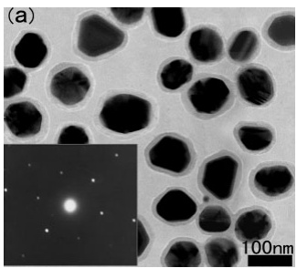

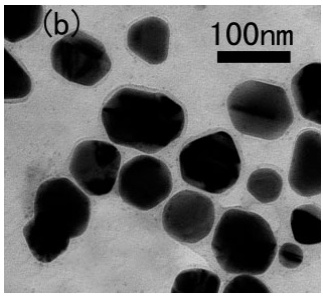

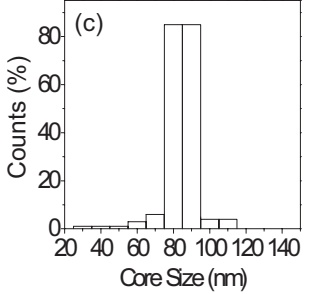

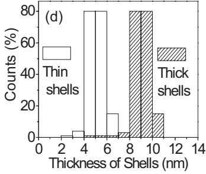

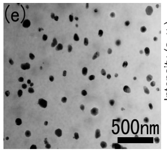

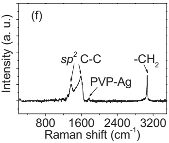

Figure 1. TEM of the Ag@C core/shell particles with a) thicker shells and b) thinner shells (not as clearly visible as the thicker shells), where the inset in (a) shows the selected area electron diffraction pattern of the particles, indicating that the Ag cores are single $\mathsf { A g }$ crystals. Size distributions of c) the $\mathsf { A g }$ cores and d) the shells, estimated from TEM observations. e) TEM and f) Raman spectrum of the composite film with $f   =   0 . 2 4$ Ag@C particles with the thicker shells.

Hence characteristic peaks mainly from the shells can clearly be seen. The two major peaks at 1385 and 1595 $\mathbf { c m } ^ { - 1 }$ are attributed to two in-plane vibration modes of $\mathrm { s p } ^ { 2 } \mathrm { C - C b o n d s . } ^ { [ 1 0 ] }$ Another strong peak at $2 9 3 5 ~ \mathrm { c m } ^ { - 1 }$ is attributed to the asymmetric stretching vibration of –CH2– groups in the skeletal chain of both the poly(vinyl pyrrolidone) (PVP) in the shells and the epoxy matrix, and a minor peak at $1 7 7 5 \mathrm { c m } ^ { - 1 }$ is attributed to $\scriptstyle \mathrm { P V P - A g }$ bonds,[10] which indicates that a large number of PVP molecules are incorporated into the carbonaceous shell framework and closely adhered to the Ag surface.

Similar dependence of the electrical properties on f (Fig. 2) was observed in the composite films containing $\mathbf { A g } @ \mathbf { C }$ particles with thicker or thinner shells. As shown in Figure 2 (with experimental error $<   5   \%   )$ , both j and conductivity r increase with f and the variations become rapid at around $f   =   0 . 2 .$ The variation of r with f looks similar to the general conduction percolation in the percolative composites, where a remarkable increase always occurs (usually several orders of magnitude higher than the insulator matrix) at ${ f _ { \mathbf { c } } } ^ { [ 6 ] }$ But here, r increases

## ADVANCED MATERIALS

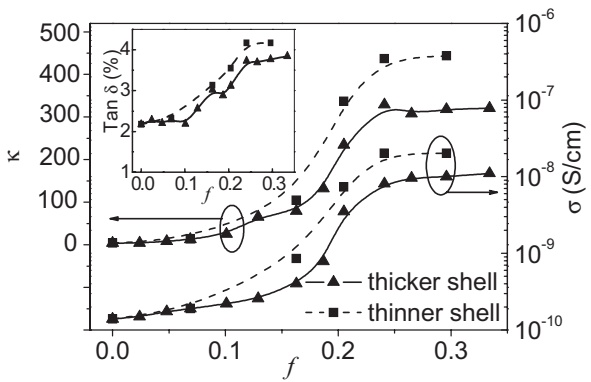

Figure 2. Variations of the dielectric constant $\kappa ,$ conductivity $\sigma ,$ and dielectric loss tan d (see the inset), of the composite films containing Ag@C particles with thicker shells or thinner shells, with the volume fraction $f ,$ at 103 Hz.

from $1 . 4 \times 1 0 ^ { - 1 0 } \mathrm { S c m ^ { - 1 } }$ for the epoxy matrix to about $1 0 ^ { - 8 }   \mathrm { S   c m ^ { - 1 } }$ for the thicker-shell particles and about $2 \times 1 0 ^ { - 8 } \; \mathrm { S \; c m ^ { - 1 } }$ for the thinner-shell particles at 1 kHz. Beyond $f _ { \mathrm { c } }   \approx   0 . 2 ,$ r of the composite films still remains at a constant low value of about $1 0 ^ { - 8 }   \mathrm { S   c m ^ { - 1 } }$ . Because a shell percolation path forms instead of a bare Ag percolation path with high leakage current, this r value of about $1 0 ^ { - 8 }   \mathrm { \bar { S }   c m ^ { - 1 } }$ represents the conductivity of the organic shells, indicating that the shells are insulating but not as insulating as the epoxy. It is only the conductivity difference of about two orders of magnitude between the epoxy matrix and the organic shells that results in the percolation-like behavior shown in Figure 2.

Figure 2 also shows that adding Ag@C fillers to the epoxy increases j by an impressive two orders of magnitude because of the percolation-like transition, as described by Equation 1. Similar changes have been observed in earlier works on the percolative composites.[3,4,7,8] However, an exceptional feature of our results is that j does not abruptly drop as f increases beyond $f _ { \mathrm { c } }$ but remains stable at a high constant value, which is completely different from percolative composites where the large leakage current caused by the direct connection between the conductive fillers leads to a significant reduction of j at $f { \geq } f _ { \mathrm { c } ^ { * } } ^ { [ 3 , 7 ] }$ Another particularly interesting feature is that there is a small change in tan d (increasing from 2 % to about 4 % at 1 kHz) and retains low values, as observed for the epoxy (Fig. 2).

The measurements further show that j (i.e., the real part of the dielectric spectrum) is almost independent of frequency in the measured frequency range up to 30 MHz and tan d increases very slightly with frequency (Fig. 3a and b). In these composites, the organic shells are electrically insulating and of low loss, more like the epoxy, while the Ag cores are conducting and lossy. The relaxation mechanism in such composites could be explained by a model for composites with multi-layered fillers.[11] The polarization of the composite films with such special core/shell structured components is dominated by the polarization in the core/shell particles. The interfacial polarization is associated with the entrapment of free charges generated in the cores at the interfaces between the cores and the matrix, i.e., at the nanometer-sized shells. Thus the dipole polarization in the nanometer-sized dielectric shells is dominant in determining the relaxation in the measured frequency range. According to this model, the relaxation frequency is estimated to be ca. $1 0 ^ { 1 1 } \; \mathrm { H z . } ^ { [ 1 1 ] }$ Thus, the relaxation frequency of the Ag@C–epoxy composites are over $1 0 ^ { 7 }$ Hz higher than the current measured frequency range, agreeing with theoretical predictions.[11] Of interest to note, the j values also exhibit a rather flat temperature dispersion that is within 5 % in the measured temperature range (Fig. 3c).

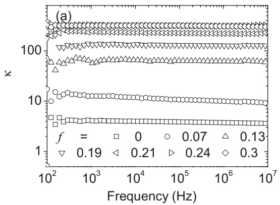

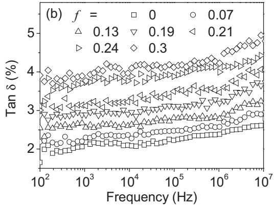

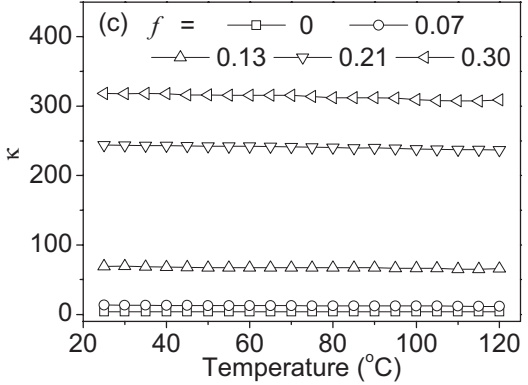

Figure 3. Frequency dependence of a) j and b) tan d, and c) temperature dependence of j at $1 0 ^ { 3 ^ { \prime } }$ Hz, of the composite films containing $\dot { A g \textcircled { o } C }$ particles with the thicker shells.

The dielectric shells play an important role in determining these peculiar behaviors. $\operatorname { A s } f { \rightarrow } f _ { \mathrm { c } } ^ { - }$ , j increases with f due to percolation as discussed above. $\operatorname { A s } f { \geq } f _ { \mathrm { c } } ,$ the Ag cores are very close to each other but isolated by a thin dielectric layer, which is identical to the case where a large number of nanocapacitors are connected with each other. Such a particle– particle junction is a nanocapacitor,[12] and above $f _ { \mathrm { c } }$ they form an interparticle barrier layer nanocapacitor network connecting the top and bottom electrodes, as good as in boundary barrier layer capacitors in high-j ceramics.[13] From the top to the bottom electrodes, these nanocapacitors are connected in series, and thus, j of the composites can be approximately expressed as

$$
\kappa / \kappa_ {\mathrm{c}} \approx 1 + d / t\tag{2}
$$

where d is the diameter of the Ag cores, and t and $\kappa _ { \mathrm { c } }$ are the thickness and dielectric constant of the shells, respectively. Figure 4a clearly demonstrates this effect of the shell thickness. For the thicker shells (Fig. 1a), $d / t _ { 1 }   \approx   1 0$ for the $\mathbf { A g } @ \mathbf { C }$ particles; and $d / t _ { 2 }   \approx   1 7$ for the thinner shells (Fig. 1b). Thus, $R = ( 1 + d / t _ { 2 } ) / ( 1 + d / t _ { 1 } ) \approx 1 . 6 4$ . Assuming that both shells exhibit the same $\kappa _ { \mathrm { c } \mathrm { s } }$ the measured j values (Fig. 4a) give R ∼ 1.62, agreeing well with the R value above. Furthermore, we can estimate $\kappa _ { c }   \approx   2 7$ which is a reasonable value for the organic shells with a resistivity not as high as that of epoxy.[4,14]

The interparticle barrier layer network arising from the core/shell fillers can also be confirmed by the current–voltage (I–V) characteristics, as shown in Figure 4b. As seen, a strongly nonlinear I–V relationship is observed only in the composites where f is higher than $f _ { \mathrm { c } } ,$ clearly marking the breakdown voltage of ca. 10 $\mathrm { )   k V   c m ^ { - 1 } }$ for the thicker-shell particles and ca. $7   \mathrm { k V   c m } ^ { - 1 }$ for the thinner-shell particles, above which the current abruptly begins to flow. Although the breakdown voltages of the films decrease substantially with increasing filler concentration,[15] $\mathbf { e . g . }$ , from ca. $3 0 0 \; \mathrm { k V }   \mathrm { c m } ^ { - 1 }$ for the pure epoxy matrix to $6 - 1 0   \mathrm { k V   c m ^ { - 1 } }$ for the composite films (Fig. 4c), the voltage values remain almost unchanged in the composites with $f   \geq   f _ { \mathbf { c } ^ { \star } }$ This feature is significantly different from the percolative metal–polymer composites with $f   \geq   f _ { \mathrm { c } } ,$ where linearity in the I–V behavior is observed due to direct ohmic connections between the metallic fillers. Instead, this intriguing nonlinear I–V behavior is similar to that of wellknown $\mathbf { Z n O - b a s e d }$ ceramic varistors where the conductivity of the grain boundary is much smaller than that of the grain interior and the Schottky barrier existing at the grain boundary contributes to the strong nonlinearity in their I–V behavior. These ceramics are barrier-layer capacitors. In our Ag@C–epoxy composites, the interparticle barrier shells pre-vent the Ag cores from directly connecting with each other, and thus serve as electrical barriers between the $\mathbf { A g }$ cores. Like the boundary barriers in barrier-layer capacitor ceramics, the electrical barriers of the organic shells govern the tunneling current between the nearby Ag cores. The threshold voltages shown in Figure 4b indicate that the breakdown voltage for the organic shells is ca. $1 0 0 ~ \mathrm { k V   c m ^ { - 1 } }$ , which is also a reasonable value. Below the threshold voltage, j is nearly independent of the voltage (Fig. 4a). The inset in Figure 4b represents the I–V plots of the first and third measurements, respectively, which illustrates that the nonlinearity of the composites is recoverable when the high voltages are removed. It should therefore be of interest for applications involving electrical switching devices.

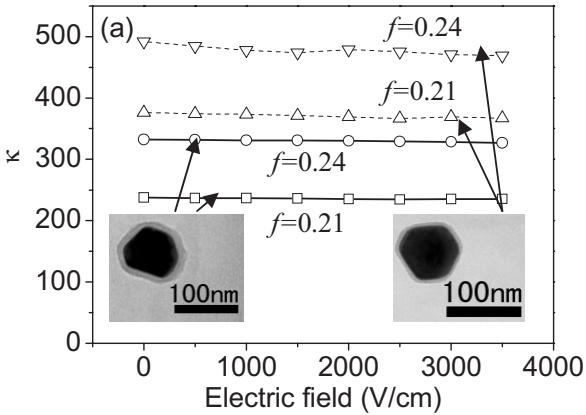

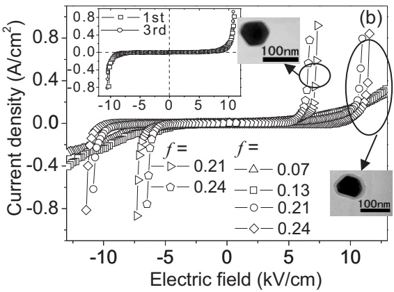

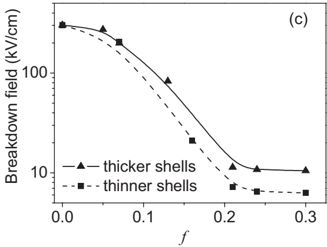

Figure 4. a) Bias dependence of j at $1 0 ^ { 3 }$ Hz of the composite films containing Ag@C particles with the thicker or thinner shells. b) I–V characteristics of these composite films, where the inset shows repeated measurements to the I–V behavior of the $f   =   0 . 2 4$ composite with the thicker shells. c) Variation of the breakdown fields with f for the composite films.

In summary, the hybrid Ag@C particles with thin organic shells coated on $\mathbf { A g }$ cores serve as special fillers to induce percolation-like enhancement in the dielectric constant of the polymer films, and, in particular, the organic nanoshells serve as electrical barriers between the Ag cores to form a continuous interparticle-barrier-layer network and retain a stable high-j and low loss. The polymer composite dielectrics combine strategies of the percolative capacitor and barrier-layer capacitor. The excellent compatibility of the organic shells with the polymer matrix also ensures the dispersion of fillers in the matrix. The high performance (i.e., high-j, low loss, and high stability of $\kappa )$ , easy processability, and low cost of the flexible composites and their compatibility with the organic PCB technology make them suited for the applications in flexible high-j components such as the PCB-embedded dielectric components. The present approach may be extended to the fabrication of similar hybrid composites with potentials in high-j applications by proper choice of materials and dimension-tuning of both the core and the shell, and choosing from a broad selection of polymers as a matrix.

## Experimental

The core/shell Ag@C particles were synthesized via a hydrothermal method [10]. 4 g glucose and 0.1 g poly(vinyl pyrrolidone) (PVP; weight-average molecular weight $M_{\mathrm{w}}=130000\ \mathrm{g}\ \mathrm{mol}^{-1}$ were dissolved in 35 mL water to form a clear solution, followed by the addition of 0.5 mL AgNO3 (0.1 M) [14]. The solution was then sealed in a 40 mL Teflon-sealed autoclave. The autoclave was kept at $1 8 0   ^ { \circ } \mathbf { C }$ for 4 h. The final Ag@C products were obtained by centrifuging and washing in deionized water, alcohol and ethylene glycol monomethyl ether (EGME). The composite films were fabricated by solution processing. A certain amount of Ag@C particles dispersed in EGME were ultrasonicated to form a stable colloid, followed by adding a certain amount of resin $( \mathbf { i . e . } ,$ neopenthyl glycol diglycidyl ether) and stirring for 10 min. Then a little hardener (i.e., a blend of diethylenetriamine and 2-hydroxythyldiethylenetriamine) was added and the mixture was stirred for another 10 min. Finally, the resultant solution mixture was spin-cast onto the silicon substrates with a Pt bottom electrode, and then dried at $4 0   ^ { \circ } \mathbf { C }$ for 12 h to thoroughly evaporate the solvent and cure the epoxy matrix, yielding films with a thickness of ca. 85 lm. The densities of the resultant Ag@C particles were estimated to be about 8.7 and $6 . 7 ~ \mathrm { g }   \mathrm { c m } ^ { - 3 }$ for the thinner- and thicker-shell particles, respectively, by using the densities of silver $(10.5~ g \cdot  cm ^{-3})$ and the carbonaceous shell $(1.5~\mathrm{g}~\mathrm{cm}^{-3})$ and the geometric sizes of the core and the shell. The volume fractions were determined from the weight fractions by using the density values.

For electrical measurements, top Pt electrodes with a diameter of 1 mm were deposited onto the film surface. The electric responses of the composite films were measured using a HP 4194A impedance analyzer in the frequency range of 100 Hz–30 MHz. The microstructures of the nanoparticles and the composite films were characterized by using X-ray diffraction, TEM, and Raman spectroscopy. The current– voltage (I–V) curve was obtained using a Keithley 2410 SourceMeter.

Received: September 14, 2006 Revised: November 24, 2006 Published online: April 18, 2007

[1] Q. M. Zhang, Nature 2002, 419, 284.

[2] a) Y. Bai, Z. Y. Cheng, V. Bharti, H. S. Xu, Q. M. Zhang, Appl. Phys. Lett. 2000, 76, 3804. b) Y. Rao, J. Appl. Polym. Sci. 2002, 83, 1084. c) L. Li, IEEE Trans. Compon. Packag. Technol. 2005, 28, 754. d) S. D. Cho, IEEE Trans. Electron. Packag. Manuf. 2005, 28, 297. e) Z. M. Dang, Y. Shen, C. W. Nan, Appl. Phys. Lett. 2002, 81, 4814.

## ADVANCED MATERIALS

[3] a) Z. M. Dang, Y. H. Lin, C. W. Nan, Adv. Mater. 2003, 15, 1625. b) C. Huang, Q. M. Zhang, G. de Botton, K. Bhattacharya, Appl. Phys. Lett. 2004, 84, 4391.

[4] C. Huang, Q. M. Zhang, J. Su, Appl. Phys. Lett. 2003, 82, 3502.

[5] a) R. Snogren, Printed Circuit Fabr. 2002, 25, 26. b) R. Ulrich, IEEE Trans. Adv. Packag. 2004, 27, 326. c) W. Jillek, W. K. C. Yung, Int. J. Adv. Manuf. Technol. 2005, 25, 350.

[6] a) D. Stauffer, A. Aharony, Introduction to Percolation Theory, Taylor and Francis, London 1992. b) C. W. Nan, Prog. Mater. Sci. 1993, 37, 1.

[7] a) D. S. McLachlan, M. B. Heaney, Phys. Rev. B 1999, 60, 12 746. b) W. D. Heiss, D. S. McLachlan, and C. Chiteme, Phys. Rev. B 2000, 62, 4196.

[8] a) L. Qi, Adv. Mater. 2005, 17, 1777. b) J. Xu, C. P. Wong, Appl. Phys. Lett. 2005, 87, 082 907.

[9] V. Ginzburg, Macromolecues 2006, 39, 3901.

[10] X. M. Sun, Y. D. Li, Langmuir 2005, 21, 6019.

[11] a) N. Bowler, J. Phys. D 2004, 37, 326. b) H. Pauly, H. P. Schwan, Z. Naturforsch. 1959, 14b, 125. The values of the parameters (e.g., the conductivities and dielectric constants for the organic shell and epoxy matrix) used for calculations of the relaxation frequency were all obtained from the experimental results. The conductivity for the Ag nanocores was taken as 6 × 105 S cm–1.

[12] G. Oldfied, T. Ung, P. Mulvaney, Adv. Mater. 2000, 12, 1519.

[13] J. Wu, C. W. Nan, Y. H. Lin, Y. Deng, Phys. Rev. Lett. 2002, 89, 217 601.

[14] The thickness of the organic shells (a blend of carbonaceous polysaccharide and PVP [10]) can be tuned by the amount of PVP added in the solution. For example, as the PVP amount in the solution increases from 0.1 g to 0.5 g while keeping all other processing parameters unchanged, the shell thickness decreases from 8–10 nm to 4–6 nm (see Fig. 1a and b). More PVP (e.g., ≥ 0.5 g) makes it hard to form the shells, and on the other hand, much less PVP can induce much thicker shells, but such thick shells become semiconductive or even conductive carbon shells which are not desired in this case.

[15] A. A. Gusev, O. A. Guseva, Adv. Eng. Mater. 2003, 5, 713.