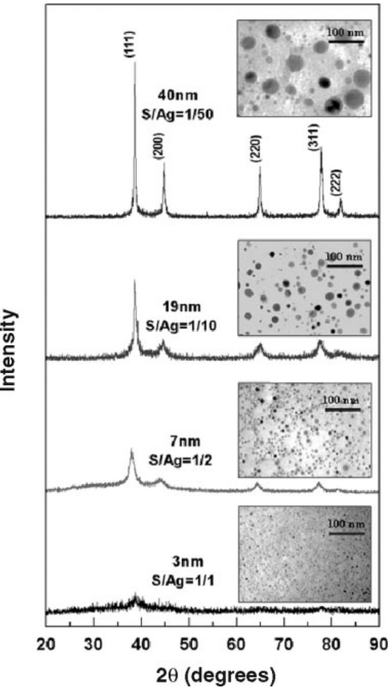
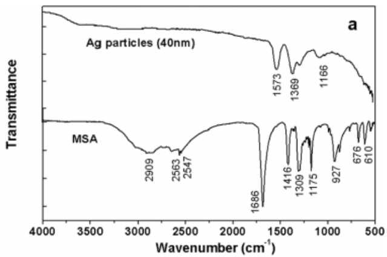
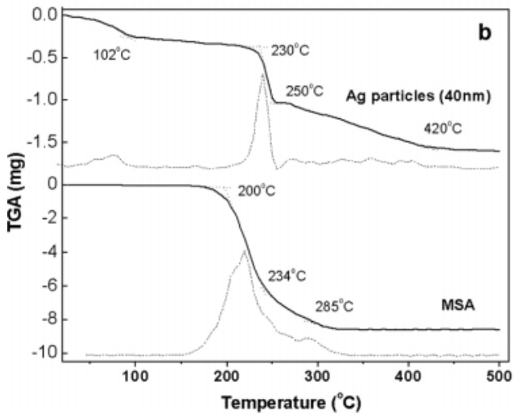
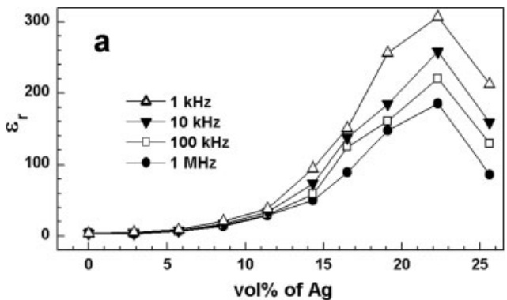
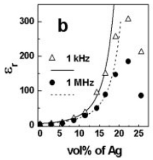
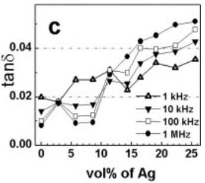
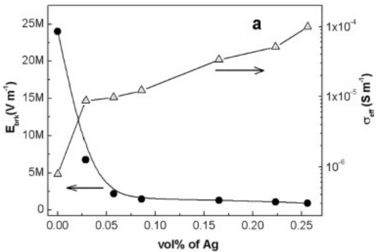
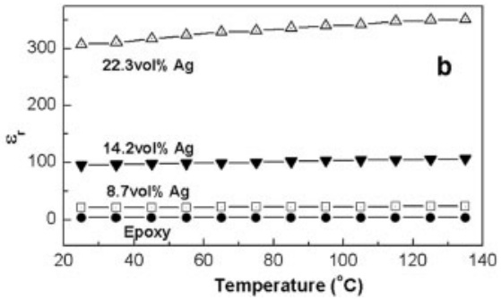

parameters. Nevertheless, the preliminary findings here are expected to benefit the nanowire community in stimulating further investigation of these alternatives in nanowire growth, characterization, and application development.

## Experimental

The synthetic approach involves a carbothermal reduction process followed by catalyst-assisted heteroepitaxial growth using a previously reported reaction chamber setup  $[8]$ . Briefly, the source consisted of powder forms of stannous tin oxide (SnO, 99.999 % purity) and synthetic graphite (99.999 % purity) in a 1:1 weight ratio. The source was placed 2–3 cm upstream of the  $\alpha$ -sapphire substrates inside a horizontal tubular reactor with an open egress. The substrate was coated with a 2 nm thin film of a catalyst material by ion-beam sputtering. Stannous tin oxide was the source material of choice here due to its relative thermal and chemical volatility compared with stannic tin oxide. The open-egress design creates a relatively more oxidative environment by back-diffusion of ambient oxygen and carbon dioxide. Cross-contamination was minimized by allowing only one catalyst species in the chamber per run and baking the chamber at 1000 °C and 450 sccm argon for one hour between runs. Other process conditions were fixed at a constant argon carrier gas flow rate (Ar, 99.999 %, 450 sccm), 840–860 °C temperature window, and a growth time of 60 min. Characterization was performed by scanning electron microscopy (SEM) using a field-emission Hitachi S4000 at 10 kV and 15  $\mu$ A, without deposition of a gold coat on the samples.

Received: October 18, 2004  
Final version: March 15, 2005  
Published online: May 19, 2005

[1] P. Nguyen, H. T. Ng, Y. Yamada, M. K. Smith, J. Li, J. Han, M. Meyyappan, Nano Lett. 2004, 4, 651.

[2] H. T. Ng, J. Han, T. Yamada, P. Nguyen, Y. P. Chen, M. Meyyappan, Nano Lett. 2004, 4, 1247.

[3] R. S. Wagner, W. C. Ellis, Appl. Phys. Lett. 1964, 4, 89.

[4] P. Yang, Y. Wu, R. Fan, Int. J. Nanosci. 2002, 1, 1.

[5] Y. Wu, P. Yang, J. Am. Chem. Soc. 2001, 123, 3165.

[6] X. F. Duan, C. M. Lieber, J. Am. Chem. Soc. 2000, 122, 188.

[7] H. T. Ng, B. Chen, J. Li, J. Han, M. Meyyappan, J. Wu, S. X. Li, E. E. Halter, Appl. Phys. Lett. 2003, 82, 2023.

[8] P. Nguyen, H. T. Ng, J. Kong, A. M. Cassell, R. Quinn, J. Li, J. Han, M. McNeil, M. Meyyappan, Nano Lett. 2003, 3, 925.

[9] P. Nguyen, Masters Thesis, San José State University, San José, CA 2003.

[10] G. Gu, M. Burghard, G. T. Kim, P. Düsberg, P. W. Chiu, V. Krstic, S. Roth, W. Q. Han, J. Appl. Phys. 2001, 90, 5747.

[11] Z. W. Pan, Z. R. Dai, C. Ma, Z. L. Wang, J. Am. Chem. Soc. 2002, 124, 1817.

[12] D. P. Yu, C. S. Lee, I. Bello, X. S. Sun, Y. H. Tang, G. W. Zhou, Z. G. Bai, Z. Zhang, S. Q. Feng, Solid State Commun. 1998, 105, 403.

[13] S. Sharma, M. Sunkara, Nanotechnology 2004, 15, 130.

[14] J. B. Baxter, F. Wu, E. Aydil, Appl. Phys. Lett. 2003, 81, 3797.

[15] P. Nguyen, unpublished.

[16] CRC Handbook of Chemistry and Physics, 78th ed. (Ed: D. R. Lide), CRC Press, Boca Raton, FL 1998.

[17] S. Sharma, M. K. Sunkara, J. Am. Chem. Soc. 2002, 124, 12288.

[18] X. Liu, C. Li, H. Song, J. Han, C. Zhou, Appl. Phys. Lett. 2003, 82, 1950.

[19] Y. X. Chen, L. J. Campbell, W. L. Zhou, J. Cryst. Growth 2004, 270, 505.

# High-Dielectric-Constant Silver–Epoxy Composites as Embedded Dielectrics\*\*

By Lai Qi, Burtrand I. Lee, $^{*}$  Sihai Chen, William D. Samuels, and Gregory J. Exarhos

Embedded-capacitor technology is an important emerging technology that will enable significant improvement of the performance and functionality of future electronic devices.$^{[1,2]}$ Embedded capacitors are specially printed portions of printed-circuit-board (PCB) laminates which perform the charge-storing function but do not require space on the surface of the PCB. One major technical challenge for implementing this technology is the development of appropriate dielectric materials with good electrical and mechanical properties, because traditional ceramic dielectrics cannot be applied by current PCB manufacturing methodologies.$^{[3,4]}$ Particulate-filled (0–3 connectivity) polymer-based composites provide an ideal solution, possessing enhanced electrical properties and retaining the mechanical properties of the matrix. Much research work has been done on ceramic-polymer systems that adopt traditional ceramics as fillers, e.g., BaTiO$_{3}$,$^{[5]}$ PZT,$^{[6]}$ and PMN-PT.$^{[7,8]}$ The advantages of these composites include predictable dielectric behavior, low dielectric loss, and easy fabrication. However, in most cases these composites have relatively low dielectric constants, $\varepsilon_{\mathrm{r}}$, (usually <100) even with high ceramic loadings (>50 vol.-%). High ceramic loadings will deteriorate the mechanical qualities of the composites and the resulting PCBs.

In developing the percolation theory of the conductor–insulator composites, $^{[9]}$  the observation of a dramatic increase of  $\varepsilon_{r}$  at the percolation threshold $^{[10]}$  brings up interest of using these composites as dielectrics. Pecharromán et al. reported ultra-high  $\varepsilon_{r}$  values (>80 000) in nickel-doped  $BaTiO_{3}$  $^{[11]}$  and molybdenum-doped mullite. $^{[12]}$  For the metal–polymer system, Rao et al. $^{[13]}$  reported a threshold  $\varepsilon_{r}$  of 2000 in silver-flake-doped epoxy. Dang et al. $^{[14,15]}$  reported  $\varepsilon_{r}$  values of 400 in a nickel–poly(vinylidene fluoride) composite. Similar enhancements of  $\varepsilon_{r}$  in other metal–polymer systems were observed by Fan et al. $^{[16]}$  Nevertheless, the benefits of these high- $\varepsilon_{r}$  values in prepared metal–polymer composites were counteracted by the high reported dielectric losses, e.g., values of tan $\delta$ of 0.24,$^{[13]}$ 0.18,$^{[14]}$ $\sim$ 0.5,$^{[15]}$ and $>2$.$^{[16]}$ It is also risky to prepare percolative dielectrics with a threshold composition due to the abrupt variation of $\varepsilon_{\mathrm{r}}$ near the threshold. According to Rao et al.,$^{[13]}$ the $\varepsilon_{\mathrm{r}}$ increased from 200 to 2000 with a filler concentration increase from 11.03 vol.$-\%$ to 11.43 vol.$-\%$ and decreased to nearly zero at 11.52 vol.$-\%$.

Moreover, to make the metal–polymer composite practically useful, the influence of the filler size has to be considered. In a classic 0–3 percolation model, $^{[9,17,18]}$ the randomly distributed metal fillers form clusters (conducting networks) within the matrix. When the size of the largest cluster approaches the size of the matrix, discharge between electrodes (percolation) happens. Based on a random distribution, the cluster volume, $V_{cluster}$, is proportional to the product of the number of fillers that in the cluster, $N_{filler}$, and the average filler volume, $V_{filler}$, as

$$
V _ {\text {cluster}} \propto N _ {\text {filler}} V _ {\text {filler}}\tag{1}
$$

Derived from Equation 1, at the threshold concentration,

$$
\bar {N} _ {\text {filler}} \propto \bar {V} _ {\text {cluster}} / V _ {\text {filler}}\tag{2}
$$

where  $\bar{N}_{filler}$  and  $\bar{V}_{cluster}$  are the threshold filler number and the threshold cluster volume, respectively. The threshold filler number is proportional to the threshold filler concentration,  $\bar{C}_{filler}$ , as

$$
\bar {N} _ {\text {filler}} \propto \bar {C} _ {\text {filler}}\tag{3}
$$

For a specific system, the percolation probability, $P_{\mathrm{pcl}}$, is always proportional to the filler concentration but inversely proportional to the threshold concentration, $\bar{C}_{\mathrm{filler}}$, as

$$
P _ {\mathrm{pcl}} \propto 1 / \tilde {C} _ {\text {filler}}\tag{4}
$$

Therefore,

$$
P _ {\mathrm{pcl}} \propto V _ {\text {filler}} / \bar {V} _ {\text {cluster}} \pm (D _ {\text {filler}} / \bar {D} _ {\text {cluster}}) ^ {3}\tag{5}
$$

where $D_{\text{filler}}$ and $\bar{D}_{\text{cluster}}$ are the diameters of filler and the threshold cluster, respectively. This means that the percolation probability is closely related to the size ratio of the filler to the composite thickness. In the classic model$^{[9]}$ or for bulk samples,$^{[13-16]}$ the insulating matrix is considered to be infinitely large in three dimensions compared with the size of fillers. Therefore, the influence of the size ratio on the percolation probability is negligible. However, for practical capacitors, dielectric materials need to be fabricated into thin layers of a typical thickness of 20–100 $\mu$m$^{[3]}$ to increase the volumetric packaging density. Therefore, in practical applications, this 3D infinity model is no longer valid, especially when the filler size is in the micrometer range and comparable to the thickness of the dielectric layer. Thus, for capacitor applications, the size of metal fillers in a metal–polymer composite has to be in the nanometer range. However, the so-far reported studies $^{[13-16]}$ on the metal–polymer composites adopted micrometer-size metal powders or even metal flakes.

In this communication, we report the synthesis of an epoxy-based composite containing randomly distributed silver nanoparticles 40 nm in size. Ag nanoparticles were prepared by a redox reaction between silver nitrate and sodium borohydride. The surface of the Ag nanoparticles is coated with a thin layer of mercaptosuccinic acid (MSA). The synthesized Ag–epoxy composite has a high dielectric constant above 300 and a relatively low dielectric loss of 0.05 while retaining the flexibility of the polymer matrix. Figure 1 shows the X-ray diffraction (XRD) patterns of the synthesized Ag particles and their corresponding transmission electron microscopy (TEM) images. The average particle size could be controlled from 3 nm to 40 nm by changing the surfactant/silver molar ratio (S/Ag) from 1:1 to 1:50. Below 3 nm, the Ag particles were basically amorphous. When the size was increased to above

Figure 1. XRD patterns and TEM images of silver nanoparticles synthesized in different sizes by varying the surfactant/silver ratio (S/Ag).

5 nm, the typical diffraction pattern belonging to cubic silver could be observed. When the size increased to 40 nm, the Ag particles could be considered to be well crystallized.

The prototype capacitors were fabricated by spin-coating the synthesized Ag–epoxy (40 nm Ag) mixture onto a gold-coated aluminum substrate. After curing at  $160^{\circ}$ C for 1 h, a typical coating thickness of 20  $\mu$ m was acquired. A series of Ag–epoxy composites with various Ag volume fractions were prepared in order to locate the optimum composition.

To have a better understanding of the organic coating, inductively coupled plasma atomic emission spectroscopy (ICP–AES) measurements were conducted to determine the elemental composition of the synthesized 40 nm Ag nanoparticles. The results showed a nanoparticle composition of C, 0.329; H, 0.004; O, 0.527; Na, 0.262; S, 0.215; and Ag, 92.67 (provided in wt.-%). An estimated molecular formula can be calculated as  $C_{4.2}H_{5.2}O_{4.9}Na_{1.7}SAg_{128.6}$ . The comparison of the Fourier-transform IR (FTIR) spectra of 40 nm Ag nanoparticles and pure MSA confirms the existence of S–Ag bonds, as shown in Figure 2a. The typical S–H stretching vibration peak at  $2547\ cm^{-1}$ [19] disappeared when MSA molecules adsorbed on the Ag particles. The double peaks of the carboxylate vibration at 1573 cm $^{-1}$ (asymmetric) and 1369 cm $^{-1}$ (symmetric) in the Ag spectrum show that the organics existed mostly as carboxyl salts. $^{[20]}$ Figure 2b compares the thermogravimetric results of 40 nm Ag and pure MSA. Most of the solvent in Ag particles was removed below 100 °C. For pure MSA, 90 % of the decomposition happened between 200 °C and 300 °C. For coated Ag particles, some MSA molecules (possibly without S–Ag bonds) decomposed between 230 °C and 250 °C as pure MSA, while the rest (possibly with S–Ag bonds) gradually decomposed between 250 °C and 420 °C.

Figure 2. a) FTIR spectra of MSA-coated Ag and pure MSA powders; b) thermogravimetric curves of MSA-coated Ag and pure MSA (solid lines) and derivatives of the curves (dotted lines).

Figure 3a shows the measured dielectric constants of prepared epoxy composites filled with $40\mathrm{nm}$ Ag particles as a function of the Ag volume fraction. A moderate increase in dielectric constant was observed when the Ag volume fraction

Figure 3. a) Evolution of the relative dielectric constant, $\varepsilon_{\mathrm{n}}$ of the Ag-epoxy composites as a function of silver volume fraction at room temperature; b) the best fit of the $1\mathrm{kHz}$ and $1\mathrm{MHz}$ $\varepsilon_{\mathrm{r}}$ data to Equation 6; c) the dependence of the loss factor, tan $\delta$, on silver volume fraction.

was below 12 vol.-%. The increase of $\varepsilon_{\mathrm{r}}$ became significant when Ag addition was more than 15 vol.-%. At a frequency of $1\mathrm{kHz}$ and room temperature, the maximum value of 308 was reached with 22 vol.-% of Ag. The decrease of $\varepsilon_{\mathrm{r}}$ upon increasing frequencies was due to the slow dielectric relaxation of epoxy resins. As shown in Figure 3b, when the Ag volume fraction was below 15 vol.-%, the variation of $\varepsilon_{\mathrm{r}}$ showed a good agreement with the typical power law[21]

$$
\varepsilon_ {\mathrm{r}} = \varepsilon_ {0} \mid (f _ {\mathrm{c}} - f) / f _ {\mathrm{c}} \mid^ {- q}\tag{6}
$$

where $\varepsilon_0, f_{\mathrm{c}}, f,$ and $q$ are the relative dielectric constant of the matrix, the percolation threshold, Ag volume fraction, and a

# ADVANCED MATERIALS

critical exponent, respectively. However, above 15 vol.-% of Ag the curve deviates from the theoretical prediction, which is supposed to be an abrupt descent of $\varepsilon_{\mathrm{r}}$ to nearly zero. On the contrary, the rate of increase of the measured $\varepsilon_{\mathrm{r}}$ gradually decreases, forming a broad peak over a wide volume fraction range of nearly 20 vol.-%. Apparently, this decrease of $\varepsilon_{\mathrm{r}}$ is not caused by conduction. Microstructure investigation revealed that the porosity of the sample with 25.2 vol.-% of Ag is significantly higher than those of the other samples with less Ag.

The introduction of porosity is possibly caused by the absorbed surfactant layer, which keeps Ag particles from directly contacting each other and leaves space between them. This is also the reason why the dry MSA-coated Ag powders result in a density of only about  $2.1 \, g cm^{-3}$ . When the epoxy amount is not enough to occupy the void between particles, pores form. Another possibility is that with higher Ag content, the viscosity of the composites increases considerably, which makes the removal of solvent difficult. With the same drying time, samples with more Ag will contain more solvent residue, which will form micropores during curing. Therefore, the observed maximum  $\varepsilon_{r}$  point should not be a real percolation threshold. It is only a point where the influence of porosity on  $\varepsilon_{r}$  overwhelms the contribution from adding Ag. Nevertheless, for practical applications, this is definitely an advantage. It makes the material safe for use, because percolation means failure for a charge-storage device.

The dielectric loss, $\tan \delta$, of prepared Ag–epoxy composites is shown in Figure 3c. The loss factor gradually increased from 0.008 to 0.05 as the Ag fraction was increased from 0 to 25.2 vol.-%. Similarly, we did not observe the rapid climbing of the tan $\delta$ values. This indicates that the threshold has not been reached, which agrees with the above conjecture; i.e., due to the organic coating, the formation of a conducting filler network is difficult. This loss factor is significantly lower than those reported values.[13-16] As shown in Figure 4a, the breakdown voltage of prepared Ag–epoxy composites decreases with increasing Ag volume fraction as expected. No abrupt change of breakdown voltages was observed, which indicates no change in the breakdown mechanism. In other words, percolation was not reached in those composites. The measured conductivity of the prepared composites is also shown in Figure 4a. The variation of $\sigma_{\mathrm{eff}}$ as a function of Ag volume fraction was relatively gentle, which agrees with the tan $\delta$ data. The relative dielectric constants of the prepared Ag–epoxy composites showed little temperature dependence from 25 °C to 135 °C, as shown in Figure 4b.

In summary, the novel Ag–epoxy composites in this work are nanometer-scale 0–3 type composites designed for embedded-capacitor applications. The high dielectric constant (>300) and relatively low dielectric loss (<0.05) render this material a promising potential to be used as an embedded dielectric. The organic coating on the Ag nanoparticle surface is found to be the cause of several interesting phenomena that do not appear in the classic bulk-metal-insulator composites, i.e., the desired high concentration tolerance and undesired porosity problem. A better understanding of the mechanisms that determine how surfactants influence those issues will prove to be helpful for developing successful 0–3 type nanocomposites.

Figure 4. a) Breakdown field, $E_{\mathrm{brk}}$, at 200 Vs$^{-1}$ (●) and electrical conductivity, $\sigma_{\mathrm{eff}}(\triangle)$, of the Ag–epoxy composites as a function of Ag volume fraction at room temperature and 1 kHz. b) The relative dielectric constant, $\varepsilon_n$ of the Ag–epoxy composites as a function of temperature at 1 kHz.

## Experimental

The Ag nanoparticles were prepared by a method similar to those previously reported  $[22,23]$ . A predetermined amount of  $AgNO_{3}$  was dissolved in 2 mL of distilled water. A certain amount of mercaptosuccinic acid (MSA) and dodecanoic acid (DDA) were dissolved in 20 ml anhydrous methanol. The molar ratio of MSA to DDA was set to 1:4.5. The molar ratio of MSA to silver was varied from 1:1 to 1:100. The  $AgNO_{3}$  solution was then mixed with the surfactant solution under stirring. A freshly prepared  $NaBH_{4}$  solution in anhydrous methanol was then added dropwise. The reacting solution was kept under stirring for an additional 10 min. The dark precipitate was separated from the liquid by centrifugation. The precipitated silver nanoparticles were washed by distilled water and then refluxed in methanol three times.

The Ag nanoparticles were dispersed in acetone after refluxing. A certain amount of the epoxy resin (3,4-epoxycyclohexylmethyl-3,4-epoxycyclohexanecarboxylate, Aldrich) was mixed with the Ag by ball-milling for 10 h. The mixture was then mixed with the epoxy hardener (hexahydro-4-methylphthalic anhydride, Aldrich) by mechanical stirring. The thoroughly mixed epoxy–silver composites were spin-coated onto a gold-sputtered aluminum substrate. The samples were heated at  $45^{\circ}$ C for 2 h and then at  $160^{\circ}$ C for 1 h to cure the epoxy. This coating–heating cycle was repeated several times to achieve the desired film thickness. A gold layer was deposited as the top electrode after the curing.

Received: November 4, 2004  
Final version: April 6, 2005

[1] R. Funer, Printed Circuit Des. 2002, 19, 8.

[2] R. Snogren, Printed Circuit Fabr. 2002, 25, 26.

[3] R. Ulrich, Circuit World 2004, 30, 20.

[4] S. K. Bhattacharya, P. M. Raj, D. Balaraman, H. Windlass, R. R. Tummala, Circuit World 2004, 30, 31.

[5] R. Popielarz, C. K. Chiang, R. Nozaki, J. Obrzut, Macromolecules 2001, 34, 5910.

[6] H. Windlass, P. M. Raj, D. Balaraman, S. K. Bhattacharya, R. R. Tummala, IEEE Trans. Adv. Packag. 2003, 26, 10.

[7] Y. Bai, Z. Y. Cheng, V. Bharti, H. S. Xu, Q. M. Zhang, Appl. Phys. Lett. 2000, 76, 3804.

[8] S. Ogitani, S. A. Bidstrup-Allen, P. A. Kohl, IEEE Trans. Adv. Packag. 2000, 23, 313.

[9] S. Kirkpatrick, Rev. Mod. Phys. 1973, 45, 574.

[10] D. M. Grannan, J. C. Garland, D. B. Tanner, Phys. Rev. Lett. 1981, 46, 375.

[11] C. Pecharromán, F. Esteban-Betegón, J. F. Bartolomé, S. López-Esteban, J. S. Moya, Adv. Mater. 2001, 13, 1541.

[12] C. Pecharromán, J. S. Moya, Adv. Mater. 2000, 12, 294.

[13] Y. Rao, C. P. Wong, IEEE Proc. Electron. Compon. Technol. Conf. 2002, 920.

[14] Z. M. Dang, Y. H. Lin, C. W. Nan, Adv. Mater. 2003, 15, 1625.

[15] Z. M. Dang, Y. Shen, C. W. Nan, Appl. Phys. Lett. 2002, 81, 4814.

[16] L. Fan, Y. Kumashiro, C. P. Wong, IEEE Proc. Electron. Compon. Technol. Conf. 2003, 167.

[19] The Aldrich Library of FT-IR Spectra, Vol. 1, 1st ed., Aldrich Chemical Co., Milwaukee, WI 1985, p. 528.

[20] N. B. Colthup, L. H. Daly, S. E. Wiberley, in Introduction to Infrared and Raman Spectroscopy, 3rd ed., Academic Press, San Diego, CA 1990, p. 291.

[17] D. Stauffer, Phys. Rep. 1979, 54, 1.

[18] C. W. Nan, Prog. Mater. Sci. 1993, 37, 1.

[21] D. R. Bowman, D. Stroud, Phys. Rev. B: Condens. Matter Mater. Phys. 1989, 40, 4641.

[22] N. R. Jana, X. G. Peng, J. Am. Chem. Soc. 2003, 125, 14280.

[23] S. H. Chen, K. Kimura, Langmuir 1999, 15, 1075.

# Synthesis and Photoluminescence of $\mathrm{SnO}_2 / \mathrm{SiO}_2$ Microrings\*\*

By Xiaohong An, Guowen Meng, $^{*}$  Qing Wei, Xueru Zhang, Yufeng Hao, and Lide Zhang

It is well known that the physical, optical, and electronic properties of materials are dependant on their shape when their size is reduced to micrometer- and nanometer-scale dimensions. $^{[1-4]}$  Two-dimensional structures, such as rings, $^{[5-7]}$ disks, $^{[8,9]}$  prisms, $^{[10,11]}$  and plates, $^{[12,13]}$  are believed to be remarkably effective in controlling optical properties. For these reasons, micro-/nanostructured rings have become a new and interesting focus of research. Several methods have been used to prepare rings consisting of semiconductors, metals, polymers, and other materials. $^{[14-19]}$  For example, capped InAs quantum rings have been prepared by molecular beam epitaxy and subsequent annealing. $^{[14,15]}$  Ordered arrays of Au, Ni, and Si nanorings have been fabricated by using  $Ar^{+}$ sputter redeposition in a porous alumina mask. $^{[16]}$  Polystyrene microring resonators have been fabricated via a nanoimprinting technique. $^{[17]}$  Amorphous metal and semiconductor nanorings have been prepared by direct-writing inorganic electron-beam lithography. $^{[19]}$  However, preparing rings by the above methods requires the use of sophisticated equipment. Here, we demonstrate that  $SnO_{2}/SiO_{2}$  microrings can be synthesized via a two-step process. In the first step, mixed powders of  $SiO_{2}$, carbon black, and Sn are heated at 1050 °C in a flowing argon/oxygen atmosphere to produce  $SnO_{2}/SiO_{2}$  nanoparticles (NPs) on a silicon wafer. In the second step, the obtained  $SnO_{2}/SiO_{2}$  NPs on the Si wafer are heated at 1100 °C and transformed into  $SnO_{2}/SiO_{2}$  microrings. Photoluminescence (PL) spectra of the  $SnO_{2}/SiO_{2}$  microrings with different sizes reveal two similar peaks, a UV peak centered at 393 nm and a green peak at 513 nm. When the microrings become smaller, the intensity of the 513 nm emission increases and the relative intensity of the 393 nm emission decreases. As for the PL spectrum of  $SnO_{2}/SiO_{2}$  NPs, only a strong peak around 513 nm could be observed. Thus the PL spectrum of  $SnO_{2}/SiO_{2}$  microrings can be controlled by their size and shape. Additionally, the appearance of a peak at 393 nm indicates that  $SnO_{2}/SiO_{2}$  microrings with a larger outer diameter may have favorable UV PL and may be used as UV laser emitters. The method reported here may be used to fabricate microrings of other materials.

The general morphology of the white products obtained after the first step is shown in Figure 1a. It can be seen that large quantities of NPs are formed on the Si substrate. Energy-dispersive X-ray (EDX) analysis reveals that the NPs are composed of Si, O, and Sn. X-ray diffraction (XRD) analysis further reveals that the NPs are composed of  $SiO_{2}$  and  $SnO_{2}$ . A close-up scanning electron microscopy (SEM) image of the NPs (Fig. 1a, inset) reveals that the NPs on the Si substrate are not uniform in size and are packed together. Statistics from counting twenty of these NPs shows that the diameters of the NPs vary from 50 to 150 nm, with an average of 100 nm. Figure 1b shows the morphology of the final products after the second step. It can be seen that large numbers of microrings are self-assembled on the Si substrate, and have outer diameters of several micrometers and wall thicknesses of about 400 nm. The mean outer diameter is about 2  $\mu$ m according to statistics obtained by counting twenty microrings. A close-up view of the microrings (Fig. 1b, inset) reveals that the walls of the microrings are not uniform, and every microring consists of a few tens of segments, which are connected and packed together to form a circularly shaped ring.

<small>[\*\*] This work was supported by the Natural Science Foundation of China (Grant No. 10374092 and 50271068) and the Ministry of Science and Technology of China (Grant No. G1 999 064 501).</small>