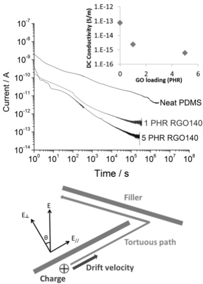
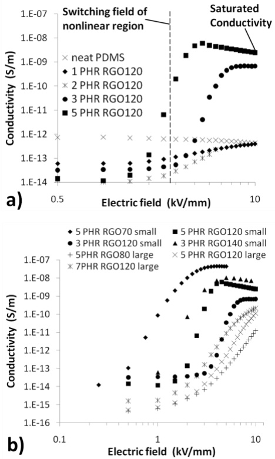
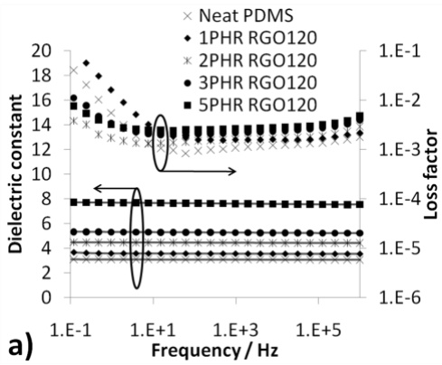
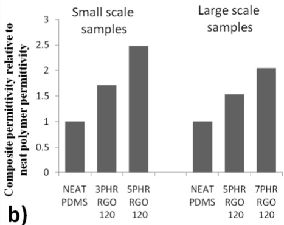

# Nonlinear Conductivity and Dielectric Response of Graphene Oxide Filled Silicone Rubber Nanocomposites

Z. Wang1, J. K. Nelson1, H. Hillborg2, S. Zhao2, L. S. Schadler1

1 Rensselaer Polytechnic Institute, Troy, NY 12180 USA

2 ABB AB, Corporate Research, Västerås, SE-721 78 Sweden

**Abstract- Graphene oxide filled silicone rubber nanocomposites were found to possess a large nonlinear coefficient of electrical conductivity, smaller low field conductivity than that of the neat polymer and an increase in the dielectric constant over that of the polymer matrix with a very small increase in the dielectric loss. These electrical and dielectric properties make graphene oxide/silicone nanocomposites an excellent candidate for a field grading material. Possible mechanisms that lead to the observed dielectric behavior are discussed in this work. The effect of sample size and processing on the material properties is also discussed.**

## I. INTRODUCTION

Electric field grading materials are used to reduce the locally enhanced electric field in many electrical apparatus. Insulating materials, usually polymer composites with tunable field dependent conductivity as well as high dielectric constant and low loss, are used for electric field grading applications [1]. Polymer composites filled with semi-conducting ceramic particles such as SiC, ZnO etc. and carbon black [2], [3] are used in current field grading materials. To obtain nonlinear electrical conductivity, the filler loading needs to reach the percolation threshold, typically 30 to 40 vol% for spherical fillers. The high loading leads to poor mechanical properties and high density.

In our previous study [4], composites of poly(dimethyl siloxane) (PDMS) filled with graphene oxide (GO) or slightly thermally reduced GO exhibited increased dielectric constant, low loss and unusual nonlinear electrical conductivity at a small filler loading of about 3 vol%. In this paper, some of the results in [4] are presented followed by a more detailed discussion about the possible mechanisms that lead to the observed dielectric and electrical response. In addition, the nonlinear conductivity and dielectric constant of GO composites in a scaled-up production are presented and compared to those of lab-scale samples.

## II. EXPERIMENTAL

GO was purchased from Angstron Materials in a 0.5% aqueous suspension. The average lateral dimension of GO was about 500 nm and the average thickness was 1.1 nm indicating mostly monolayer GO. The suspension was freeze-dried for 2 days and thermally reduced at temperatures ranging from 70 °C to 160 °C for 12 hours. The temperature ramp rate was kept at $0 . 5 \; ^ { \circ } \mathrm { C } ,$ /min to avoid violent reduction of GO.

For small samples that are about 0.7 grams, Sylgard 184 (Dow Corning) consisting of PDMS and a reinforcing silica filler was used as the polymer matrix. The reduced graphene oxide (RGO) was mixed into the precursor Sylgard 184A using a FlackTek Speed Mixer at 3000 rpm for a total of 30 minutes in 6 intermittent runs. The filler volume fraction ranged from 1 to 5 PHR (parts per hundred parts of resin). Then Sylgard 184B was added into the mixture, followed by curing in a mould at $1 5 0 \; ^ { \circ } \mathrm { C }$ for 1 hour. Planar samples with a diameter of 3.18 cm and a thickness of approximately 300 µm were obtained. To test the properties of composites processed using a more scalable industrial process, RGO was mixed with about 30 grams of a high viscosity silicone (addition-curing PDMS and 25 wt.% reinforcing silica filler) in a two-rollermixer. Planar samples with a diameter of 20 cm and a thickness of approximately 1 mm were prepared by compression molding.

The absorption current and conductivity measurements were carried out in a guarded cell connected to a high voltage DC power supply and Keithley picoammeter. In the conductivity measurement, the field strength was stepped up to 10 kV/mm at an interval of 0.5 kV/mm. Conductivity data were taken as a function of field strength after holding the voltage constant for 30 minutes. The composite samples were tested in a Novocontrol alpha high resolution dielectric impedance analyzer for dielectric spectroscopy at room temperature.

## III. RESULTS

The samples are denoted with their GO loading and reduction temperature. For example, 3PHR-RGO140 means the loading was 3 PHR and the GO was thermally reduced at $1 4 0 ~ ^ { \circ } \mathrm { { C } } .$ Some of these results were published in [4].

## A. Conductivity at Low Field

The low field behavior of GO filled composites can be observed in an absorption current measurement with an applied electric field of 1 kV/mm shown in Fig. 1a. The inset shows the conductivity as a function of GO loading. The current of the 5 PHR composite samples was below the sensitivity of the equipment after about 3 hours, indicating a conductivity of less than $6   \times   1 0 ^ { - 1 6 }$ S/m. On the other hand, the current for the neat PDMS samples started with a higher initial value, and dropped continuously during 6 days to a stable value of $7.54 \times 10^{-14}    S/m$

## B. Field Dependent Conductivity at High Field

Fig. 2a shows the conductivity for the small samples with GO reduced at $1 2 0 ~ ^ { \circ } \mathrm { C }$ as a function of electric field. At low field strength (below 1 kV/mm), all the nanocomposites exhibited a lower conductivity than that of the neat PDMS. At higher field, the conductivity of the composites increases dramatically. This non-linear conductivity can be described by the switching field and the slope in the non-linear region. The slope corresponds to the nonlinear coefficient α, which can be defined in the function $\sigma \propto E ^ { \alpha - 1 }$ [1], where σ is the conductivity of material and E is the field strength. In the non-linear region of GO filled composites, α has a value of 16 which is considered to be a large value in field grading applications [1]. The conductivity also reached a plateau at high field, which is unique from the field grading composites with spherical fillers [2].

Fig. 1. a) Plot of absorption current as a function of time after switching on an electric field of 1 kV/mm for the neat PDMS and composites filled with GO reduced at 140 °C (inset shows the conductivity calculated from the stable current at the end of the measurement.) [4]; b) schematic showing the double effect of tortuous path and reduction in driving force

Fig. 2b shows the comparison of conductivity between the small and large samples. At low field, the conductivity of the larger samples was even lower, compared to the initial measurements on smaller test objects. This is due to a higher resistivity of the polymer matrix and a higher sensitivity of the test equipment. At high field, the test was limited to 10 kV/mm due to surface flashover. However, it appears that the large samples possessed a lower saturated conductivity. The ability to tailor the switching field and the saturation conductivity of the composites by altering the GO oxidation state is also shown in Fig. 2b.

## C. Dielectric Spectroscopy

In addition to the interesting nonlinear response leading to resistive field grading behavior, these composites can also provide capacitive field grading from their increased dielectric constant. The dielectric spectroscopy of the small size GO composite samples is shown in Fig. 3a. Generally, both the dielectric constant and loss increased with the filler loading and the reduction temperature. The dielectric constant increased to 8 in the 5PHR-RGO120 sample, which is significant considering the low filler loading. Meanwhile, the loss factor increased moderately from 0.001 to 0.003 at 100

Hz. Both the dielectric constant and loss factor were flat above 10 Hz for all the composites.

A comparison of the composite dielectric constants of the small and large samples is shown in Fig. 3b. Because different base silicone was used in the samples, the relative permittivity increase over the neat polymer was considered. The relative increase in the composite dielectric constant is smaller in the large samples at the same filler loading and reduction temperature. For example, the relative increase of the dielectric constant for the 5PHR-RGO120 composites is 55% for the large samples, and 150% for the small samples.

## IV. DISCUSSION

## A. Conductivity at Low Field

Since the field strength was 1 kV/mm in the low field tests, electron injection from the electrodes into the polymer is unlikely. Additionally, GO is insulating at low field [5]. Therefore, the measured current is attributed to the motion of impurity ions in the polymer matrix. The lower conductivity in the composites is likely due to the blockage of ion movement by the GO network. The ions are either forced to take a more tortuous route or completely constrained by the GO network. This reduces the charge mobility, resulting in a reduction in the measured current. The constraint and trapping effect from the GO network results in a faster immobilization of ions and a much shorter travel distance, thus a faster current decay even though the mobility is smaller. As a result, the current drops quickly as ions encounter the GO.

Fig. 2. Plot of conductivity with respect to field strength, a) composite with different loading of GO reduced at 120 °C [4]; b) comparison between large and small samples with different loading and reduction temperature

Fig. 3. a) Dielectric spectroscopy of GO/PDMS composites showing comparison of different GO loading [4]; b) comparison of composite dielectric constant for large and small samples

The effect of tortuosity is described in the models for molecular diffusion driven by concentration gradient through composites filled with clays [6], which can be adopted to analyze the charge transport in the composites. The tortuosity factor is defined as the ratio of the actual tortuous distance that a molecule must travel, $d ^ { \prime } ,$ to the shortest distance it needs to travel without the blockage of fillers, $d .$ For randomly orientated fillers, the tortuosity factor, $\tau _ { z }$ can be described by (1) and (2), where S, L, W and f is the order parameter, lateral size, thickness and volume fraction of fillers, respectively [6].

$$
\tau = \frac{d'}{d} = 1 + \frac{L}{2W} f\left(\frac{2}{3}\right)\left(S + \frac{1}{2}\right)\tag{1}
$$

$$
S = \frac {1}{2} \langle 3 c o s ^ {2} \theta - 1 \rangle\tag{2}
$$

For the GO composites with a filler aspect ratio of 500 and a filler loading of 5 PHR, the calculated tortuosity factor is $5 . 2 .$ However, this cannot explain the approximately 100 times reduction of the measured current in the composites, and the reason is the following. In the GO composites, the driving force of the charge motion is only a constituent of the applied electric field, $E _ { \slash \flat }$ as shown in Fig. 1b. Thus, a factor of sinθ needs to be further considered in the calculation of the current reduction. Unfortunately, an analytical solution cannot be obtained because of the zero drift velocity in case of $\theta = 0$ However, it can be concluded that a much smaller current is expected in the composites compared to that calculated only from the tortuosity factor.

## B. Field Dependent Conductivity at High Field

While the neat polymer showed no field dependent conductivity, the nonlinear conductivity of composites can originate from several mechanisms: charge injection into GO at the electrode, double Schottky barriers at the filler contacts and the intrinsic nonlinearity of fillers. Charge injection has been shown to be irrelevant to the I-V response of GO in [7] for pure GO material. The energy barriers at filler contacts usually possess a relatively large distribution in amplitude because the barriers depend on the contact quality, thickness of the thin polymer layer between the fillers, and environmental effects such as pressure, humidity and contamination [2]. As a result, the nonlinear coefficient of composites resulting from the filler contact is small due to the superposition of energy barriers with different magnitude. On the other hand, the nonlinear coefficient is expected to be large when the nonlinearity comes from the intrinsic behavior of fillers, because of a more uniform distribution of the energy barrier magnitudes. Judging by the large nonlinear coefficient of 16, the intrinsic nonlinear behavior of GO is likely to be the dominant mechanism that leads to the field dependent conductivity of composites.

GO possesses an intrinsic field-dependent conductivity [5]. The abundant surface groups at the GO surface lead to a disrupted $s p 2$ structure and act as energy barriers for charge transport along the carbon network [8]. The charge carriers are blocked by the energy barriers at low electric field. At high field, charge carriers become capable of passing through. The conduction mechanism is believed to be variable-range hopping or band-like transport depending on the reduction level of GO [7]. Electronic conduction along the GO network is facilitated at elevated field and becomes the major contribution to the total current in percolated samples.

The percolation threshold is between 2 and 3 PHR based on the conductivity results, comparable to that reported in the literature [9]. After the nonlinear region, the conductivity reached a plateau, which is significantly different from that observed in the field grading composites with spherical fillers [2]. This suggests that the maximum current is limited by electron transport along the GO network. Because the GO sheets have a much smaller cross section area and a larger length in the current flow direction compared to that of spherical fillers, the overall resistance of the network is much larger. Consequently, a saturated conductivity was observed.

Each energy barrier in GO possesses a characteristic voltage/potential-drop above which the charge carriers can pass through. The total switching voltage of the composites should be the sum of the characteristic voltage for each energy barrier across a percolation path. Thus adjusting the oxidation state of GO can affect the energy barrier from surface groups [8] and eventually change the total switching voltage. By increasing the reduction temperature from 120 to 140 $^ \circ \mathrm { C }$ (3PHR-RGO120 vs. 3PHR-RGO140) the switching field was shifted from 4 to 2 kV/mm. This shift was likely due to a reduced number of the oxidized surface groups. The saturated conductivity was also changed by tuning the oxidation state of GO. Interestingly, the 5PHR-RGO70 was found to possess a lower switching field and higher saturated conductivity compared to that of 5PHR-RGO120. This is likely due to the rearrangement of functional groups on the GO surface during the heat treatment process. In the heating process, epoxy groups tend to line up to reduce the total strain in the graphene sheet [10]. These linear surface group clusters are more efficient energy barriers against electron transport compared to the scattered surface groups. Thus the total switching voltage increased even though the total number of surface groups might have been reduced.

The difference between the large and small samples is likely due to the alignment of GO in the plate direction during the compression molding. A larger plate area in the compression mold results in a stronger filler alignment in the plate direction. The high viscosity base silicone used in the large samples might contribute to the stronger alignment by providing a larger shear force in the compression process. The percolation path across the sample thickness was then in a zigzag shape, thus longer than that in randomly dispersed samples. Consequentially, a larger switching voltage was needed to activate the increased amount of energy barriers on the path. Anisotropic determination of the permittivity will be performed in order to verify this hypothesis.

## C. Dielectric Spectroscopy

High aspect ratio fillers can increase the dielectric constant of polymer composites more efficiently [11], and the GO used in this work possess an aspect ratio of 500 according to the supplier‟s datasheet. When high aspect ratio conductive fillers are used, the leakage current usually leads to a large loss factor given their small percolation threshold. One way reported to avoid the high loss is through an insulating coating on the conductive filler surface [12]. In the case of GO, the intrinsic barriers limit the leakage current at low voltage, while the conductive regions where surface groups are absent can still provide the benefits of high aspect ratio fillers on the composite dielectric constant. This explains the permittivity increase with only a slight increase in the loss factor.

The difference between the small and large samples can be attributed to the filler alignment as well. The alignment of GO in the sample plane reduced the measured composite permittivity in the orthogonal direction. In the real geometry of field grading applications and processing of field grading materials, the filler alignment might be favorable to the field grading effect. The values measured in the plate samples cannot represent the performance in a real application. An inplane measurement is desired to evaluate the anisotropy of the dielectric response due to the filler orientation.

## V. SUMMARY

In conclusion, GO filled composites possess various unique electrical properties suitable for electric field grading applications. At low field strength, the composite showed a lower conductivity compared to the neat polymer, possibly due to the blockage of ion transport by the GO network. At electric fields near the switching field, the GO composites exhibited nonlinear conductivity because of the intrinsic energy barriers in the carbon network. The conductivity at higher electric field was limited by electron transport along the GO network, thus potentially providing a controllable method for avoiding thermal runaway. The switching field and maximum conductivity can be tailored by varying the oxidation state of the GO and the volume fraction. The dielectric constant also increased at small filler loadings, and the loss factor remained low because of the insulating nature of GO at low field and the absence of percolation current. The filler alignment in the compression molding process is likely to cause the difference observed between the small and large samples.

## ACKNOWLEDGMENT

This work was supported by ABB and the Nanoscale Science and Engineering Center for Directed Assembly of Nanostructures at Rensselaer Polytechnic Institute under NSF Contract # DMR 0642573. One of us (H. Hillborg) also acknowledges support from the Swedish Research Council (IFA 2007-5095).

## REFERENCES

[1] T. Christen, L. Donzel, and F. Greuter, “Nonlinear resistive electric field grading part 1: Theory and simulation,” IEEE Electr. Insul. Mag., vol. 26, no. 6, pp. 47-59, Nov. 2010.

[2] L. Donzel, F. Greuter, and T. Christen, “Nonlinear resistive electric field grading Part 2: Materials and applications,” IEEE Electr. Insul. Mag., vol. 27, no. 2, pp. 18-29, Mar. 2011.

[3] E. Martensson, B. Nettelbled, U. Gafvert, and L. Palmqvist, “Electrical properties of field grading materials with silicon carbide and carbon black,” Proc. of the 1998 IEEE 6th Int. Conf. on Conduction and Breakdown in Solid Dielectrics, 1998, pp. 548-552.

[4] Z. Wang, J. K. Nelson, H. Hillborg, S. Zhao, and L. S. Schadler, “Graphene oxide filled nanocomposite with novel electrical and dielectric properties,” Adv. Mater., vol. 24, no. 23, pp. 3134-3137, 2012.

[5] C. Gómez-Navarro et al., “Electronic transport properties of individual chemically reduced graphene oxide sheets.,” Nano Lett., vol. 7, no. 11, pp. 3499-3503, Nov. 2007.

[6] R. K. Bharadwaj, “Modeling the barrier properties of polymer-layered silicate nanocomposites,” Macromolecules, vol. 34, no. 26, pp. 9189-9192, Dec. 2001.

[7] G. Eda, C. Mattevi, H. Yamaguchi, H. Kim, and M. Chhowalla, “Insulator to semimetal transition in graphene oxide,” J. Phys. Chem. C, vol. 113, no. 35, pp. 15768-15771, Sep. 2009.

[8] I. Jung, D. A. Dikin, R. D. Piner, and R. S. Ruoff, “Tunable electrical conductivity of individual graphene oxide sheets reduced at „low‟temperatures.,” Nano Lett., vol. 8, no. 12, p. 4283, Dec. 2008.

[9] H. Kim, A. A. Abdala, and C. W. Macosko, “Graphene/polymer nanocomposites,” Macromolecules, vol. 43, no. 16, pp. 6515-6530, Aug. 2010.

[10] H. Schniepp et al., “Functionalized single graphene sheets derived from splitting graphite oxide,” J. Phys. Chem. B, vol. 110, no. 17, pp. 8535–8539, May 2006.

[11] A. Sihvola, “Mixing rules with complex dielectric coefficients,” Subsurf. Sens. Technol. Appl., vol. 1, no. 4, pp. 393–415, 2000.

[12] C. Yang, Y. Lin, and C. W. Nan, “Modified carbon nanotube composites with high dielectric constant, low dielectric loss and large energy density,” Carbon, vol. 47, no. 4, pp. 1096-1101, Apr. 2009.