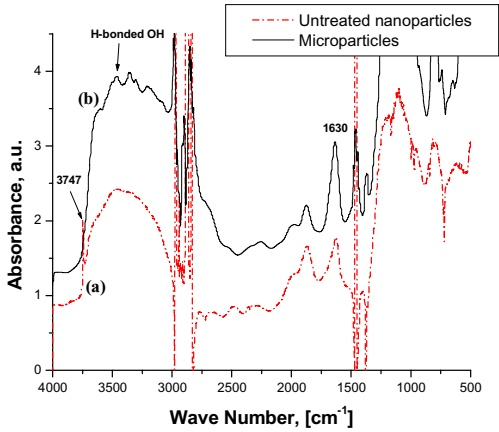

**ERRATA**

# Polymer Nanocomposite Dielectrics – The Role of the Interface

In this paper [1] Figure 11 was inadvertently removed during the printing process. This figure is reproduced below.

Figure 11. FTIR surface spectra of silica powders. (a), nanometric size; (b), micrometer size.

[1] M. Roy, J.K. Nelson, C.W. Reed, R.K. MacCrone, R.J. Keefe, W. Zenger and L.S. Schadler, “Polymer nanocomposite Dielectrics- the role of the interface”, IEEE Trans, Dielectr. Electr. Insul., Vol. 12, pp. 629-643, 2005.