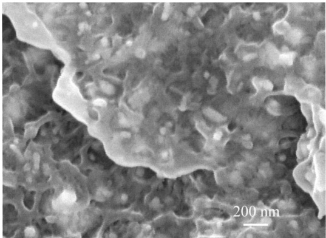
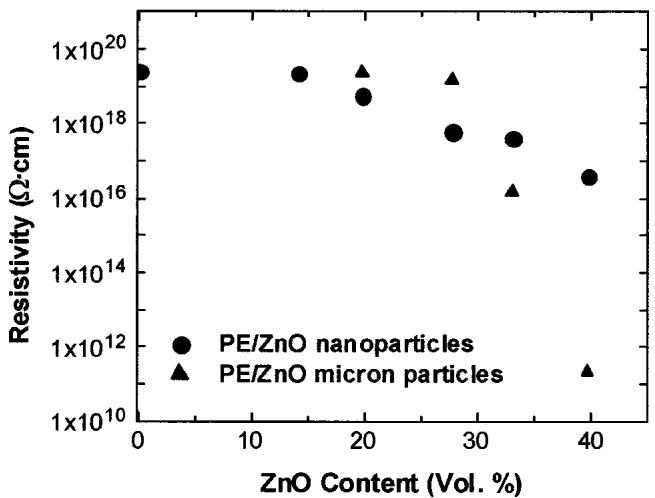
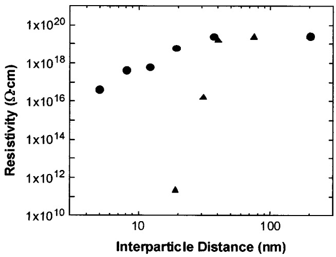
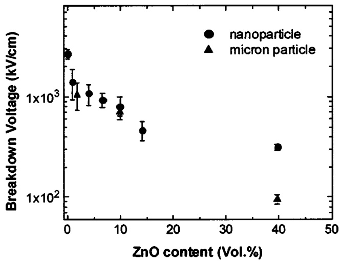

# Rescaled electrical properties of ZnO/low density polyethylene nanocomposites 

J. I. Hong; L. S. Schadler; R. W. Siegel; E. Mårtensson

Check for updates

**Appl. Phys. Lett.** 82, 1956–1958 (2003)

[https://doi.org/10.1063/1.1563306](https://doi.org/10.1063/1.1563306)

## Articles You May Be Interested In

Distinctive electrical properties in sandwich-structured $\mathsf { A l } _ { 2 } \mathsf { O } _ { 3 }$ [/low density polyethylene nanocomposites](https://pubs.aip.org/aip/apl/article/108/9/092902/31720/Distinctive-electrical-properties-in-sandwich)

**Appl. Phys. Lett.** (March 2016)

[Space charge suppression induced by deep traps in polyethylene/zeolite nanocomposite](https://pubs.aip.org/aip/apl/article/102/1/012902/126725/Space-charge-suppression-induced-by-deep-traps-in)

**Appl. Phys. Lett.** (January 2013)

[Effect of deep trapping states on space charge suppression in polyethylene/ZnO nanocomposite](https://pubs.aip.org/aip/apl/article/99/14/142903/908831/Effect-of-deep-trapping-states-on-space-charge)

**Appl. Phys. Lett.** (October 2011)

Applied Physics Letters

Special Topics Open for Submissions

Learn More

# Rescaled electrical properties of ZnOÕlow density polyethylene nanocomposites

J. I. Hong, L. S. Schadler,a) and R. W. Siegel

Materials Science and Engineering Department and Rensselaer Nanotechnology Center, Rensselaer Polytechnic Institute, Troy, New York 12180

E. Mårtensson

ABB Corporate Research, SE-721 78 Västerås, Sweden

\~Received 4 November 2002; accepted 3 February 2003!

ZnO/low density polyethylene \~LDPE! nanocomposites were prepared using melt mixing with good dispersion of the ZnO nanoparticles. The electrical properties \~dc resistivity and breakdown strength! of the composite with various concentrations of ZnO up to the percolation limit were measured and compared to the corresponding electrical properties of submicron ZnO filled LDPE. It was observed that the nanocomposites exhibited a lower percolation limit and a slower decrease in resistivity with filler concentration compared to the conventional composite. The dielectric breakdown strength was also found to be higher for the nanocomposite at high filler concentration. © 2003 American Institute of Physics. @DOI: 10.1063/1.1563306#

Polymers are often used for electrical insulation. The chemical stability of polymers allows their use in harsh conditions, and polymers are generally regarded as a good insulating material. Both the mechanical and electrical properties of polymers can be further improved or modified with the addition of inorganic fillers. Increases in the mechanical strength of nanocomposites have been reported and changes in electrical conductivity due to the addition of carbon black or another conductive filler4,5 have been studied for many years. The properties have been found to change with the dispersion state, geometric shape, and surface quality of the filler particles, as well as with the particle size. In recent years, nanoscale fillers have attracted interest because the properties of nanoparticles are different from bulk materials due to their small size and corresponding increase in surface area.8–11 Thus, it is expected that the addition of nanoparticles into a polymer will lead to an unprecedented ability to control the electrical properties of filled polymers.12,13

Low density polyethylene \~LDPE! was chosen as a representative polymer matrix in this work because it is one of the most widely used polymers for electrical insulation in the cable and wire industry due to its high breakdown strength and resistivity.14 Another advantage is that good dispersion of the filler can be achieved through melt mixing. ZnO is a semiconducting material well known for its nonlinear electrical conducting properties, and has been studied by many researchers.15–17 The conductivity of ZnO is much higher than that of LDPE and is dominated by the properties of its surfaces.18 The conductivities of ZnO/LDPE composites are thus expected to change, depending on the concentration of ZnO filler, as the ZnO interparticle distance and surface chemistry changes. However, the detailed relationship between the filler concentration and conductivity of the composite is unknown. The behavior near the percolation threshold, $p _ { c }$ , at which filler concentration the resistivity starts to change rapidly, is also of interest.19 Classical percolation theory predicts a power law dependence of conductivity on the filler concentration, $\sigma   \approx   ( p   -   p _ { c } ) ^ { t }$ , with exponent t52.19,20 However, experimental measurements frequently reported t values different from 2.21,22

In this letter, we attempt to understand how ZnO nanoparticles and their surfaces affect the electrical properties of ZnO/LDPE polymer composites in comparison to those filled with conventional submicron size ZnO.

ZnO/LDPE nanocomposites were produced by melt mixing commercial grade DOW 681I and 49 nm diameter ZnO nanoparticles in a Haake batch mixer. ZnO nanoparticles were obtained from Nanophase Technologies Corporation. To avoid any thermal degradation of the polymer matrix, the mixing time was set to 10–13 min at 200 °C.23 The specimen was then hot pressed into a disc shape with a diameter of 63.5 mm and a thickness of ;0.4 mm for the measurements of dc resistivity. ZnO/LDPE composites with ZnO several hundred nanometers in diameter were processed similarly.

In order to realize the full effects of nanoscale fillers on the nanocomposite properties, they must be dispersed well in the matrix. Figure 1 shows a FESEM micrograph of the fracture surface \~at cryogenic temperature! of the ZnO/LDPE nanocomposite. Nanoparticles are shown as white spheres dispersed throughout the entire area examined. Excellent dispersion was achieved.

FIG. 1. FESEM image of a ZnO/LDPE nanocomposite. Good dispersion of nanoparticles in the LDPE matrix can be observed.

(a)

(b)

FIG. 2. dc resistivity of nanocomposites measured at an applied field strength of 10 kV/cm. Resistivity as a function of \~a! ZnO content and \~b! interparticle distance.

The dc resistivity was measured with a Keithley 6517A electrometer and 6008 electrode cell. The current through the specimen was measured after steady state was reached, which took 1–3 days.

Figure 2 shows the dc resistivity of ZnO/LDPE nanocomposites compared to composites made with micron-scale filler. The measured dc resistivity of the nanocomposite began to decrease with volume fraction at 14 vol %. The resistivity of the micron-scale filled composite did not start to decrease until the concentration reached 30 vol. %, above which the resistivity decreased rapidly, as expected from percolation theory, and more rapidly than the nanocomposites. The difference in the percolation limit between the two types of samples can be understood from the difference in the interparticle distance of the filler particles in the composite. From a purely geometric consideration, assuming a spherical shape for the particles and a uniform size distribution and dispersion, the interparticle distance, l, is expressed as

FIG. 3. Breakdown strength of ZnO/LDPE composites as a function of ZnO content.

$$
l = r \left[ (4 \pi / 3 \nu) ^ {1 / 3} - 2 \right],\tag{1}
$$

where $r$ is the radius of the particle and n is the volume fraction. The interparticle distance for the nanocomposite with 14 vol % nanoparticles corresponds to the interparticle distance in the composite with 30 vol % of micron size particles \~approximately 40 nm! and the conduction between particles starts at approximately the same interparticle distance, as shown in Fig. 2\~b!. Once the average interparticle distance becomes less than a certain critical value, the conduction between particles can commence via tunneling between particles and a decrease in resistivity can be observed. Therefore, the start of conduction occurs at the same interparticle distance, but it occurs at a different fractional distance when the distance is scaled with the average size of the filler particles in the composite.

In addition to the lower percolation limit in the nanocomposites, the rate of decrease of resistivity with increasing ZnO content is much slower. This leads to higher values of resistivity for the nancomposite at high volume percent filler compared to the micron-scale filled composite. There are two possible reasons for this difference in the rate of resistivity decline. Due to the small size of the nanoparticle, the percolated path for conduction, which is composed of connections of nanoparticles, contains more interfaces for electrons to pass over the thickness of the specimen. Furthermore, the interfaces themselves were observed by transmission electron microscopy to be covered with polyethylene molecules resulting in higher interface resistivity.

One of the limitations of filled polymers compared to unfilled polymers is that the dielectric breakdown strength decreases due to the presence of the particles. Measured breakdown strengths of ZnO/LDPE samples showed such a decrease with filler concentration \~Fig. 3!. The decrease of breakdown strength is similar for the nanocomposites and micron-size filled samples up to about 15 vol % ZnO filler. At 40 vol % ZnO filler concentration, however, the measured breakdown strength for the nanocomposite was found to be considerably greater \~by more than a factor of 3! than that for the micron filled ZnO/LDPE composite. The breakdown strength of the filler is different from that of matrix material, and the filler particles work as barriers to keep the breakdown from propagating throughout the thickness of the specimen. The number density of the barriers is higher for a nanocomposite, and it is less probable for the breakdown to occur throughout the thickness of the specimen, resulting in the measurement of higher breakdown strength. At the same time, the interparticle distance for the nanocomposite is smaller @as indicated by Eq. \~1!#, and the breakdown probability between two particles is higher for the nanocomposite than for the micron filled composite of the same filler concentration. The measured breakdown strength is determined by the breakdown probability between two neighboring particles and the number of particles over the thickness of the specimen. The decreases of the breakdown strength by the two factors exhibit little difference at low filler concentration, but the difference becomes evident at high filler concentration.

In conclusion, owing to the interfaces between nanoparticles and polymer matrix, the resistivity and breakdown strength of the nanocomposites were found to be much higher at the highest nanoparticle loading levels investigated. The resistivity decreases exponentially with increasing ZnO volume content of the nanoparticles, but at a rate considerably less than that expected for a sharp onset of percolation. The electrical conduction is thought to be due to the tunneling between ZnO filler particles.

The authors acknowledge ABB for funding this work and Nanophase Technologies Corporation for donating nanoparticles. The authors also thank Professor J. Keith Nelson for discussions and advice.

1 M. Ieda, M. Nagao, and M. Hikita, IEEE Trans. Dielectr. Electr. Insul. 1, 934 \~1994!.

2 C. Brosseau, P. Quéffélec, and P. Talbot, J. Appl. Phys. 89, 4532 \~2001!.

3 C. B. Ng, B. J. Ash, L. S. Schadler, and R. W. Siegel, Adv. Compos. Lett. 10, 101 \~2001!.

4 K. T. Chung, A. Sabo, and A. P. Pica, J. Appl. Phys. 53, 6867 \~1982!.

5 X. W. Zhang, Y. Pan, Q. Zheng, and X. S. Yi, J. Polym. Sci., Part B: Polym. Phys. 38, 2739 \~2000!.

6 M. Sumita, K. Sakata, S. Asai, K. Miyasaka, and H. Nakagawa, Polym. Bull. \~Berlin! 25, 265 \~1991!.

7 L. Flandin, M. Verdier, B. Boutherin, Y. Brechet, and J. Y. Cavaille, J. Polym. Sci., Part B: Polym. Phys. 37, 805 \~1999!.

8 M. Kawasumi, N. Hasegawa, M. Kato, A. Usuki, and A. Okada, Macromolecules 30, 6333 \~1997!.

9 Y. Wang and N. Herron, J. Phys. Chem. 95, 525 \~1991!.

10 R. W. Siegel, Nanostruct. Mater. 3, 1 \~1993!.

11 H. Gleiter, J. Weissmüller, O. Wollersheim, and R. Wurschum, Acta Mater. 49, 737 \~2001!.

12 D. Y. Godovsky, Adv. Polym. Sci. 153, 163 \~2000!.

13 R. Gangopadhyay and A. De, Chem. Mater. 12, 608 \~2000!.

14 M. S. Khalil and A. Gastli, IEEE Trans. Power Deliv. 14, 699 \~1999!.

15 E. E. Hahn, J. Appl. Phys. 22, 855 \~1951!.

16 T. K. Gupta, J. Am. Ceram. Soc. 73, 1817 \~1990!.

17 Y. Nakamura, T. Harada, H. Kuribara, A. Kishimoto, N. Motohira, and H. Yanagida, J. Am. Ceram. Soc. 82, 3069 \~1999!.

18 C. W. Nan, A. Tshöpe, S. Holten, H. Kliem, and R. Birringer, J. Appl. Phys. 85, 7735 \~1999!.

19 D. Stauffer and A. Aharony, Introduction to Percolation Theory \~Taylor & Francis Inc., Washington, DC, 1991!.

20 F. Carmona, Physica A 157, 461 \~1989!.

21 M. B. Heaney, Phys. Rev. B 52, 12477 \~1995!.

22 Y. Song, T. W. Noh, S. I. Lee, and J. R. Gaines, Phys. Rev. B 33, 904 \~1986!.

23 J. I. Hong, K. S. Cho, C. I. Chung, L. S. Schadler, and R. W. Siegel, J. Mater. Res. 17, 940 \~2002!.